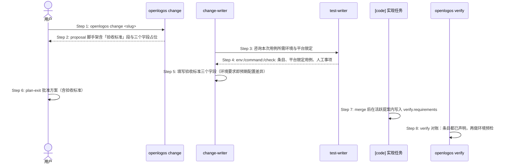

## ADDED — S09 提案验收标准段（verify-self-sufficient-cases）

> 来源变更：verify-self-sufficient-cases（决策 C01；评审 proposal-r1 F5、proposal-r2 F5 处置）。规则权威见功能规格 §2.106.8、§2.106.9；lint 检查见 `core-S35-change-lint.md`「S35 验收标准段检查」；verify 对账见 `core-S13-verify-results.md`「S13 verify 自足：环境预检与跳过分类」。

### 场景目标

用户批准方案时，能从 proposal 一眼看出本次验收要求什么机器环境、哪些用例只在特定平台执行、哪些事要人亲手做；提案承诺的环境要求有明确的落盘责任人，并在 verify 时被核对，不会出现「文档写了、配置是空的、预检形同虚设」。

### 参与者

| 别名 | 组件 | 说明 |
|---|---|---|
| U | 用户 | 发起提案、批准方案 |
| CLI | `openlogos change` | 生成 proposal 脚手架 |
| W | change-writer | 填写「验收标准」段 |
| T | test-writer | 给出不需要人参与的用例所需的具体环境要求 |
| I | `[code]` 实现任务 | 在活跃提案内写入 `logos/logos.config.json` 的 `verify.requirements` |
| V | `openlogos verify` | 对账与预检 |

### 前置条件

- 项目已 launched；用户执行 `openlogos change <slug>` 创建提案并写入 guard。

### 成功后置条件

- proposal 含合法的「验收标准」段；其中列出的环境要求在 `[code]` 完成后都已出现在生效的 `verify.requirements` 中，verify 对账通过。

### 时序图

### 步骤说明

1. **用户** 执行 `openlogos change <slug>`。
2. **CLI** 生成的 proposal 在「决策澄清」与「变更概述」之间含「验收标准」段：自动验收环境要求、平台限定用例、需要人参与的验收（en locale：`Acceptance Criteria` 与对应三个字段）。
3. **change-writer** 向 test-writer 咨询本次涉及的用例需要什么环境、哪些只在特定平台执行、哪些需要人参与。
4. **test-writer** 返回具体条目：`env:<变量名>` / `command:<命令名>` / `check:<检查名>`（check 附检查命令与适用条件），以及平台限定用例与人工事项。
5. **change-writer** 按事实填写三个字段：没有就写「无」；环境要求写成反引号条目；人工事项在 openlogos #3 落地前用文字写明事项与预期执行环节。
6. **用户** 在 plan-exit 批准方案时一并确认验收标准。
7. **`[code]` 实现任务** 在 merge 之后、活跃提案范围内把条目写入 `logos/logos.config.json` 的 `verify.requirements`（guard 对该文件在有活跃提案时按提案范围处理；生成指令同口径，见 `spec/agents-md.md`）。
8. **verify** 先对账（条目都已声明，否则 `acceptance_requirement_undeclared`），再做环境预检。

### 异常与边界

#### EX-9I.1：提案不需要任何环境要求
- **触发条件**：本次用例只依赖项目既有工具链。
- **期望响应**：「自动验收环境要求」写「无」；verify 不对账。
- **副作用**：无。

#### EX-9I.2：在途提案没有该段
- **触发条件**：升级前创建的提案没有「验收标准」段。
- **期望响应**：change-lint 只出警告 `acceptance_criteria_missing`，不阻断；verify 不对账。
- **副作用**：无。

#### EX-9I.3：`[code]` 漏写配置
- **触发条件**：验收标准列出 `command:mvn`，`[code]` 完成后 `verify.requirements` 仍无该项。
- **期望响应**：verify 以 `acceptance_requirement_undeclared` 判 FAIL 并点名，不执行预跑命令。
- **副作用**：无。

#### EX-9I.4：试图借此修改保护范围
- **触发条件**：实现任务需要忽略或豁免某路径。
- **期望响应**：`.gitignore`、`.git/info/exclude` 与 `logos.config.json` 的 `guard` 字段仍不得直接修改，必须走 `openlogos ignore|exempt` 并经宿主原生审批；「已立案可改」只适用于其他配置字段。
- **副作用**：无。

### 追溯

- 需求：AC-VERIFY-SELF-01、AC-VERIFY-SELF-03、AC-VERIFY-SELF-09、AC-VERIFY-SELF-10。
- 功能规格：§2.106.8、§2.106.9。
- 规范与 Skill：`skills/change-writer/SKILL.md`「验收标准」段、`skills/test-writer/SKILL.md` 3c、`spec/agents-md.md`「变更管理例外文件清单与保护范围配置」。
- 测试：`core-S09-test-cases.md`（UT-S09-490 起）、`core-S08-test-cases.md`（UT-S08-90 起）、`core-S13-test-cases.md`（对账相关用例）。
