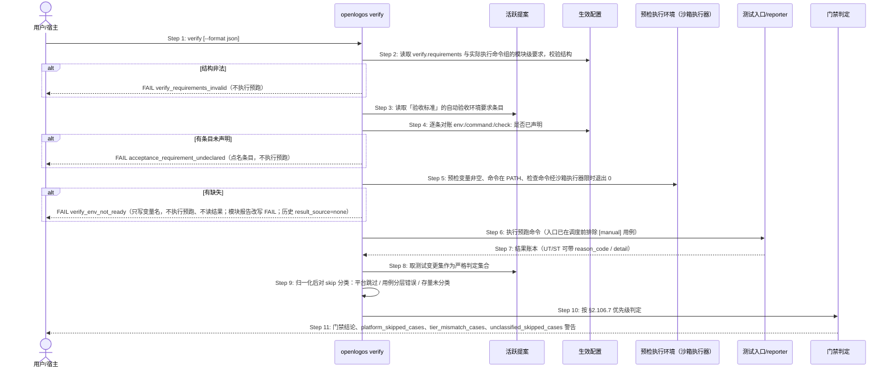

## ADDED — S13 verify 自足：环境预检与跳过分类（verify-self-sufficient-cases）

### 场景目标

让 `openlogos verify` 全程不需要人配合：执行任何预跑命令之前，先确认提案承诺的环境要求已写入配置、本机环境已就绪；测试结束后，本次改动的 UT/ST 只允许平台跳过，不允许「环境没准备好就写 skip」混过门禁。规则权威见功能规格 §2.106；格式见 `spec/test-results.md`「verify 环境要求声明、对账与预检」「verify 跳过分类」。

### 参与者

| 别名 | 组件 | 说明 |
|---|---|---|
| Caller | 用户或 RunLogos driver | 发起 verify |
| CLI | `openlogos verify` | 门禁与统计 |
| Cfg | 生效配置 | 未启用模块范围时为项目级 `verify.requirements`；启用时先按覆盖模块求 E(m)（模块级同名 check 只替换本模块），再合并（同名同命令合并、同名异命令分别执行） |
| Prop | 活跃提案 | proposal「验收标准」段；`SPEC_MERGED.test_change_set`（经 `readTestChangeSet` 校验） |
| Env | 预检执行环境 | 预跑命令将继承的环境变量与 `PATH`；检查命令经与预跑命令同一个沙箱执行器执行 |
| Runner | 项目测试入口 + OpenLogos reporter | 在调度前排除 `[manual]` 用例，写结果账本 |
| Gate | 门禁判定 | §2.106.7 优先级 |

### 前置条件

- 项目已初始化，`verify` 配置可解析；本次命令已通过用法与前置拒绝检查。
- 结果路径锁已获取（见本文档「验收历史留存与查询时序」Step 2）。
- 有无活跃提案均适用；无活跃提案时不对账，跳过分类只出警告。

### 成功后置条件

- 预检类原因均未命中时，预跑与门禁按既有流程执行；严格集合内只有平台跳过，平台跳过在 JSON 与报告中单独列出。
- 预检类原因命中时，未执行任何预跑命令，门禁 FAIL 并逐项列出缺失项。

### 时序图

### 步骤说明

1. **Caller** 执行 `openlogos verify`（可带 `--format json`）。
2. **CLI** 求生效集合：未启用模块范围时取项目级 `verify.requirements`；启用时先沿用既有命令组选择得到本次实际执行的命令组，只对这些命令组服务的模块 m 求 E(m)（项目级加 `verify.modules.<m>.requirements`，m 的同名 check 只替换 m 自己的），再合并——`env`、`commands` 取并集，名称与命令都相同的 check 合并，名称相同、命令不同的 check 分别执行并记录归属模块。结构非法时以 `verify_requirements_invalid` 判 FAIL，不执行预跑。
3. **CLI** 有活跃提案时读取 proposal「验收标准」段的「自动验收环境要求」；字段为「无」、缺段或无活跃提案时跳过 Step 4。
4. **CLI** 逐条核对 `env:` / `command:` / `check:` 条目是否出现在生效集合对应字段；缺任一项以 `acceptance_requirement_undeclared` 判 FAIL 并点名，不执行预跑。
5. **CLI** 逐项预检：变量（按预跑命令将继承的环境）存在且非空；命令可在同一 `PATH` 解析；检查命令经与预跑命令同一个沙箱执行器执行（同一沙箱模式与复用配置，工作目录为沙箱工作副本中的项目根，写回白名单为空，注入归属模块的 `OPENLOGOS_VERIFY_MODULES`），60 秒内退出 0。缺任一项以 `verify_env_not_ready` 判 FAIL，诊断只写变量名与检查名（check 只写退出码或「超时」，并带归属模块）。本次没有任何预跑命令执行时，Step 5 只检查项目级要求（模块级要求不检查），缺项即在读取结果文件前判 FAIL。无沙箱隔离（`off` 或 `auto` 降级）时检查命令在源工作区运行、不承诺源工作区保护，检查命令须只读，输出标注 `isolation: "unisolated"`。Step 2～5 任一失败：不执行预跑、不截断也不读取结果文件；共用报告计数显示「未执行」；覆盖的 initial 模块报告改写为 FAIL；验收历史记 `result_source: "none"`。
6. **CLI** 执行既有预跑流程；项目测试入口在调度前排除 `[manual]` 用例的测试代码（测试分组、独立文件或独立入口）。
7. **Runner** 通过 reporter 写结果账本；平台限定用例在不适用时写 `reason_code: "platform-unavailable"` 与说明执行条件的 `detail`。
8. **CLI** 经 `readTestChangeSet` 读取活跃提案 `SPEC_MERGED.test_change_set.changed_test_ids`，取其中 UT/ST 作为严格判定集合：尚未 merge 时为空集；读取器判有效时取其集合（含合法空集）；已有 `SPEC_MERGED` 但读取器判无效时报 `test_change_set_invalid`，门禁 FAIL；切片 checkpoint 下与可计入集合求交。
9. **CLI** 对 `status:"skip"` 分类：严格集合内的平台跳过入 `platform_skipped_cases`；严格集合内的其余 skip 入 `tier_mismatch_cases`；严格集合外的非平台 skip 入 `unclassified_skipped_cases`（警告）。
10. **Gate** 按功能规格 §2.106.7 取 `gate.reason`：预检类原因最先；`case_tier_mismatch` 紧随 `failed_cases`。
11. **CLI** 输出门禁结论、`data.requirements` 与三个跳过子集；验收报告单独列出平台跳过与用例分层错误，警告单列。

### 异常与边界

#### EX-13.1：验收标准条目未写入配置
- **触发条件**：活跃提案验收标准列出 `check:db-ready`，生效配置中没有同名 check。
- **期望响应**：门禁 FAIL，`gate.reason="acceptance_requirement_undeclared"`，诊断点名 `check:db-ready`；预跑命令未执行。
- **副作用**：无；验收历史记一条门禁 FAIL 的记录。

#### EX-13.2：环境缺失
- **触发条件**：生效配置声明 `env: ["DB_URL"]` 与 `commands: ["docker"]`，本机两者都缺。
- **期望响应**：门禁 FAIL，`gate.reason="verify_env_not_ready"`，诊断依次列出 `env DB_URL` 与 `command docker`；输出与报告中不出现任何变量值；预跑命令未执行。
- **副作用**：无。

#### EX-13.3：检查命令超时或非零退出
- **触发条件**：`checks` 中某项 60 秒未退出，或以非零状态退出。
- **期望响应**：该项计为缺失，`detail` 为「超时」或退出码；超时的检查进程组被终止；不写检查命令的输出。
- **副作用**：无。

#### EX-13.4：严格集合内的非平台 skip
- **触发条件**：活跃提案新增 UT-S01-90，结果为无原因的 skip。
- **期望响应**：门禁 FAIL，`gate.reason="case_tier_mismatch"`（无失败用例且账本自洽时），`tier_mismatch_cases` 含该 ID 与 fix_hint「准备好环境并声明到 verify.requirements，或改标 `[manual]`」。
- **副作用**：无。

#### EX-13.5：平台跳过缺 detail
- **触发条件**：严格集合内用例写 `reason_code: "platform-unavailable"`，`detail` 为空串或缺失。
- **期望响应**：不按平台跳过放行，按 EX-13.4 判用例分层错误。
- **副作用**：无。

#### EX-13.6：适用平台缺前置工具与平台不适用的区分
- **触发条件**：本仓 ST-S13-26 只在「Linux、非 root、沙箱复用能力可用」时执行并需要 `cc`；`check:linux-nondump-cc` 与用例共用同一适用判定。机器为非 root Linux、没有 `cc`。
- **期望响应**：复用能力不可用时，检查直接通过，用例写平台跳过；复用能力可用时，预检报 `verify_env_not_ready`（缺 `check linux-nondump-cc`），不执行预跑；非 Linux 机器上检查直接通过、用例写平台跳过。
- **副作用**：无。

#### EX-13.7：人工用例不被测试入口启动
- **触发条件**：项目有一条自动用例与一条 `[manual]` 用例，后者的测试代码被启动即写哨兵文件。
- **期望响应**：普通最终 verify 完成，自动用例有结果，哨兵文件不存在；人工 ID 未出现在结果账本中。
- **副作用**：无。

#### EX-13.8：无活跃提案或存量用例
- **触发条件**：无活跃提案时执行 verify；或存量用例写了无原因的 skip。
- **期望响应**：不对账；skip 口径按 §2.7A 不变，门禁结论与退出码不变；输出警告 `unclassified_skipped_cases` 并列出 ID。
- **副作用**：无。

#### EX-13.9：未声明任何要求的零变化
- **触发条件**：未声明 `verify.requirements`，验收标准未列条目，严格集合内没有 skip。
- **期望响应**：判定、`gate.reason` 与退出码与引入前一致；`data.requirements` 缺省。
- **副作用**：无。

#### EX-13.10：模块验收报告不残留旧 PASS
- **触发条件**：双模块项目，两个 initial 模块已有 PASS 模块报告；随后 ① 项目级环境要求缺失；② 环境就绪，但模块 a 的用例子集中有严格集合内的非平台 skip。
- **期望响应**：① 两份模块报告都整份改写为 FAIL（计数「未执行」，写明预检原因），不读取旧账本；② 模块 a 的报告 FAIL（用例分层错误），模块 b 的报告 PASS。两种情形下受影响模块都不能再通过 `launch` 的验收报告检查。
- **副作用**：被改写的模块报告原子替换。

#### EX-13.11：预检失败的验收历史
- **触发条件**：① 首次 verify、从未生成过结果文件、验收标准条目未写入配置；② 上次 verify 留下 PASS 账本，本次环境未就绪。
- **期望响应**：两种情形都写一条 `outcome: "completed"`、`result_source: "none"`、`gate.result: "FAIL"` 的中央索引，计数为 null、ID 数组为空；报告快照按既有留存策略落点——无活跃提案只有中央索引；有活跃提案且 `raw_in_proposal: true` 时在提案完整记录；`raw_in_proposal: false` 时提案完整记录只有结构化 `record.json`、快照在本机原文目录。任何情况下都不写本轮结果文件；② 中旧账本未被截断，也不被复制或引用。
- **副作用**：无。

#### EX-13.12：模块同名检查命令不同
- **触发条件**：模块 a、b 同时被覆盖，各自声明 `db-ready`，命令分别检查各自的数据库；a 的数据库不可用。
- **期望响应**：两条检查都被执行；预检报 `verify_env_not_ready`，缺失项为 `{kind:"check", name:"db-ready", modules:["a"]}`；不因名称相同而漏掉任何一个模块的检查。
- **副作用**：无。

#### EX-13.13：检查命令在沙箱中执行
- **触发条件**：`verify.sandbox_mode: "always"`；某依赖只在宿主工作区存在、沙箱工作副本中不存在；检查命令还会在当前目录写一个临时文件。
- **期望响应**：检查在沙箱工作副本中执行并失败，报 `verify_env_not_ready`，测试入口未启动；源工作区没有出现检查写出的文件，`isolation: "sandboxed"`。沙箱无法隔离时：`always` 按既有规则判 FAIL；`auto` 降级后检查在源工作区运行，`isolation: "unisolated"`，此时不承诺源工作区保护，只读检查执行后源工作区不变。
- **副作用**：无。

#### EX-13.14：已合并提案的测试变更集无效
- **触发条件**：活跃提案已正常 merge（新增 UT-S01-90），随后 `SPEC_MERGED.test_change_set` 的摘要被改坏；UT-S01-90 写无原因 skip，其余用例通过。
- **期望响应**：读取器判无效，不推导为空集；门禁 FAIL，`gate.reason="test_change_set_invalid"`，`detail` 带读取器原因码；不产生最终 PASS。
- **副作用**：无。

#### EX-13.15：被覆盖但没有任何预跑命令的模块
- **触发条件**：`verify --all` 覆盖 a、b；项目级未配置预跑命令，a 有自己的命令组，b 只有模块级要求 `command:b-tool`，本机没有 `b-tool`。
- **期望响应**：既有命令组选择只返回服务 a 的命令组；b 的要求不检查；预检通过，a 的 runner 被启动。另一种情形：项目没有任何预跑命令、已有一份通过的旧账本、显式声明的项目级 `env: ["DB_URL"]` 缺失——预检照常执行并报 `verify_env_not_ready`（点名 `DB_URL`），旧账本不被读取，不得 PASS。
- **副作用**：无。

### 追溯

- 需求：AC-VERIFY-SELF-01～08、AC-VERIFY-SELF-11、AC-VERIFY-SELF-13。
- 功能规格：§2.106.2～§2.106.7A、§2.106.10、§2.104.3（`result_source: "none"`）。
- 同源章节：本文档「verify 结果账本一致性预检」「EX-7.4: 合法 skip 不阻塞 verify Gate」（存量口径不变）、「S13 人工用例判据的声明位与一致性判据的输入」（声明位不变）、「验收历史留存与查询时序（verification-history）」（预检失败照常留存）。
- 测试：`core-S13-test-cases.md`（UT-S13-157 起、ST-S13-40 起）；安装态 smoke：`core-smoke-test-cases.md`（SMOKE-core-338 起）。
