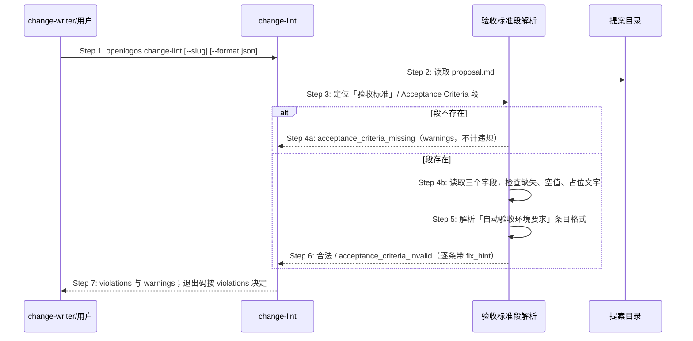

## ADDED — S35 验收标准段检查（verify-self-sufficient-cases）

> 来源变更：verify-self-sufficient-cases（决策 C01；评审 proposal-r1 F5 处置）。规则权威见功能规格 §2.106.8；脚手架见 `core-S09-change-management.md`「S09 提案验收标准段」。

### 场景目标

proposal 的「验收标准」段在场时，格式必须能被 verify 对账消费；在途提案缺这一段时只提醒、不阻断。

### 参与者

| 别名 | 组件 | 说明 |
|---|---|---|
| W | change-writer / 用户 | 写 proposal，按违规修复 |
| L | change-lint | 命令入口、违规与警告、退出码 |
| A | 验收标准段解析 | 定位段、读取三个字段、解析环境要求条目（verify 对账使用同一解析） |
| FS | 提案目录 | 只读 |

### 前置条件

- 存在活跃提案或以 `--slug` 指定提案；proposal.md 可读。

### 成功后置条件

- 段合法：不产生任何违规或警告；段缺失：只产生警告，退出码不变；段非法：产生违规，退出码 2。

### 时序图

### 步骤说明

1. **用户或 change-writer** 执行 `openlogos change-lint`。
2. **change-lint** 读取 proposal.md。
3. **解析** 按 locale 的段名（`验收标准` / `Acceptance Criteria`）定位二级标题。
4. 段不存在时产生警告 `acceptance_criteria_missing`，进 `warnings`，不计入 violations、不改变退出码。段存在时逐个读取「自动验收环境要求」「平台限定用例」「需要人参与的验收」三个字段（en 对应字段名）。
5. 「自动验收环境要求」取值为「无」，或由一个及以上反引号条目 `env:<名>` / `command:<名>` / `check:<名>` 组成（名称匹配 `^[A-Za-z0-9][A-Za-z0-9._-]*$`），条目后可跟说明文字。
6. 字段缺失、值为空、仍为脚手架占位文字（方括号提示）、或环境要求条目格式非法（未知前缀、名称非法、写了内容却没有任何合法条目）时，产生违规 `acceptance_criteria_invalid`，`path` 指向 proposal.md 与该字段行，`fix_hint` 说明缺什么、补成什么样。
7. **change-lint** 输出违规与警告；有违规时退出码 2。

### 异常与边界

#### EX-35.A1：段缺失
- **触发条件**：proposal 没有「验收标准」段。
- **期望响应**：`warnings` 含 `acceptance_criteria_missing`，`pass` 与退出码由其他检查决定；`fix_hint` 提示按脚手架补段。
- **副作用**：无。

#### EX-35.A2：字段缺失或为空
- **触发条件**：段在场，缺「平台限定用例」一行，或「需要人参与的验收」冒号后为空。
- **期望响应**：违规 `acceptance_criteria_invalid`，点名字段，`fix_hint`「没有就写『无』」。
- **副作用**：无。

#### EX-35.A3：占位文字未替换
- **触发条件**：字段值仍为脚手架的方括号提示。
- **期望响应**：违规 `acceptance_criteria_invalid`，点名字段。
- **副作用**：无。

#### EX-35.A4：环境要求条目格式非法
- **触发条件**：「自动验收环境要求」写 `` `pkg:docker` `` 或 `` `env:` `` 或只写散文「需要数据库」。
- **期望响应**：违规 `acceptance_criteria_invalid`，指出非法条目，`fix_hint` 给出 `env:` / `command:` / `check:` 三种合法写法。
- **副作用**：无。

#### EX-35.A5：与 canonical 段的关系
- **触发条件**：任意提案。
- **期望响应**：本段不进 `PLAN_SECTION_REGISTRY`，不影响 L0 canonical 判定与 Plan Package 的 `ready`；`plan_state` 不因缺段改变。
- **副作用**：无。

### 追溯

- 需求：AC-VERIFY-SELF-09。
- 功能规格：§2.106.8。
- 测试：`core-S35-test-cases.md`（UT-S35-225 起）。
