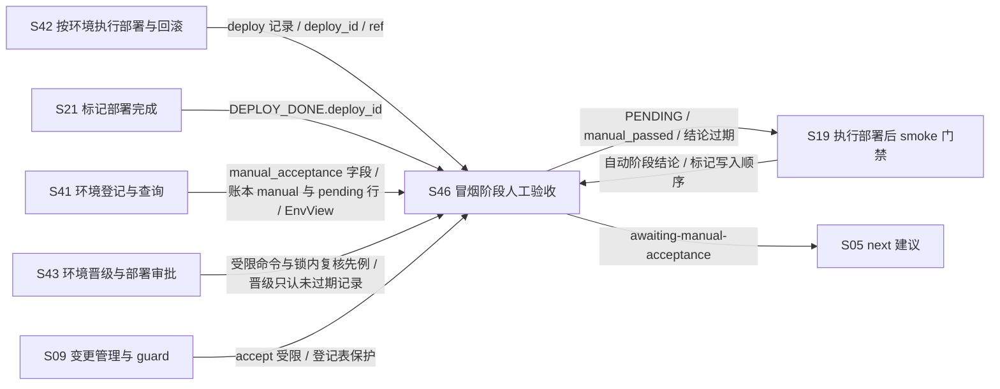

## ADDED — S46 场景登记与依赖关系（smoke-manual-acceptance）

### 场景地图增量

| 编号 | 场景名称 | 主要实现 | 测试规格 | 状态 |
|---|---|---|---|---|
| S46 | 冒烟阶段人工验收 | `lib/manual-acceptance.ts`（新增）/ `commands/accept.ts`（新增）/ `lib/smoke-coverage.ts` / `commands/smoke.ts` / `lib/environments.ts` / `lib/lifecycle-gate.ts` / `lib/flow-derive.ts` / `commands/init.ts`；guard：`plugin/bin/guard-check`、`plugin-cursor/hooks/runtime.cjs`；Skill：test-writer、change-writer | `core-S46-test-cases.md` | 进行中 |

### 依赖关系

### 依赖说明

1. S46 消费 S42 / S21 产生的部署身份：当前部署 D 取 E 最近一条 deploy 记录（任意 `result`，与 S19 部署身份核对同一身份），其结果不是 `done` 时为未确认，不退回更早的成功部署；提案通道另以 `DEPLOY_DONE.deploy_id` 判定 accept 是否删除 `SMOKE_PASS`。
2. S46 在 S41 的登记表与账本上新增字段与记录类型（`manual_acceptance`、`kind=manual`、smoke `result=pending`）；未配置该字段、没有人工用例的项目，S41 的读取与视图不变。
3. S46 接在 S19 的自动阶段之后：S19 的覆盖、平台跳过与环境证据规则只作用于自动 SMOKE；人工阶段结论回写 S19 的标记与账本，沿用 S19 的写入顺序与快照恢复。
4. S46 的「只能由人记录」复用 S43 / S09 的受限命令与宿主原生审批；晋级判定（S43）只认未过期的 `verified` 记录。
5. S05 新增驻留态 `awaiting-manual-acceptance`，只读账本派生，不读 git。

### 场景索引增量

- [S46：冒烟阶段人工验收](./core-S46-smoke-manual-acceptance.md)
- 对应测试：`logos/resources/test/core-S46-test-cases.md`。
- 功能规格：§2.107；权威格式：`spec/environments.md` §15。

### 元数据 apply

规格合并提交时，把 S46 登记进 `logos/logos-project.yaml` 的 `scenarios`：`name: 冒烟阶段人工验收`，`module: core`，`feature: F05` 验收与部署门禁（与已登记的 S19 同组）。同时把 `scenario_counter.next_id` 从 46 推进到 47。`core-S46-smoke-manual-acceptance.md` 与 `core-S46-test-cases.md` 的 `resource_index` 登记，由 `openlogos merge` 对 CREATE 目标自动完成。
