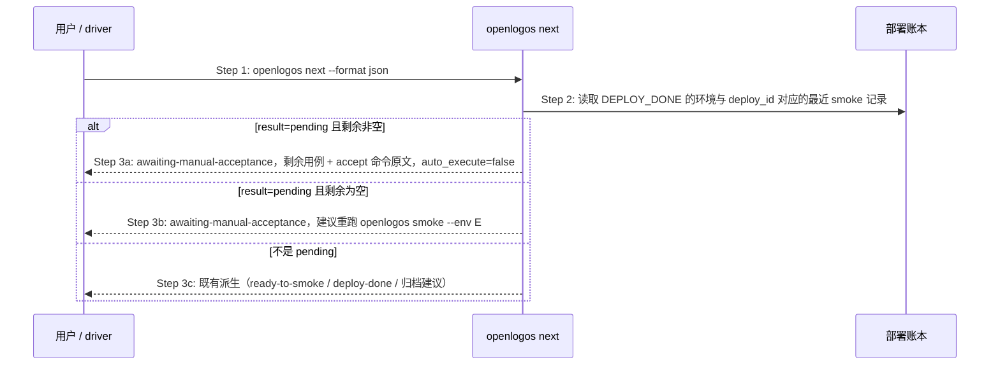

## ADDED — 等待人工验收的 next 建议（smoke-manual-acceptance）

> 来源变更：smoke-manual-acceptance（决策 C01；proposal-r1 F3/F6、proposal-r2 F3/F6 处置）。规则权威见功能规格 §2.107.7～§2.107.9、`spec/environments.md` §15、`spec/cli-json-output.md`。本节补充「deploy-done 对 next 的影响」中 `ready-to-smoke` 之后的派生，其余规则不变。

### 派生条件

活跃提案满足以下全部条件时，`next` / `status` 的驻留态为 `awaiting-manual-acceptance`（标签「等待人工验收」）：

1. `DEPLOY_DONE` 存在，`[deploy]` section 已全部勾选，`smoke_required=true`；
2. `SMOKE_PASS`、`SMOKE_FAIL` 都不在场；
3. 账本中 `DEPLOY_DONE` 的环境与 `deploy_id` 对应的最近一条 smoke 记录为 `result=pending`。

派生只读账本（同一次流式扫描），不读 git、不重跑 smoke。剩余清单 = 该 pending 记录的 `manual_pending` 减去其后同一部署 manual 记录覆盖的用例。

### 建议内容

- **剩余非空**：
  - 列出剩余用例 ID 与命令模板 `openlogos accept --env <E> --deploy <deploy_id> --case <ID,…> --result '<pass 或 fail>'`：结果占位符不预填、整体加单引号，人按实际结果替换为 `pass` 或 `fail`（失败加 `--note`）后执行；未替换就原样执行时 CLI 以 `ACCEPT_ARGS_INVALID` 拒绝且不写入；
  - 注明「人工验收结果只能由人记录，请在终端以 `! <命令>` 执行或在 RunLogos 界面记录」；
  - `auto_execute=false`。`next --auto` 不放行，`gate_auto_passed` 不为 true。
- **剩余为空**：建议重跑 `openlogos smoke --env <E>`。这一步与 `ready-to-smoke` 同口径：`--auto` 下按既有 smoke standing 授权由 driver 重新驱动；半自动下仍需用户授权。
- **通过已过期或不属于本部署**：`SMOKE_PASS` 在场，但 `DEPLOY_DONE` 的环境开启了人工验收、或账本中该部署有 manual 记录，而该部署自己的最近一条 smoke 记录不是 pass（开启时还须 `manual_passed=true`），或其后又出现 manual 记录（§2.107.7）。此时驻留态回到 `ready-to-smoke`，建议文案说明「人工结果在通过后有更新，需重跑 smoke」，不派生为可归档。

### 时序

1. **用户 / driver** 执行 `openlogos next`（Step 1）。
2. **openlogos next** 只读账本，取 `DEPLOY_DONE` 对应部署的最近 smoke 记录与其后的 manual 记录（Step 2）。
3. **openlogos next** 按剩余清单给出两种建议之一；不是 pending 时走既有派生（Step 3）。

### 异常与边界

#### EX-5.6：`--auto` 遇等待人工验收
- **触发条件**：`next --auto`，驻留态 `awaiting-manual-acceptance`，剩余非空。
- **期望响应**：不自动放行，`auto_execute=false`，不追加 `GATE_AUTO_PASSED`；建议文案同半自动。
- **副作用**：无。

#### EX-5.7：重新部署后旧 pending 不再生效
- **触发条件**：pending 记录属于 D1，提案随后重新部署为 D2（`DEPLOY_DONE.deploy_id=D2`）。
- **期望响应**：D2 没有 smoke 记录，回到 `ready-to-smoke`。
- **副作用**：无。

#### EX-5.8：版本通道
- **触发条件**：没有活跃提案，环境的当前部署最近 smoke 记录为 pending。
- **期望响应**：`next` 不派生提案驻留态；`status` / `env show` 的环境视图在 `manual_acceptance.waiting` 中给出剩余清单。
- **副作用**：无。

### 追溯

- 功能规格：§2.107.7～§2.107.9；场景：S46；测试：`core-S05-test-cases.md`（UT-S05-58 起）。
