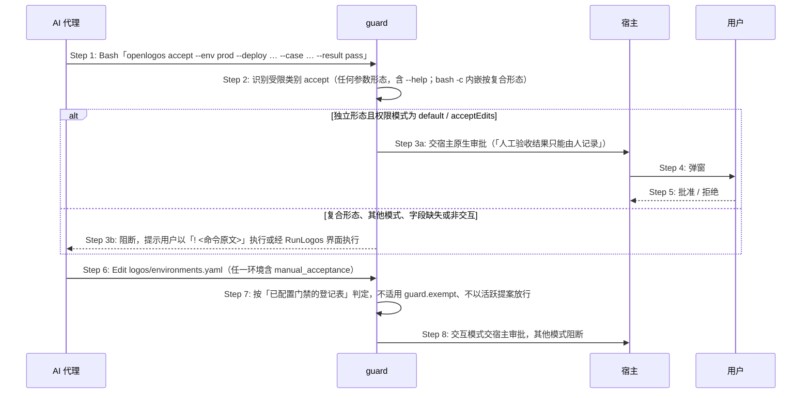

## ADDED — S09 人工验收记录命令受限与开关字段保护（smoke-manual-acceptance）

> 来源变更：smoke-manual-acceptance（决策 C01；沿用 D14）。规则权威见功能规格 §2.107.9、§2.107.10，`spec/pretooluse-guard.md`「受限命令」「已配置门禁的登记表」，`spec/agents-md.md`、`spec/change-management.md` 硬红线条目。本节扩展 S09-F Step 41 的受限命令清单与登记表保护，判定流程、提示形态与宿主审批路径不变。

### 场景目标

人工验收结果与人工验收开关，都只能由人产生或修改。AI 代理不能代记 `openlogos accept`，也不能改登记表来关掉人工验收；`--auto` 的 standing 授权不覆盖这两件事。

### 参与者

| 别名 | 组件 | 说明 |
|---|---|---|
| AI | AI 代理 | 在会话中发起 Bash / Edit / Write |
| G | guard（`plugin/bin/guard-check`、`plugin-cursor/hooks/runtime.cjs`；qoder / workbuddy / zcode 适配层） | PreToolUse 判定 |
| H | 宿主（Claude Code 等） | `default` / `acceptEdits` 下弹出原生审批 |
| U | 用户 | 批准或拒绝；或在终端以 `! <命令>` 自行执行 |

### 时序图

### 步骤说明

1. **AI** 发起 `openlogos accept …`（Step 1）。
2. **guard** 识别受限类别 `accept`，规则与 `approve` 相同：任何参数形态都受限；只允许 `cd <目录> &&` 前缀；与其他命令组合，或以 `bash -c` / `eval` 字符串内嵌，按复合形态阻断（Step 2）。
3. **guard** 在独立形态且权限模式允许时，交宿主对这一次调用弹出原生审批；否则阻断并给出提示（Step 3～5）。
4. **AI** 修改登记表时，guard 判断登记表原文是否含 `manual_acceptance` 字段名字面量（与 `promote_from` / `require_approval` 同一识别方式）。含有时，按「已配置门禁的登记表」处理：直接修改、删除、移动都须经宿主审批，否则阻断（Step 6～8）。

### 非 Claude / Cursor 宿主（评审 delta-r1 F3）

qoder（`plugin-qoder/hooks/runtime.cjs`）、workbuddy（`plugin-workbuddy/hooks/runtime.cjs`）、zcode（`plugin-zcode/runtime/hook-runtime.js`）的 `decideGuard` 不能保证弹出可靠的原生审批。它们在任何提前放行（「initial 生命周期不启用变更硬门禁」、安全命令判定、initial 模块归属）之前，先检查命令文本：出现 `openlogos accept`（任何形态）即拒绝，提示用户在终端执行或经 RunLogos 界面记录。因此在 initial 与 launched 生命周期、有无活跃提案下结论都相同，AI 都无法经这些宿主登记人工结果。部署审批类命令在这三个宿主上的既有覆盖限制不变（`spec/pretooluse-guard.md`「已知覆盖限制」第 5 条）。

### 生成指令

`openlogos init` / `sync` 生成的 AGENTS.md / CLAUDE.md「两档授权语义」硬红线新增一条（中英各一份，权威文案见 `spec/agents-md.md`）：冒烟阶段「等待人工验收」（剩余清单非空）在任何模式、含 `--auto` 下都不放行；AI 不得执行 `openlogos accept`，不得修改 `manual_acceptance` 来关闭人工验收；人记录后宿主重新驱动 smoke 即可继续。

### 异常与边界

#### EX-9M.1：`accept --help`
- **触发条件**：AI 执行 `openlogos accept --help`。
- **期望响应**：与 `approve --help` 相同，按受限命令处理。
- **副作用**：被阻断时无执行。

#### EX-9M.2：复合形态
- **触发条件**：`openlogos smoke --env prod && openlogos accept …`，或 `bash -c "openlogos accept …"`。
- **期望响应**：阻断，提示受限命令必须单独执行。
- **副作用**：整条命令不执行。

#### EX-9M.3：未写 `manual_acceptance` 的登记表
- **触发条件**：登记表没有任何门禁字段，也没有 `manual_acceptance`。
- **期望响应**：保持现有豁免，判定不变。
- **副作用**：无。

#### EX-9M.5：initial 生命周期下经 qoder / workbuddy / zcode 调用
- **触发条件**：项目为 initial 生命周期（或 launched 且命令被判为安全命令），AI 经 qoder、workbuddy 或 zcode 执行 `openlogos accept …`。
- **期望响应**：适配层返回拒绝，不进入生命周期与安全命令的提前放行。
- **副作用**：命令不执行，账本无新增 manual 记录。

#### EX-9M.4：用户在终端自行执行
- **触发条件**：用户以 `! openlogos accept …` 在会话中执行，或在普通终端执行。
- **期望响应**：不经 AI 工具调用，guard 不介入，命令按 §2.107.5 正常执行。
- **副作用**：按命令写入账本。

### 追溯

- 功能规格：§2.107.9、§2.107.10；场景：S46、S43（受限命令先例）；测试：`core-S09-test-cases.md`（UT-S09-493 起）、`core-S08-test-cases.md`（UT-S08-93 起）。
