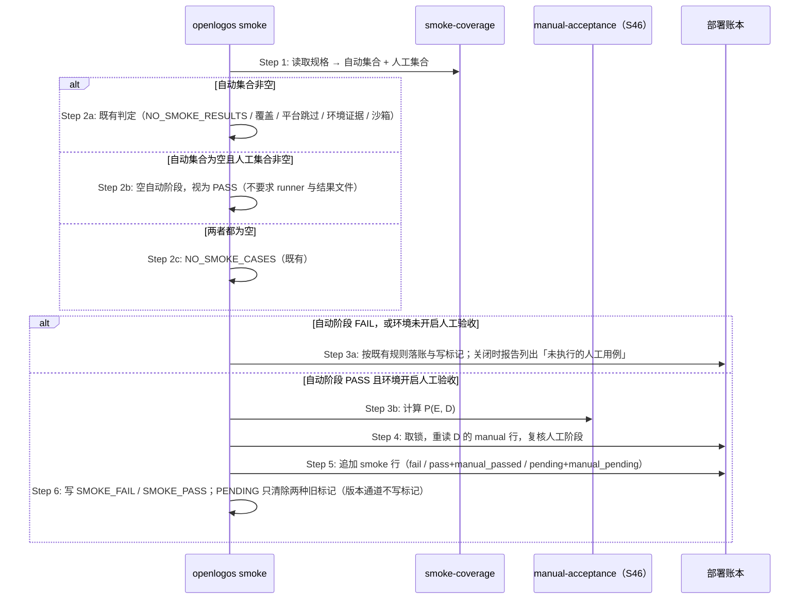

## ADDED — S19 SMOKE 人工标记读取与人工判定接入（smoke-manual-acceptance）

> 来源变更：smoke-manual-acceptance（决策 C01、C02；proposal-r1 F2～F6、proposal-r2 F3/F6 处置）。规则权威见功能规格 §2.107、`spec/environments.md` §15、`spec/test-results.md`「Smoke 结果与覆盖预检」。人工验收的完整场景见 S46；本节只说明 S19 门禁在哪些地方接入、哪些地方不变。

### 首格读法与人工集合

- `extractSmokeIdsFromContent` 的首格读法容忍人工标记：首格为 `SMOKE-<…> [manual]` 或 `SMOKE-<…> [manual/<平台>]` 的行与裸 ID 行同样计为「表格用例行」，正则与 UT/ST 同源（`MANUAL_MARKER_RE`）。整份文件只要有一行表格用例（含人工行），就不再退回全文扫描。
- 读取输出两份集合：自动集合（裸 ID 行）进入既有 defined / covered / uncovered 计算与 §2.24 runner 覆盖预检；人工集合不计入 defined，不要求 runner，不进入 `changed_case_ids` 的必要证据判定（§2.48），只交给人工阶段（S46）。
- 结果文件中出现人工集合里的 ID 时，门禁 FAIL，诊断 `manual_smoke_result_id`。

### 门禁顺序

1. **smoke-coverage** 读取 smoke 规格，分出自动集合与人工集合（Step 1）。
2. **openlogos smoke** 判定自动阶段：自动集合非空时规则逐字不变；只有人工用例时视为空通过；两者都为空时仍报 `NO_SMOKE_CASES`（Step 2）。
3. **openlogos smoke** 在自动阶段 FAIL 或环境未开启人工验收时，按既有规则落账与写标记；关闭时在报告与 JSON 中列出「未执行的人工用例」（Step 3a）。
4. **openlogos smoke** 在自动阶段 PASS 且环境开启人工验收时，取得 S46 的待验收清单，进入账本锁复核人工阶段，追加对应 smoke 行，并按结论写或清除标记（Step 3b～6）。

### 标记与账本

- PASS / FAIL 沿用 `spec/environments.md` §5.1 的「先账本、后标记」与快照恢复；PASS 时 smoke 记录带 `manual_passed=true`。
- PENDING 追加 `result=pending`、`verified=false` 的 smoke 记录，带 `deploy_id` 与 `manual_pending`（锁内读取时仍无记录的用例）。提案通道清除旧的 `SMOKE_PASS` / `SMOKE_FAIL`，同样先账本后标记、失败恢复；版本通道只写账本。不新增任何提案标记。
- PENDING 的退出码与 FAIL 相同（1）；JSON `gate.result` 为 `PENDING`。
- 锁内复核：取得账本锁后、追加 smoke 行前，重读 D 的 manual 行并重新判定人工阶段；锁外判定只用于提前报告。

### 不变的部分

- 未配置人工验收且没有人工用例的项目：读法、覆盖、平台跳过、环境证据、沙箱改判、写入顺序、退出码逐字不变。
- 有人工 UT/ST 但未开启人工验收：门禁结论不变，报告新增「未执行的人工用例 N 条」。
- `verified` 的判定（`spec/environments.md` §5.3）不变；pending 行恒为 `verified=false`；全人工项目没有结果行，`verified=false`。

### 异常与边界

#### EX-19.26：整份文件只有人工行
- **触发条件**：某 smoke 规格文件只有 `| SMOKE-core-901 [manual] | … |` 一行表格用例，正文另提到 SMOKE-core-902。
- **期望响应**：不触发全文回退；SMOKE-core-901 进入人工集合，SMOKE-core-902 不被当作用例。
- **副作用**：无。

#### EX-19.27：人工 SMOKE 被写入结果
- **触发条件**：`smoke-results.jsonl` 含人工集合中的 ID。
- **期望响应**：门禁 FAIL，诊断 `manual_smoke_result_id`。
- **副作用**：写 `SMOKE_FAIL` 与 `result=fail` 的 smoke 记录。

#### EX-19.28：有自动用例但缺结果
- **触发条件**：自动集合非空、人工集合非空，结果文件不存在。
- **期望响应**：仍报 `NO_SMOKE_RESULTS`，不进入人工阶段。
- **副作用**：按既有早退处理。

#### EX-19.29：PENDING 写入时标记清除失败
- **触发条件**：PENDING 已追加账本，删除旧 `SMOKE_PASS` 时失败。
- **期望响应**：按快照恢复两种标记，并撤销本次账本行，以 `SMOKE_LEDGER_WRITE_FAILED` 结束。
- **副作用**：账本与标记回到调用前状态。

### 追溯

- 功能规格：§2.107.2、§2.107.6；场景：S46；测试：`core-S19-test-cases.md`（UT-S19-127 起、ST-S19-40 起）。
