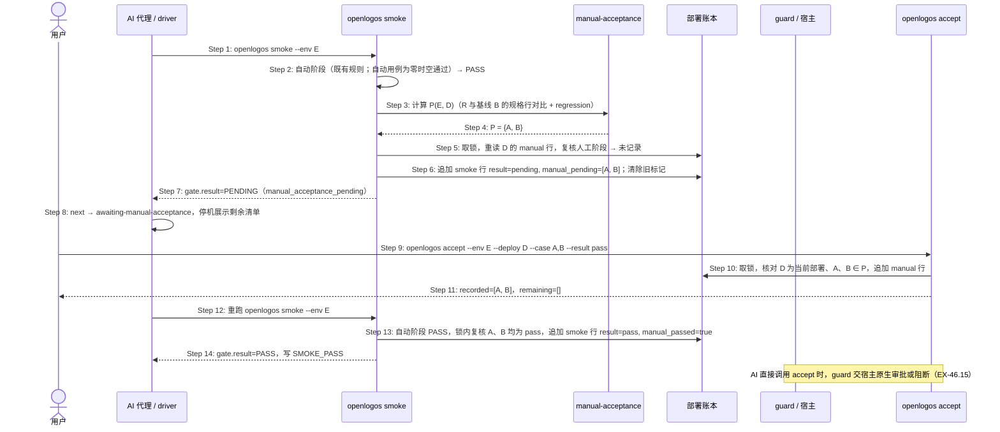

## ADDED — logos/resources/prd/3-technical-plan/2-scenario-implementation/core-S46-smoke-manual-acceptance.md（新文件，整文件）
# S46：冒烟阶段人工验收

> 模块：core｜来源：需求「冒烟阶段人工验收需求（smoke-manual-acceptance）」、提案 `smoke-manual-acceptance`（Team openlogos #3；决策 C01～C03；proposal-r1 F1～F6、proposal-r2 F3/F6 处置）｜规则权威：功能规格 §2.107、`spec/environments.md` §15

## 场景目标

需要人参与的用例（首格带 `[manual]` 的 UT / ST / SMOKE）不进 verify。本场景让它们在部署后的冒烟验收中有确定的去处，具体做法是：
- 按环境开关决定是否执行；
- 由 CLI 自动算出该环境「自上次人工验收通过以来」新增或修改的人工用例，再加上回归用例；
- 人逐条执行并用 `openlogos accept` 记录，结果绑定当前部署；
- 全部通过后 smoke 才写 `SMOKE_PASS`。

关闭人工验收的环境只列出未执行的人工用例，这些用例累积到下一次开启人工验收的环境。记录结果只能由人完成，`--auto` 下停在「等待人工验收」。

## 参与者

- **用户（人工验收者）**：在登记表中为环境开启人工验收、指定回归用例；在终端或 RunLogos 界面执行人工用例并用 `openlogos accept` 记录结果。
- **OpenLogos CLI**：`openlogos smoke` 判定自动阶段与人工阶段；`openlogos accept` 核对并写入账本；`next` / `status` / `env show` 从账本派生等待状态与剩余清单；archive 以账本核对最近有效结论。
- **本机部署账本**（`logos/.openlogos-runtime/deployments.jsonl`）：保存 deploy、smoke（含 `result=pending`）与 `kind=manual` 记录，是唯一事实源。
- **Git 仓库**：提供已部署版本 R 与基线版本 B 的测试规格。
- **guard 与宿主**：拦截 AI 对 `openlogos accept` 的调用，以及对已写 `manual_acceptance` 的登记表的修改，转交宿主原生审批或阻断。
- **AI 代理 / RunLogos driver**：推进到 smoke，遇「等待人工验收」停下；人记录后重新驱动 smoke。

## 前置条件

- 项目已初始化并存在登记表 `logos/environments.yaml`；环境 E 写了 `manual_acceptance: {enabled: true, regression: […]}`（关闭的环境见 EX-46.7）。
- E 的当前部署 D 是账本中 E 最近一条 deploy 记录（与 smoke 部署身份核对同一身份），其结果为 `done`，`ref` 为已确认的 40 位提交 R，且 R 的对象在本地可读。
- 已合并测试规格中存在人工用例（首格 `[manual]` / `[manual/<平台>]`）。
- 提案通道：存在活跃提案，`DEPLOY_DONE` 指向 D；版本通道：没有活跃提案，部署身份取自账本。

## 成功后置条件

- 账本中 E 有一条针对 D 的 smoke 记录：`result=pass`、`manual_passed=true`，且其后没有同一部署的 manual 记录。它成为 E 下次计算待验收清单的基线。
- P(E, D) 中每个用例在 D 上的最后一条 manual 记录都是 `pass`。
- 提案通道下写入 `SMOKE_PASS`；archive 的账本核对通过。
- next / status 不再显示「等待人工验收」。

## 时序图

## 步骤说明

1. **AI 代理 / driver** 在部署完成后执行 `openlogos smoke --env E`（Step 1）。
2. **openlogos smoke** 按既有规则判定自动阶段：存在自动用例时，缺结果仍报 `NO_SMOKE_RESULTS`；只有人工用例时，自动阶段视为空通过（Step 2）。
3. **manual-acceptance** 在已部署版本 R 上枚举人工用例行，与基线 B（E 中 `deploy_id` 不等于 D 的部署里，最近一条未过期的 `manual_passed=true` smoke 记录的 `ref`）对比，得到新增或内容变化的人工用例；B 不存在时取全部人工用例；再并上解析有效的 regression（Step 3～4）。
4. **openlogos smoke** 取得账本锁，重读 D 的 manual 记录并复核人工阶段。仍有未记录用例时，追加 `result=pending` 的 smoke 记录，`manual_pending` 为当时仍无记录的用例。提案通道清除旧的 `SMOKE_PASS` / `SMOKE_FAIL`，版本通道只写账本（Step 5～6）。
5. **openlogos smoke** 以 `gate.result=PENDING`、原因 `manual_acceptance_pending`、退出码 1 结束；JSON 给出 `deploy_id` 与剩余清单（Step 7）。
6. **AI 代理 / driver** 读取 next：驻留态 `awaiting-manual-acceptance`，剩余非空，`auto_execute=false`。driver 停机展示待验收用例与带 `--deploy` 的命令原文（Step 8）。
7. **用户** 逐条执行人工用例，用 `openlogos accept` 记录结果。失败必须写 `--note`，可附 `--evidence`（Step 9）。
8. **openlogos accept** 在账本锁内重读账本，核对 `--deploy` 等于 E 最近一条 deploy 记录且该部署已确认、每个 `--case` 都在 P 中，通过后逐条追加 manual 记录；返回已记录用例与剩余清单（Step 10～11）。
9. **AI 代理 / driver** 看到剩余为空后重跑 smoke（Step 12）。
10. **openlogos smoke** 自动阶段再次通过后，锁内复核 P 中每个用例在 D 上的最后结果均为 `pass`，追加 `result=pass`、`manual_passed=true` 的 smoke 记录，提案通道写 `SMOKE_PASS`（Step 13～14）。

## 异常与边界

### EX-46.1：人工用例失败
- **触发条件**：P 中某用例在 D 上的最后一条 manual 记录为 `fail`。
- **期望响应**：自动阶段通过后，门禁 FAIL，原因 `manual_cases_failed`；报告与 JSON 的 `failed[]` 列出用例与说明；写 `SMOKE_FAIL`。
- **副作用**：账本追加 `result=fail` 的 smoke 记录；不推进基线。

### EX-46.2：记录不在清单中的用例
- **触发条件**：`openlogos accept --case` 中有 ID 不在 P(E, D) 中（拼写错误、不是人工用例、已不在本次清单）。
- **期望响应**：`ACCEPT_CASE_NOT_PENDING`，列出不在清单中的 ID，退出码 1。
- **副作用**：整批零写入。

### EX-46.3：环境未开启人工验收
- **触发条件**：对 `manual_acceptance` 缺省或 `enabled=false` 的环境执行 `openlogos accept`。
- **期望响应**：`ACCEPT_NOT_ENABLED`，退出码 1。
- **副作用**：无写入。

### EX-46.4：环境没有部署，或最近一次部署未确认
- **触发条件**：E 在账本中没有任何 deploy 记录；或 D1 成功、待验，随后同一环境的 D2 落账为 `unknown` / `failed`。
- **期望响应**：没有记录时报 `ACCEPT_NO_DEPLOYMENT`。D2 未确认时，用 D1 的清单记录报 `ACCEPT_DEPLOY_CHANGED`，用 D2 记录报 `ACCEPT_DEPLOYMENT_UNCONFIRMED`；smoke 的人工阶段按清单无法确定处理（`manual_scope_unresolved`），不退回 D1。D2 经 `--reconcile` 补记为 `done` 后，只接受 D2 的清单。
- **副作用**：无写入。

### EX-46.5：失败未写说明
- **触发条件**：`--result fail` 未带 `--note` 或说明为空白。
- **期望响应**：`ACCEPT_NOTE_REQUIRED`，退出码 1。
- **副作用**：无写入。

### EX-46.6：重新部署后旧结果作废
- **触发条件**：D1 上已记录 X 为 `pass`，E 随后重新部署为 D2，X 仍在 P(E, D2) 中。
- **期望响应**：smoke 把 X 列为待验，D1 上的记录不计入。
- **副作用**：无。

### EX-46.7：关闭环境只列出
- **触发条件**：E 未开启人工验收（含没有登记表的项目），本次部署版本 R 相对 E 上一次部署版本（`previous_ref`）新增或修改了人工用例，或 E 配置了 regression。
- **期望响应**：门禁结论只由自动阶段决定；报告列出「未执行的人工用例 N 条」，JSON 的 `unexecuted[]` 列出 ID；regression 中失效的 ID 只出警告 `manual_regression_unknown`。
- **副作用**：不写 pending；这些用例在开启环境的 P 中自然累积。

### EX-46.8：不部署提案的人工用例被累积
- **触发条件**：提案 A 新增人工用例 X 后归档但未部署；提案 B 部署到开启人工验收的 E，E 的基线版本不含 X。
- **期望响应**：P(E, D) 含 X。
- **副作用**：无额外记账。

### EX-46.9：首次开启取全部现有人工用例
- **触发条件**：E 在账本中没有未过期的 `manual_passed=true` smoke 记录。
- **期望响应**：P = R 版本全部人工用例 ∪ 有效 regression（C02）。
- **副作用**：无。

### EX-46.10：已部署版本无法确认或不可读
- **触发条件**：D 的 `ref` 为 null（如 CI 未回报实际部署提交），或 R 的对象在本地不可读（如浅克隆）。
- **期望响应**：开启的环境门禁 FAIL，原因 `manual_scope_unresolved`，提示取得 R 的提交（如 `git fetch --unshallow`）后重跑；即使工作区所在分支缺少某条人工用例，也不签发通过、不推进基线。关闭的环境只出同名警告、不列清单。
- **副作用**：开启时写 `SMOKE_FAIL` 与 `result=fail` 的 smoke 记录。

### EX-46.11：基线不可读
- **触发条件**：B 有记录但其对象在本地不可读。
- **期望响应**：按 B 不存在处理（全部人工用例），出警告 `manual_baseline_unavailable`。
- **副作用**：无。

### EX-46.12：回归用例失效
- **触发条件**：开启环境的 regression 中有 ID 在 R 版本不存在，或已失去人工标记。
- **期望响应**：门禁 FAIL，原因 `manual_regression_unresolved`，`regression_unresolved[]` 列出环境与失效 ID；只记录有效项也不能通过，直到人修正登记表或规格；失效 ID 不在 P 中，accept 不接受。
- **副作用**：写 `SMOKE_FAIL`。

### EX-46.13：部署已更换
- **触发条件**：用户手上是 D1 的清单，提交 `openlogos accept --deploy <D1>` 时 E 已部署为 D2（即使 D1、D2 是同一提交）。
- **期望响应**：在账本锁内核对后报 `ACCEPT_DEPLOY_CHANGED`，退出码 1。
- **副作用**：整批零写入。

### EX-46.14：通过后再记录使通过过期
- **触发条件**：D 已有 `manual_passed=true` 的 smoke 记录与 `SMOKE_PASS`，用户又对 D 记录了任何人工结果（例如把回归用例 X 或普通用例 Y 更正为 `fail`）；或另一次 smoke 重跑暂停在 PASS 账本追加之后，更正完成后又写回了 `SMOKE_PASS`。D 自己的通过记录不作为 D 的基线，因此通过后 P(E, D) 不变，普通用例也能更正。
- **期望响应**：
  - 提案通道下 accept 删除 `SMOKE_PASS`，JSON 的 `expired_pass=true`；
  - 两种情况下，直接执行 archive 都以 `ARCHIVE_SMOKE_NOT_PASSED` 拒绝（`details.reason=smoke_pass_expired`）；
  - 过期记录不再作为基线与晋级依据；
  - next / status 提示重跑 smoke。
- **副作用**：账本追加 manual 记录；`SMOKE_PASS` 删除失败时撤销本次账本行，并以 `ACCEPT_LEDGER_WRITE_FAILED` 结束。

### EX-46.15：AI 调用 accept
- **触发条件**：AI 代理在会话中执行 `openlogos accept …`（含 `--help`、复合命令、`bash -c "…"` 内嵌），任何生命周期。
- **期望响应**：guard 识别为受限命令。Claude Code `default` / `acceptEdits` 下由宿主弹出原生审批；其他模式、非交互运行与复合形态阻断，提示用户以 `! <命令原文>` 自行执行或经 RunLogos 界面执行。qoder / workbuddy / zcode 在生命周期与安全命令的提前放行之前一律拒绝，initial 生命周期也一样。
- **副作用**：被阻断时无写入。

### EX-46.16：`--auto` 停机
- **触发条件**：`openlogos next --auto` 遇到驻留态 `awaiting-manual-acceptance` 且剩余清单非空。
- **期望响应**：不自动放行，`auto_execute=false`；driver 停在「等待人工验收」。剩余为空时建议重跑 smoke，driver 可重新驱动。
- **副作用**：无。

### EX-46.17：只有人工用例的项目
- **触发条件**：项目只有一条人工 SMOKE，没有 runner、没有结果文件，E 开启人工验收。
- **期望响应**：自动阶段空通过，不报 `NO_SMOKE_RESULTS` / `NO_SMOKE_CASES`；随后依次得到 `PENDING`、记录后重跑得到 PASS。smoke 记录 `verified=false`（没有结果行），不能作为晋级依据。
- **副作用**：按主路径写入。

### EX-46.18：多次重跑后从账本恢复等待状态
- **触发条件**：P = {A, B}。记录 A 后重跑 smoke，仍等待 B；再记录 B，然后重启。有、无活跃提案两种通道。
- **期望响应**：第二条 pending 记录的 `manual_pending` 只含 B。重启后 next / env show 计算的剩余清单为空，提示重跑 smoke，不会把 A 重新列为待验。
- **副作用**：无。

### EX-46.20：重新部署后旧部署的 smoke 写回通过标记
- **触发条件**：同一提案在开启人工验收的 E 上部署 D1，D1 的 smoke 把 PASS 追加到账本后暂停；提案重新部署为 D2（清除旧标记、写入新 `DEPLOY_DONE`）；D1 的 smoke 恢复并写回 `SMOKE_PASS`。D2 尚无任何人工记录。
- **期望响应**：直接执行 archive，以 `ARCHIVE_SMOKE_NOT_PASSED`（`smoke_pass_expired`）拒绝，因为 E 开启人工验收时 archive 只认 D2 自己的 `manual_passed=true` 通过记录；D2 自己完成 smoke 并通过后才可归档。
- **副作用**：无。

### EX-46.19：人工 SMOKE 被写入结果
- **触发条件**：runner 为人工 SMOKE 写了结果行。
- **期望响应**：门禁 FAIL，诊断 `manual_smoke_result_id`。
- **副作用**：写 `SMOKE_FAIL`。

## 追溯

- 需求：AC-SMOKE-MANUAL-01～AC-SMOKE-MANUAL-14（`core-01-requirements.md`「冒烟阶段人工验收需求（smoke-manual-acceptance）」）。
- 功能规格：§2.107；架构：「五十九、冒烟阶段人工验收：账本 manual 记录与待验收清单」；规范：`spec/environments.md` §15、`spec/test-results.md`、`spec/pretooluse-guard.md`、`spec/cli-json-output.md`。
- 关联场景：S19（smoke 门禁接入）、S41（登记表字段与账本读取）、S05（等待人工验收的 next 建议）、S09（guard 受限命令与登记表保护）、S43（受限命令与锁内复核先例）。
- 测试：`core-S46-test-cases.md`（UT-S46-01 起、ST-S46-01 起）；安装态 smoke：`core-smoke-test-cases.md`（SMOKE-core-342 起）。
