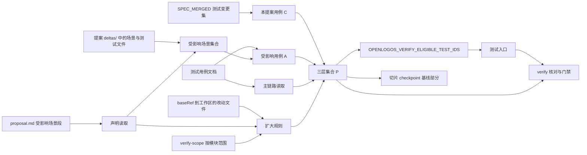

## ADDED — 六十、分层验收：验收集合的三层构成与两级证据

> 来源变更：layered-verification（决策 C01～C06）。功能规格见 §2.109；场景见 `core-S13-verify-results.md`「S13 分层验收：提案级三层集合」「S13 发布级全量验收」、`core-S09-change-management.md`「S09 提案脚手架的『受影响场景』段」、`core-S35-change-lint.md`「S35 受影响场景声明与主链路小节的结构检查」、`core-S32-slice-planning.md`「S32 分层开启时切片 checkpoint 的基线部分」。

### 60.1 目标与边界

- 让提案级验收只对「本提案用例 ∪ 受影响用例 ∪ 主链路用例」给出结论，让发布级验收在确定的提交上对全量给出结论，两种结论分开留证。
- **复用而非新建**：
  - 集合交给测试入口：既有的 `OPENLOGOS_VERIFY_ELIGIBLE_TEST_IDS`；
  - 本提案用例：既有的测试变更集读取（§2.106.6）；
  - 评估不可用时的上一级范围、提案起点与改动文件集合：既有的按模块限定范围（§2.96，`verify-scope`）；
  - 发布级留证：既有的验收历史中央索引，只加 `level`、`platform` 两个字段；
  - 偶发判定：既有的失败复跑（§2.108）。
- **不新增**：flow 节点、门、提案标记、代码文件到场景的索引、全量调度。执行机、每晚触发、发布门属 Team 与 RunLogos。

### 60.2 组件

| 组件 | 职责 | 读取 | 写入 |
|---|---|---|---|
| 主链路读取 | 从测试用例文档的主链路小节得到集合 MP 与结构错误 | `logos/resources/test/**/*-test-cases.md` | 无 |
| 受影响场景声明读取 | 解析提案「受影响场景」段，给出可用性状态 | 活跃提案 `proposal.md`、已合并场景与测试文档、提案 `deltas/` | 无 |
| 三层集合计算 | 由 C、声明、delta 触及场景、MP 与扩大规则得到 P 及其来源说明 | 上两项的结果、测试变更集、`verify-scope` 的结果 | 无 |
| `verify-scope`（既有） | 提案起点、改动文件集合、范围内模块；作为第 2 级扩大的取值 | guard、git、`logos-project.yaml` | 无 |
| 切片状态派生（既有） | checkpoint 的 eligible；baseline 的基线部分取三层集合计算的结果 | 切片清单、三层集合 | 无 |
| verify（既有） | 提案级：注入 P、核对、门禁、报告；发布级：前置检查、固定提交号、全量、收尾复核 | 以上全部 | 结果文件、提案级报告或发布级报告、验收历史、（仅提案级）提案标记 |
| 验收历史（既有） | 记录每次运行的 `level`、`platform`、提交号；供发布级查询 | — | 中央索引 |
| change-lint（既有） | 写规格时检查声明结构与主链路小节 | 主链路读取、声明读取 | 无 |

### 60.3 数据流

### 60.4 单一事实源

- **三层集合只在一处计算**。verify 的提案级验收与切片状态派生共用同一个结果；不得各自实现一份集合或扩大判定。计算结果同时给出提案集合 P、本次执行集合 E（final 时等于 P，checkpoint 时为当前 eligible）与本次要执行的命令组。
- **命令组先于环境预检确定**。三层集合与命令组都是只读计算，发生在环境预检之前；预检与执行使用同一组命令组。
- **声明的可用性只有一个判定**。verify 与 change-lint 调用同一个读取函数：lint 报告为违规或警告的状态，verify 一律按扩大处理，不会出现「lint 通过但 verify 读不懂」。
- **主链路小节只有一个读取函数**，供 verify 的门禁与 change-lint 的警告共用。
- 用例首格语法（`test-id`）不变；主链路读取只消费它给出的「本文档已定义的用例及其是否人工」。

### 60.5 两级证据

| 证据 | 写入者 | 何时写 | 读取者 |
|---|---|---|---|
| 提案级验收报告 `acceptance-report.md` | 提案级 verify | 每次提案级验收的最终门禁之后 | 人、宿主 |
| `VERIFY_PASS` / `VERIFY_FAIL` 等提案标记 | 提案级 verify | 同上 | flow 派生 |
| 发布级验收报告 `release/acceptance-report.md` | 发布级 verify | 每次发布级验收的最终门禁之后 | 人、宿主 |
| 验收历史中央索引（`level`、`platform`、`commit.head`） | 两级 verify | 每次运行结束 | `verify --release --check`、`history`、Team |

- 发布级 verify 不写任何提案级证据；提案级 verify 不写发布级报告。两者只共用结果文件与运行锁。
- 发布级结论的有效性不落盘为标记：`--check` 每次从中央索引现算（目标提交 + 平台下最近一次有结论的运行）。没有可以过期的派生状态。
- 发布级提交号在执行前固定并贯穿报告与历史；收尾时只做复核，不用收尾时的 HEAD 改写身份。

### 60.6 失败与降级

| 情形 | 行为 |
|---|---|
| 声明缺失、非法、无法评估、场景不存在 | 扩大到按模块（不可用时全量），保留已识别场景与 delta 触及场景，不失败 |
| 声明的共享标志为真（不论声明其余部分是否可用） | 扩大到全量，不失败 |
| 提案起点不可用、共享改动 | 扩大到全量，不失败 |
| 主链路小节结构错误、超限（分层开启） | 执行前判 FAIL，不执行命令 |
| 主链路用例偶发（分层开启） | 执行后判 FAIL |
| 测试入口未按清单收窄 | 门禁仍只采信执行集合；上报了集合外结果时告警；命令退出状态照常计入（因集合外失败而非零退出仍是 `pre_run_failed`） |
| 切片 checkpoint 中 pending 用例被提前上报 | 既有越界判定不变 |
| 发布级运行中出现没有平台原因的跳过 | FAIL `case_tier_mismatch`，不构成有效结论中的通过 |
| 发布级前置条件不满足 | 拒绝，不产生结论 |
| 发布级运行期间提交或工作区变化 | FAIL `release_commit_changed`，记录归执行前固定的提交 |

### 60.7 追溯

需求 AC-VERIFY-TIER-01～22；功能规格 §2.109、§2.104.3。
