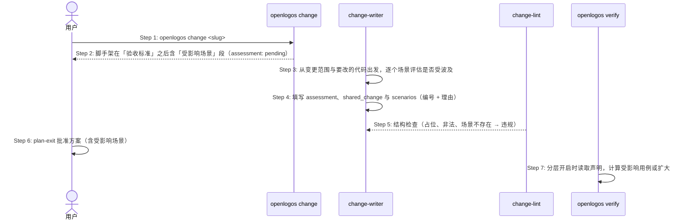

## ADDED — S09 提案脚手架的「受影响场景」段（layered-verification）

> 来源变更：layered-verification（决策 C01）。规则权威见功能规格 §2.109.4；lint 检查见 `core-S35-change-lint.md`「S35 受影响场景声明与主链路小节的结构检查」；verify 的读取见 `core-S13-verify-results.md`「S13 分层验收：提案级三层集合」。

### 场景目标

写提案时就评估「这次改动会波及哪些已有场景」，把结论结构化地写进提案，随方案一起由人批准；分层开启的项目据此确定提案级验收要跑哪些场景的用例。

### 参与者

| 别名 | 组件 | 说明 |
|---|---|---|
| U | 用户 | 发起提案、批准方案 |
| CLI | `openlogos change` | 生成 proposal 脚手架 |
| W | change-writer | 评估并填写「受影响场景」段 |
| L | `openlogos change-lint` | 检查该段结构 |
| V | `openlogos verify` | 读取声明，计算受影响用例 |

### 前置条件

- 项目已 launched；用户执行 `openlogos change <slug>` 创建提案并写入 guard。

### 成功后置条件

- proposal 含结构合法的「受影响场景」段：`assessment` 为 `assessed` 或 `unknown`，所列场景都存在且各有理由。

### 时序图

### 步骤说明

1. **用户** 执行 `openlogos change <slug>`。
2. **CLI** 生成的 proposal 在「验收标准」之后、「变更概述」之前含「受影响场景」段（en locale：`Affected Scenarios`），正文为 fenced YAML：`schema: openlogos/affected-scenarios@1`、`assessment: pending`、`shared_change: false`、`scenarios: []`。既有各段的顺序与内容不变。
3. **change-writer** 从本次变更范围和将要修改的代码出发，逐个场景判断其行为是否可能受波及。
4. **change-writer** 填写：已评估写 `assessed` 并列出场景编号与理由；无法判断写 `unknown`；涉及共享代码、配置或依赖时 `shared_change: true`。
5. **change-lint** 检查结构；`pending`、非法取值、空理由、不存在的场景编号都报违规。
6. **用户** 在 plan-exit 批准方案时一并审视受影响场景；提案改动核心流程时同时审视主链路是否需要调整。
7. **verify** 在分层开启时读取该段（§2.109.5～§2.109.7）。

### 异常与边界

#### EX-9J.1：在途提案没有该段
- **触发条件**：0.16.27 之前创建的提案。
- **期望响应**：change-lint 只出警告 `affected_scenarios_missing`，不阻断；分层开启时 verify 按 `declaration_missing` 扩大。
- **副作用**：无。

#### EX-9J.2：除自身触及的场景外没有受影响场景
- **触发条件**：评估后认为不波及其他场景。
- **期望响应**：`assessment: assessed`、`scenarios: []` 合法；提案 delta 触及的场景仍由 verify 自动并入。
- **副作用**：无。

#### EX-9J.3：实现阶段影响面扩大
- **触发条件**：写代码时发现需要改动声明之外的场景所依赖的代码。
- **期望响应**：更新该段（追加场景或改 `shared_change`）；verify 每次运行重新读取。
- **副作用**：无。

#### EX-9J.4：该段不是必填章节
- **触发条件**：任何提案。
- **期望响应**：`PLAN_SECTION_REGISTRY` 不含该段；段缺失不影响 `plan_ready`；段在场但违规时照 change-lint 违规处理。
- **副作用**：无。

### 追溯

- 需求：AC-VERIFY-TIER-05、AC-VERIFY-TIER-09、AC-VERIFY-TIER-21。
- 功能规格：§2.109.4。
- 规范与 Skill：`spec/change-management.md`「受影响场景」、`skills/change-writer/SKILL.md`「Step 4 补充：『受影响场景』段」。
- 测试：`core-S09-test-cases.md`（UT-S09-504 起）、`core-S35-test-cases.md`（UT-S35-231 起）。
