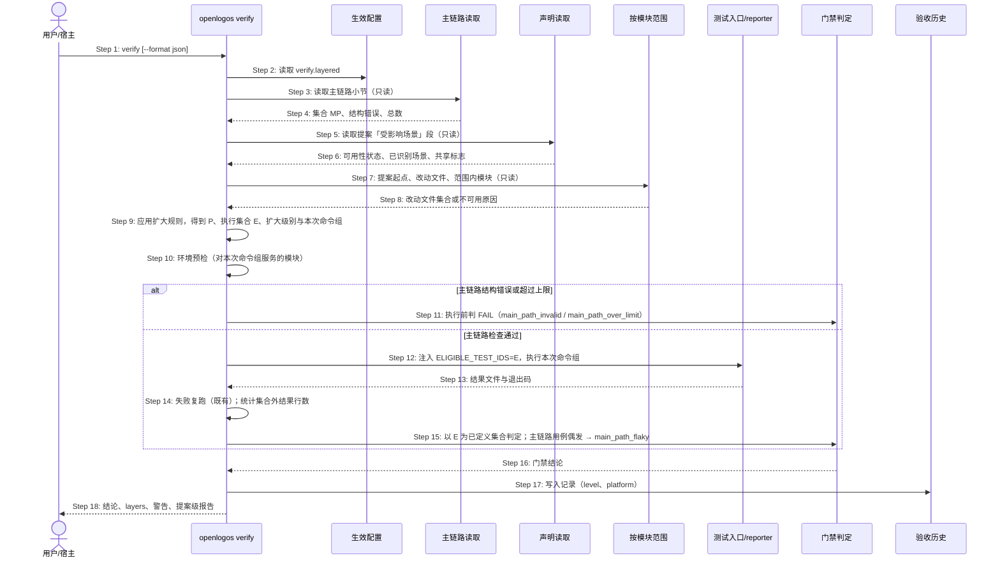
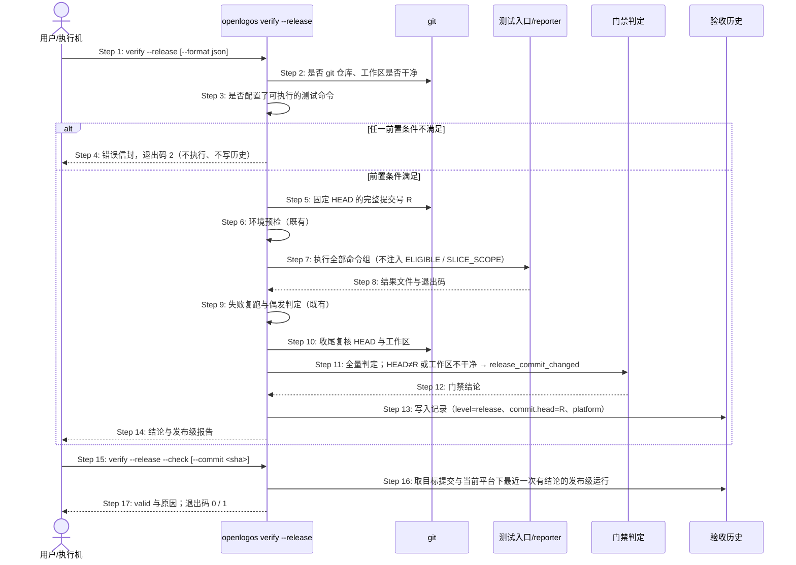

## ADDED — S13 分层验收：提案级三层集合（layered-verification）

### 场景目标

分层开启的项目上，`openlogos verify` 的提案级验收只对「本提案用例 ∪ 受影响用例 ∪ 主链路用例」给出结论；评估不可用或涉及共享改动时扩大范围，不缩小。规则权威见功能规格 §2.109.2～§2.109.10、§2.109.13～§2.109.14；测试入口约定见 `spec/test-results.md`「分层验收（layered-verification）」。

### 参与者

| 别名 | 组件 | 说明 |
|---|---|---|
| Caller | 用户或 RunLogos driver | 发起 verify |
| CLI | `openlogos verify` | 读取配置、计算集合、注入、核对、门禁、报告 |
| Cfg | 生效配置 | `verify.layered`（缺省关闭、上限 50、共享路径清单） |
| MP | 主链路读取 | 测试用例文档主链路小节 → 集合与结构错误 |
| Decl | 受影响场景声明读取 | 提案「受影响场景」段 → 可用性状态 |
| Scope | 按模块限定范围（§2.96） | 提案起点、改动文件集合、范围内模块 |
| Runner | 项目测试入口 + OpenLogos reporter | 按 `OPENLOGOS_VERIFY_ELIGIBLE_TEST_IDS` 选择并执行 |
| Gate | 门禁判定 | §2.109.10 的原因优先级 |
| Hist | 验收历史 | 记录 `level: "proposal"`、`platform` |

### 前置条件

- 命令已通过用法检查；`verify.layered.enabled` 为 true。
- 结果路径运行锁已获取。

### 成功后置条件

- 验收集合 P 及其三层来源、扩大级别与原因在 JSON 与验收报告中可见。
- 门禁只依据 P 内的结果；P 之外的已定义用例不计未覆盖。
- 验收报告标明级别为提案级。

### 时序图

### 步骤说明

1. **Caller** 执行 `openlogos verify`。
2. **CLI** 读取 `verify.layered`；非法项按缺省值处理并记警告 `layered_config_invalid`。`enabled` 不为 true 时不进入本场景（EX-13.28）。
3. **CLI** 读取全部测试用例文档的主链路小节。Step 3～9 都是只读计算，发生在环境预检之前。
4. **主链路读取** 返回集合 MP、结构错误清单与总数。
5. **CLI** 读取活跃提案的「受影响场景」段；没有活跃提案时直接到 Step 9（扩大到全量）。
6. **声明读取** 返回状态（`usable` / `missing` / `invalid` / `unknown` / `scenario_unknown`），以及不论状态如何都能独立采信的两项：已识别场景与共享标志。
7. **CLI** 取得提案起点与改动文件集合（§2.96 的同一计算，不要求模块范围已启用）。
8. 起点不可用或差异计算失败时返回原因。
9. **CLI** 应用扩大规则（§2.109.7），得到：扩大级别 `none` / `module` / `full` 与原因清单；提案集合 P；本次执行集合 E（final 时等于 P，切片 checkpoint 时为当前 eligible）；本次要执行的命令组（§2.109.8）。
10. **CLI** 对本次命令组服务的模块做环境预检。未通过时按既有预检类原因收尾，不进入后续步骤——因主链路或已识别场景多带出的模块同样被预检，最终不执行的模块不参与预检。
11. 主链路有结构错误，或总数超过 `main_path_max` → 不执行预跑命令、不读取结果文件，直接判 FAIL；`result_source` 为 `"none"`。已合并提案的测试变更集无效时，原因取 `test_change_set_invalid`。
12. **CLI** 在级别为 `none` 或 `module` 时注入 `OPENLOGOS_VERIFY_ELIGIBLE_TEST_IDS`=E，执行本次命令组；final 验收不注入 `OPENLOGOS_VERIFY_SLICE_SCOPE`。
13. **Runner** 按清单选择并执行，写结果文件。
14. **CLI** 照既有规则做失败复跑（复跑集合与 E 求交）；统计属于已定义用例但不在 P 内的结果行数。
15. **Gate** 以 E 为已定义集合判定。MP 中的用例被判为偶发时原因为 `main_path_flaky`。命令组的退出状态照常计入，不因忽略集合外结果行而改变。
16. 集合外结果行数大于 0 时 `warnings` 增加 `layered_runner_not_narrowed`。
17. **CLI** 写验收历史（`level: "proposal"`、`platform`）。
18. **CLI** 写提案级验收报告（含级别与验收范围小节）与提案标记，输出结论；退出码与 `gate.result` 一致。

### 异常与边界

#### EX-13.28：分层未开启
- **触发条件**：`verify.layered.enabled` 未配置或为 false。
- **期望响应**：不读取主链路小节与受影响场景段；验收范围、门禁、报告、退出码与引入前一致；JSON 只多出 `level: "proposal"`，没有 `layers`。
- **副作用**：无。

#### EX-13.29：没有活跃提案
- **触发条件**：分层开启，没有 guard 或没有活跃提案。
- **期望响应**：扩大到全量，原因 `no_active_change`；主链路约束照常检查。
- **副作用**：无。

#### EX-13.30：声明缺失、非法或无法评估
- **触发条件**：声明状态为 `missing`、`invalid` 或 `unknown`。
- **期望响应**：扩大到按模块，原因分别为 `declaration_missing`、`declaration_invalid`、`assessment_unknown`；模块范围未启用或其自身回落时结果为全量，并追加原因 `module_scope_unavailable`。按模块扩大时，声明中已识别的场景与 delta 触及的场景仍保留在集合内（即使不在范围 M 的模块中），其所属模块的命令组一并执行。门禁结论不因扩大改变。
- **副作用**：无。

#### EX-13.31：声明了不存在的场景
- **触发条件**：`scenarios` 中有不存在的场景编号。
- **期望响应**：同 EX-13.30，原因 `scenario_unknown`，点名该编号。声明中其余存在的场景照常计入（已识别场景），结果是「按模块范围 ∪ 已识别场景 ∪ delta 触及场景」，不小于未写错时的集合。
- **副作用**：无。

#### EX-13.32：涉及共享改动
- **触发条件**：改动文件命中 `logos/logos.config.json`、`logos/logos-project.yaml` 或 `shared_paths`；或声明的共享标志为真——只要 `shared_change: true` 可读出即采信，声明其余部分为 `unknown`、未填写或有错时同样成立。
- **期望响应**：扩大到全量，原因 `shared_path_changed`（列出命中的文件）或 `shared_change_declared`。
- **副作用**：无。

#### EX-13.33：提案起点不可用
- **触发条件**：不是 git 仓库、guard 缺 `baseRef`、`baseRef` 不可达，或差异计算失败。
- **期望响应**：扩大到全量，原因 `base_ref_unavailable` 并附具体情形。
- **副作用**：无。

#### EX-13.34：delta 触及的场景未在声明中
- **触发条件**：提案 `deltas/` 中有场景 S21 的场景文档或测试用例文档，声明没有 S21。
- **期望响应**：S21 计入受影响场景，来源 `delta`；不报错。
- **副作用**：无。

#### EX-13.35：主链路超过上限
- **触发条件**：MP 的大小大于 `main_path_max`。
- **期望响应**：FAIL `main_path_over_limit`，报告与 JSON 给出上限与实际数量；测试入口未被调用。
- **副作用**：无。

#### EX-13.36：主链路小节结构错误
- **触发条件**：小节列了未定义 ID、人工用例、SMOKE、重复 ID，或同一文档有多个小节。
- **期望响应**：FAIL `main_path_invalid`，逐条给出文档、ID 与错误代码；测试入口未被调用。与 EX-13.35 同时成立时取本条。
- **副作用**：无。

#### EX-13.37：主链路用例偶发
- **触发条件**：MP 中的用例首跑失败、复跑通过。
- **期望响应**：FAIL `main_path_flaky`；该用例在 `flaky_cases` 与 `layers.main_path.flaky_ids` 中；不写 `VERIFY_PASS`；报告提示修复或移出主链路。同一次运行中非主链路用例的偶发照常按 §2.108 处理。
- **副作用**：无。

#### EX-13.38：测试入口没有收窄
- **触发条件**：测试入口忽略清单，执行并上报了全部用例。
- **期望响应**：P 之外的已定义用例的结果不采信、不计入统计、不判 `result_outside_eligible_scope`；`layers.outside_result_count` 大于 0，警告 `layered_runner_not_narrowed`；门禁按执行集合判定。测试入口执行了集合外文件但没有上报时不告警。命令的退出状态是另一份证据：入口因集合外用例失败而非零退出、又没有集合内失败可供复跑改判时，门禁为 `pre_run_failed`；入口零退出时才可能 PASS。
- **副作用**：无。

#### EX-13.39：与按模块限定范围并存
- **触发条件**：分层开启，且模块范围已启用。
- **期望响应**：未扩大时执行「P 中用例所属模块」的命令组（P 含不带模块前缀的文档中的用例时执行全部命令组）；扩大到按模块时执行范围 M 的命令组，加 MP 与已识别场景、delta 触及场景所属模块的命令组；环境预检针对同一组命令组服务的模块；`data.scope` 照旧输出。
- **副作用**：无。

#### EX-13.40：提案尚未合并规格
- **触发条件**：活跃提案没有 `SPEC_MERGED`。
- **期望响应**：本提案用例为空集；其余两层照常。
- **副作用**：无。

#### EX-13.54：切片 checkpoint 的执行集合
- **触发条件**：分层开启的 slice-checkpoint（`baseline` 范围）。
- **期望响应**：注入的清单、已定义集合与复跑集合都取当前 eligible（提案集合 P 的子集，不含 pending）；`layers.total` 为 P，`layers.execution` 为当前 eligible。pending 用例没有结果是正常的；pending 用例被提前上报时照既有规则判 `result_outside_eligible_scope`；P 之外的已定义用例被上报时只计入 `outside_result_count`。`owned` 范围的 checkpoint 不适用最后一条：当前 eligible 之外的任何已定义用例被上报都判 `result_outside_eligible_scope`。
- **副作用**：无。

#### EX-13.55：多带出的模块缺少环境条件
- **触发条件**：模块范围 M 只有 `backend`，主链路用例在 `core`，`core` 声明了独有的环境要求且未满足。
- **期望响应**：环境预检覆盖 `core`，判 `verify_env_not_ready`；任何命令组都未执行。
- **副作用**：无。

#### EX-13.41：配置非法
- **触发条件**：`layered` 不是对象，或其字段取值非法。
- **期望响应**：非法项按缺省值处理（`enabled` 非法即视为未开启），警告 `layered_config_invalid` 指出字段。
- **副作用**：无。

### 追溯

- 需求：AC-VERIFY-TIER-01～13、AC-VERIFY-TIER-19、AC-VERIFY-TIER-20。
- 功能规格：§2.109.2～§2.109.10、§2.109.13、§2.109.14。
- 测试：`core-S13-test-cases.md`（UT-S13-217 起、ST-S13-48 起）。

## ADDED — S13 发布级全量验收（layered-verification）

### 场景目标

在确定的提交上实际执行全量并留下与提交号绑定的结论；任何时候都能查询某个提交在当前平台上是否有有效的发布级结论。规则权威见功能规格 §2.109.11、§2.109.12。全量的调度、执行机与发布门不在本场景内。

### 参与者

| 别名 | 组件 | 说明 |
|---|---|---|
| Caller | 用户、执行机或宿主 | 发起发布级验收或查询 |
| CLI | `openlogos verify --release` | 前置检查、固定提交号、全量执行、收尾复核、报告 |
| Git | git | 提交号与工作区状态 |
| Runner | 项目测试入口 + OpenLogos reporter | 执行全量 |
| Gate | 门禁判定 | 既有全量判据，加 `release_commit_changed` |
| Hist | 验收历史 | 记录 `level: "release"`、提交号、平台 |

### 前置条件

- 项目已初始化。发布级验收不要求、也不读取活跃提案。

### 成功后置条件

- 验收历史有一条 `level: "release"` 的记录，`commit.head` 为执行前固定的提交号。
- 发布级报告写在 `logos/resources/verify/release/acceptance-report.md`。
- 提案目录中的任何标记与提案级验收报告都没有被改动。

### 时序图

### 步骤说明

1. **Caller** 执行 `openlogos verify --release`。
2. **CLI** 检查项目是 git 仓库、HEAD 可解析；检查工作区干净（lifecycle 路径之外没有任何未提交或未跟踪的条目）。
3. **CLI** 检查配置了可执行的测试命令。
4. 任一不满足：`RELEASE_VERIFY_NOT_GIT` / `RELEASE_VERIFY_DIRTY` / `RELEASE_VERIFY_NO_COMMAND`，退出码 2。不获取运行锁、不截断结果文件、不写历史。
5. **CLI** 解析并固定当前 HEAD 的完整提交号 R。
6. **CLI** 做环境预检（项目级与全部模块的要求）。未通过时按既有预检类原因判 FAIL，`result_source` 为 `"none"`——这次运行不是发布级结论。
7. **CLI** 执行全部命令组（命令组选择等同 `--all`）；清除并不注入 `OPENLOGOS_VERIFY_ELIGIBLE_TEST_IDS`、`OPENLOGOS_VERIFY_SLICE_SCOPE`。
8. **Runner** 执行全量并写结果文件。
9. **CLI** 照既有规则做失败复跑与偶发判定；对全部自动化用例严格判定跳过（只接受带平台原因的跳过）。
10. **CLI** 再次读取 HEAD 与工作区状态。
11. **Gate** 以全部不带 `[manual]` 的 UT/ST 为已定义集合判定。HEAD 不等于 R 或工作区不干净时，原因为 `release_commit_changed`，优先于其他原因。
12. 得到门禁结论。
13. **CLI** 写验收历史：`level: "release"`、`commit: { head: R, dirty: false }`、`platform`、`proposal: null`、`raw_location: "none"`。
14. **CLI** 写发布级报告，输出结论；不写任何提案标记，不改写提案级验收报告与模块验收报告，不执行 smoke 覆盖预检。
15. **Caller** 执行 `openlogos verify --release --check`（只读，不要求工作区干净）。
16. **CLI** 解析目标提交（`--commit` 或当前 HEAD），在验收历史中取「目标提交 + 当前平台」下最近一次有结论的发布级运行。
17. **CLI** 输出 `valid`、`reason` 与该运行；`valid` 为 true 时退出码 0，否则 1。

### 异常与边界

#### EX-13.42：工作区不干净
- **触发条件**：有未提交的改动或未跟踪文件（lifecycle 路径除外）。
- **期望响应**：`RELEASE_VERIFY_DIRTY`，`details.paths` 列出至多 20 条；不执行任何命令。
- **副作用**：无。

#### EX-13.43：不是 git 仓库
- **触发条件**：项目不在 git 仓库内，或 HEAD 无法解析（尚无提交）。
- **期望响应**：`RELEASE_VERIFY_NOT_GIT`；不执行任何命令。
- **副作用**：无。

#### EX-13.44：没有测试命令但有旧的全绿结果
- **触发条件**：未配置任何测试命令，`result_path` 上有一份完整且全部通过的结果文件。
- **期望响应**：`RELEASE_VERIFY_NO_COMMAND`；结果文件不被读取、不被改动；随后的 `--check` 不因它给出有效结论。
- **副作用**：无。

#### EX-13.45：运行期间提交变化
- **触发条件**：在提交 A 上启动，收尾时 HEAD 已是提交 B（或工作区出现未提交改动）。
- **期望响应**：FAIL `release_commit_changed`；历史记录的提交号是 A；`--check --commit B` 不命中这次运行。
- **副作用**：无。

#### EX-13.46：存在活跃提案
- **触发条件**：仓库里有活跃提案及其标记。
- **期望响应**：发布级验收照常执行全量；`VERIFY_PASS`、`VERIFY_FAIL`、切片 checkpoint、循环账本、提案完整记录目录、提案级验收报告都保持原样。
- **副作用**：`result_path` 被本次全量结果覆盖。

#### EX-13.47：分层开启或模块范围启用
- **触发条件**：`verify.layered.enabled` 为 true，或项目启用了按模块限定范围。
- **期望响应**：发布级验收仍为全量，不计算三层集合与模块范围，不检查主链路约束。
- **副作用**：无。

#### EX-13.56：全量入口只上报跳过
- **触发条件**：测试入口正常退出，为用例写了没有平台原因的 skip（极端情形是每条用例都是无理由 skip）。
- **期望响应**：发布级对全部自动化用例严格判定跳过：这些用例列入 `tier_mismatch_cases`，门禁 FAIL，原因 `case_tier_mismatch`；随后的 `--check` 返回 `latest_failed`。带平台原因的跳过（`platform-unavailable` 加非空说明）被接受并列入 `platform_skipped_cases`，其余用例通过时门禁 PASS。
- **副作用**：无。

#### EX-13.48：同一提交先通过后失败
- **触发条件**：同一提交、同一平台上先后两次有结论的发布级运行，先 PASS 后 FAIL。
- **期望响应**：`--check` 返回 `valid: false`、`reason: "latest_failed"`，退出码 1。先 FAIL 后 PASS 时 `valid: true`，退出码 0。
- **副作用**：无。

#### EX-13.49：环境预检未通过的运行
- **触发条件**：某次发布级运行因环境预检类原因判 FAIL（`result_source: "none"`）。
- **期望响应**：它不是结论：此前同一提交的 PASS 仍然有效；此前没有结论时 `--check` 返回 `no_conclusive_run`。
- **副作用**：无。

#### EX-13.50：只有其他提交或其他平台的结论
- **触发条件**：目标提交在当前平台没有结论。
- **期望响应**：其他平台有该提交的结论 → `other_platform_only`；只有其他提交的结论 → `other_commit_only`；什么都没有 → `no_conclusive_run`。退出码 1。
- **副作用**：无。

#### EX-13.51：`--commit` 无法解析
- **触发条件**：`--commit` 的值不是当前仓库中的提交。
- **期望响应**：`RELEASE_CHECK_COMMIT_INVALID`，退出码 2。
- **副作用**：无。

#### EX-13.52：结果路径配置落在发布级报告路径上
- **触发条件**：`result_path` 等配置为 `logos/resources/verify/release/acceptance-report.md`。
- **期望响应**：按既有报告保留路径规则改写到默认路径并提示；发布级报告不被结果内容覆盖。
- **副作用**：无。

#### EX-13.53：存在名为 `release` 的模块
- **触发条件**：多模块项目有模块 `release`，其模块验收报告为 `logos/resources/verify/release-acceptance-report.md`。
- **期望响应**：发布级报告在 `release/` 子目录，与模块验收报告是两个文件，互不覆盖；模块完成判定不受影响。
- **副作用**：无。

### 追溯

- 需求：AC-VERIFY-TIER-14～19。
- 功能规格：§2.109.11～§2.109.14、§2.104.3。
- 测试：`core-S13-test-cases.md`（UT-S13-217 起、ST-S13-48 起）。
