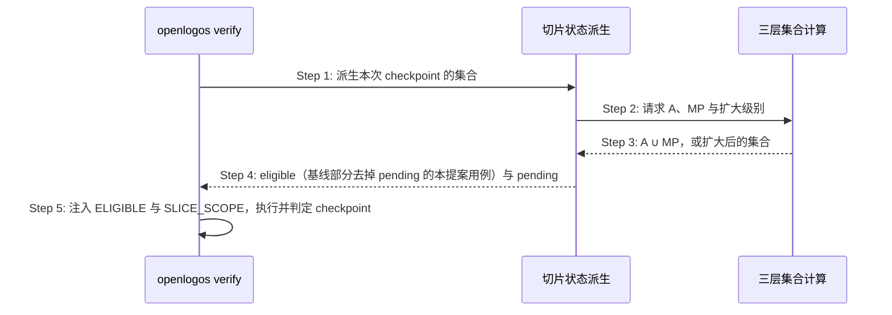

## ADDED — S32 分层开启时切片 checkpoint 的基线部分（layered-verification）

> 来源变更：layered-verification。规则权威见功能规格 §2.109.9；验收范围的冻结规则见「S32 切片规划冻结验收范围时序」（不变）；三层集合见 `core-S13-verify-results.md`「S13 分层验收：提案级三层集合」。

### 场景目标

分层开启后，`baseline` 范围的切片 checkpoint 不再回归全部基线，而是回归「受影响用例 ∪ 主链路用例」，使切片验收不超出提案级验收的范围（切片 ⊂ 提案 ⊂ 发布）。

### 参与者

| 别名 | 组件 | 说明 |
|---|---|---|
| V | `openlogos verify` | 执行切片 checkpoint |
| S | 切片状态派生 | 计算 eligible / pending |
| L | 三层集合计算 | 给出 A、MP 与扩大级别（§2.109.6～§2.109.7） |

### 前置条件

- 活跃提案有有效的切片清单，处于 slice-checkpoint；`verify.layered.enabled` 为 true。

### 成功后置条件

- `baseline` 范围 checkpoint 的 eligible = 基线部分 ∪ 已确认切片的 owned ∪ 本片的 owned，其中基线部分取自三层集合计算。

### 时序图

### 步骤说明

1. **verify** 进入 slice-checkpoint 模式，请求切片状态派生。
2. **切片状态派生** 在 `verify_scope` 为 `baseline` 且分层开启时，向三层集合计算请求基线部分。
3. **三层集合计算** 返回：未扩大时为 A ∪ MP；扩大到按模块时 A 取 §2.109.7 第 2 级算出的值（模块范围内用例 ∪ 已识别场景与 delta 触及场景的用例，模块范围之外的已识别场景同样保留）；扩大到全量时为全部非本提案用例（与引入前相同）。本步骤不另行计算 A，只引用三层集合计算的结果。
4. **切片状态派生** 从基线部分中去掉尚未轮到的本提案用例（pending），并上已确认切片与本片的 owned。
5. **verify** 照既有规则注入变量、执行、判定并记录 checkpoint：注入的清单、已定义集合与复跑集合都是本次 eligible（执行集合），不是提案集合 P；`layers.total` 输出 P，`layers.execution` 输出本次 eligible。

### 异常与边界

#### EX-32.33：`owned` 范围
- **触发条件**：切片清单冻结的 `verify_scope` 为 `owned`。
- **期望响应**：与分层无关，eligible 仍为已确认切片与本片的 owned。越界判定也与引入前相同：测试入口额外上报 eligible 之外的任何已定义用例（包括提案集合之外的基线用例），都计入 `outside_eligible_result_ids` 并判 `result_outside_eligible_scope`，checkpoint FAIL——不按「提案集合之外只计数并告警」处理。
- **副作用**：无。

#### EX-32.34：分层未开启
- **触发条件**：`verify.layered.enabled` 不为 true。
- **期望响应**：`baseline` 范围的基线部分为全部非本提案用例，与引入前一致。
- **副作用**：无。

#### EX-32.35：扩大时 checkpoint 随之扩大
- **触发条件**：声明缺失、涉及共享改动等扩大情形。
- **期望响应**：基线部分取扩大后的集合；`data.layers.expansion` 同样输出。按模块扩大时，声明中已识别、但不在模块范围内的场景的用例仍在基线部分、在注入的清单与 `layers.execution` 中，其所属模块的命令组一并执行。
- **副作用**：无。

#### EX-32.36：受影响场景中含本提案用例
- **触发条件**：某条尚未轮到的本提案用例同时属于受影响场景。
- **期望响应**：它仍是 pending，不进入本次 eligible、不在注入的清单中；没有它的结果是正常的，不计未覆盖。它被测试入口提前上报时，照既有 checkpoint 规则判 `result_outside_eligible_scope`（不按「P 之外的结果」忽略）。轮到其所属切片时作为 owned 进入。
- **副作用**：无。

#### EX-32.37：主链路约束
- **触发条件**：分层开启的 checkpoint，主链路小节结构错误或超限，或主链路用例偶发。
- **期望响应**：与 final 相同（§2.109.10）：前两者在执行前判 FAIL，后者执行后判 FAIL；checkpoint 记为 FAIL。
- **副作用**：无。

### 追溯

- 需求：AC-VERIFY-TIER-13。
- 功能规格：§2.109.9、§2.101。
- 测试：`core-S32-test-cases.md`（UT-S32-118 起）。
