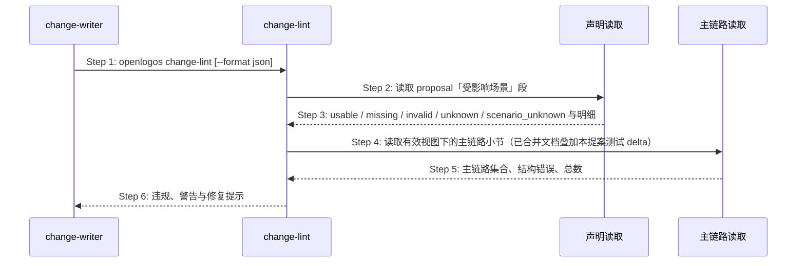

## ADDED — S35 受影响场景声明与主链路小节的结构检查（layered-verification）

> 来源变更：layered-verification（决策 C01、C03、C05）。规则权威见功能规格 §2.109.3、§2.109.4；脚手架见 `core-S09-change-management.md`「S09 提案脚手架的『受影响场景』段」；verify 侧的同一判定见 `core-S13-verify-results.md`「S13 分层验收：提案级三层集合」。

### 场景目标

在写规格的阶段就发现两类问题，不等到 verify：提案的「受影响场景」段写得不可用；测试用例文档的主链路小节写错或超过上限。

### 参与者

| 别名 | 组件 | 说明 |
|---|---|---|
| W | change-writer / 用户 | 运行 change-lint |
| L | `openlogos change-lint` | 检查并输出违规与警告 |
| D | 声明读取 | 与 verify 共用的可用性判定（§2.109.4） |
| M | 主链路读取 | 与 verify 共用的小节读取（§2.109.3） |

### 前置条件

- 存在活跃提案（或以 `--slug` 指定提案）。

### 成功后置条件

- 「受影响场景」段在场时结构合法；主链路小节的问题都已作为警告列出。

### 时序图

### 步骤说明

1. **调用方** 运行 `openlogos change-lint`。
2. **change-lint** 调用声明读取。
3. 按状态处理：
   - `missing` → 警告 `affected_scenarios_missing`（进 `warnings`，不计违规、不改退出码）；
   - `invalid` → 违规 `affected_scenarios_invalid`，`detail` 指出具体问题（YAML 缺失或损坏、字段缺失或类型不对、`assessment` 仍为 `pending`、`assessment` 取值非法、`reason` 为空、编号重复），带 `fix_hint`；
   - `scenario_unknown` → 违规 `affected_scenarios_invalid`，点名不存在的场景编号；
   - `unknown`、`usable` → 通过。`unknown` 另给警告 `affected_scenarios_unknown`，提示分层开启时验收范围会扩大。
4. **change-lint** 调用主链路读取。读取对象是测试用例文档的有效视图：已合并文档叠加本提案 `deltas/test/` 的合成后态（与 L4 测试 ID 检查同一合成）。
5. 主链路读取返回集合、结构错误与总数。
6. 主链路问题一律为警告，不计违规：
   - 结构错误 → `main_path_invalid`，逐条给出文档、ID 与错误代码；
   - 总数超过生效的 `verify.layered.main_path_max` → `main_path_over_limit`，给出上限与实际数量。

   分层是否开启不影响这两条警告是否给出；开启时警告文案注明 verify 会据此判 FAIL。

### 异常与边界

#### EX-35T.1：引用本提案新建的场景
- **触发条件**：`scenarios` 中的编号只存在于本提案 `deltas/` 的场景文档或测试用例文档。
- **期望响应**：视为存在，不报违规。
- **副作用**：无。

#### EX-35T.2：不改 plan 判据
- **触发条件**：任何提案。
- **期望响应**：该段不进 `PLAN_SECTION_REGISTRY`；缺段不影响 `plan_ready`；违规照既有规则使 change-lint 退出码为 2。
- **副作用**：无。

#### EX-35T.3：项目没有任何主链路小节
- **触发条件**：全部测试用例文档都没有主链路小节。
- **期望响应**：不给出主链路相关警告；主链路集合为空。
- **副作用**：无。

#### EX-35T.4：本提案的测试 delta 改动了主链路小节
- **触发条件**：`deltas/test/` 中新增或修改了主链路小节。
- **期望响应**：按合成后态检查；合成失败时由既有 L4 报告，主链路检查跳过该文档。
- **副作用**：无。

### 追溯

- 需求：AC-VERIFY-TIER-21。
- 功能规格：§2.109.3、§2.109.4。
- 测试：`core-S35-test-cases.md`（UT-S35-231 起）。
