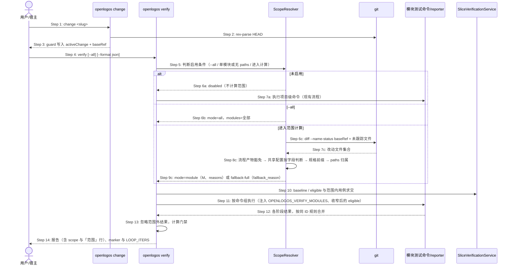
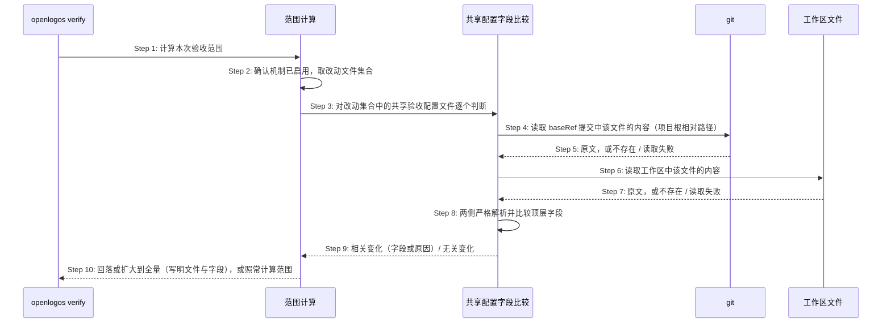

## MODIFIED — S13 按模块限定范围的 verify > 时序图

## MODIFIED — S13 按模块限定范围的 verify > 步骤说明

1. **用户 / 宿主**执行 `openlogos change <slug>`（时序 Step 1）。
2. **openlogos change** 读取当时 `HEAD`（Step 2），在 guard 中写入 `activeChange` 与 `baseRef`（Step 3）；非 git 或无提交时不写 `baseRef`。
3. **用户 / 宿主**执行 `openlogos verify`（Step 4）。
4. **ScopeResolver** 先判断启用条件（Step 5）：传 `--all` 时直接全量（Step 6b）；单模块或没有任何模块声明 `paths` 时不启用，CLI 按现有流程只执行项目级命令、不输出 `scope`（Step 6a、7a），跳到第 8 步的门禁计算。
5. **ScopeResolver** 取 `baseRef` 到工作区的差异与未跟踪文件（Step 6c、7c），按「流程产物豁免 → 共享验收配置按字段判断（相关变化或无法判断时回落，只有无关变化时该文件不参与后续分类；见「S13 共享验收配置按字段判断」）→ `logos/resources/` 下模块前缀规格归属 → `paths` 归属」分类（Step 8c），与提案归属模块、delta 前缀模块合并为 M（Step 9c）；任一回落条件成立则 `fallback-full`。
6. **SliceVerificationService** 把 baseline、confirmed、attempted、eligible 与范围内用例求交（Step 10）。
7. **CLI** 为范围内模块选出命令组并去重，逐组执行，注入 `OPENLOGOS_VERIFY_MODULES` 与收窄后的 `OPENLOGOS_VERIFY_ELIGIBLE_TEST_IDS`（Step 11）；各阶段结果按同 ID 去重全序规则合并（Step 12）。
8. **CLI** 忽略范围外模块用例的结果行并计入 `out_of_scope_result_count`，按既有硬门计算门禁（Step 13），写报告、marker 与 `LOOP_ITERS`（Step 14）。

## MODIFIED — EX-10.3: 共享验收配置被修改（review F2）
- **触发条件**：改动文件含 `logos/logos.config.json` 或 `logos/logos-project.yaml`，且按字段判断为相关变化——相关字段或清单未列出的字段有变化，或任一侧原文无法严格解析（功能规格 §2.96.3.1）。
- **期望响应**：回落全量，`fallback_reason.code: "shared_config_changed"`，`detail` 写明文件与变化的字段（无法判断时写明是哪一侧与原因）。只有无关字段变化时不回落，见「S13 共享验收配置按字段判断」EX-13.57。
- **副作用**：无。

## MODIFIED — EX-13.32：涉及共享改动
- **触发条件**：改动文件命中 `shared_paths`；或 `logos/logos.config.json`、`logos/logos-project.yaml` 按字段判断为相关变化（功能规格 §2.96.3.1，含无法判断；只有无关字段变化时不命中）；或声明的共享标志为真——只要 `shared_change: true` 可读出即采信，声明其余部分为 `unknown`、未填写或有错时同样成立。
- **期望响应**：扩大到全量，原因 `shared_path_changed`（列出命中的文件，共享验收配置文件写明字段或原因）或 `shared_change_declared`。
- **副作用**：无。

## ADDED — S13 共享验收配置按字段判断（verify-scope-fields-and-slice-module）

> 来源变更：verify-scope-fields-and-slice-module（openlogos #4）。规则权威见功能规格 §2.96.3.1；本节细化「S13 按模块限定范围的 verify」Step 8c 与「S13 分层验收：提案级三层集合」的共享改动判定，两处共用同一判断。

### 场景目标

提案期间 `logos/logos.config.json` 或 `logos/logos-project.yaml` 有变化时，verify 只在与验收相关的字段变了、或无法判断时才回落全量，并说明是哪个文件的哪些字段；合并规格写入的资源索引、宿主写回的运行偏好不再触发全量。

### 参与者

| 别名 | 组件 | 说明 |
|---|---|---|
| CLI | `openlogos verify` | 发起范围计算，输出 `scope` 或 `layers` |
| Scope | 范围计算 | 按模块限定范围（§2.96.3）或分层验收的扩大规则（§2.109.7） |
| Cmp | 共享配置字段比较 | 取两侧原文、严格解析、比较顶层字段 |
| Git | git | 提供提案起点提交中的文件内容 |
| FS | 工作区文件 | 提供当前文件内容 |

### 前置条件

- 相应范围机制已启用：按模块限定范围经 §2.96.2 判定为启用，或分层验收已开启且存在活跃提案、提案起点可用。
- 改动文件集合（`baseRef` → 工作区）已算出。

### 成功后置条件

- 每个共享验收配置文件得到「相关变化」「无关变化」或「未改动」之一。
- 有相关变化时回落（或扩大到）全量，原因的 `detail` 写明文件与字段；否则范围照常计算，这两个文件不参与后续分类。

### 时序图

### 步骤说明

1. **verify** 请求范围计算（Step 1）。
2. **范围计算** 确认相应机制已启用并取得改动文件集合（Step 2）。起点不可用、差异计算失败等既有回落条件在本步按既有规则给出原因并结束，不进入后续步骤。某个机制未启用时，该机制不进入本场景、入口行为与引入前相同，另一个已启用的机制照常进入（EX-13.61）。
3. **范围计算** 把改动集合中属于共享验收配置的文件交给字段比较（Step 3）；流程产物豁免先于本步。分层验收中，被 `shared_paths` 显式列出的文件不交给字段比较，直接按路径命中（EX-13.62）。
4. **字段比较** 从 git 读取提案起点提交中该文件的内容（Step 4、5）。项目根在 git 仓库子目录时按项目根相对路径读取。
5. **字段比较** 读取工作区中该文件的内容（Step 6、7）。
6. **字段比较** 对两侧原文严格解析；都通过且顶层都是对象时，取顶层键的并集逐个比较取值（Step 8）：对象不看键顺序，数组看元素顺序，标量按解析后的值。
7. **字段比较** 返回结论（Step 9）：变化的键中有相关字段或未列出的字段，或任一侧无法判断 → 相关变化，并带上字段名或原因；否则 → 无关变化。
8. **范围计算** 汇总（Step 10）：任一文件为相关变化 → 按模块限定范围回落全量（`shared_config_changed`），分层验收扩大到全量（`shared_path_changed`）；都是无关变化 → 这两个文件不参与后续分类，范围照常计算。

### 异常与边界

#### EX-13.57：只有无关字段变化
- **触发条件**：变化的顶层键全部在无关字段清单中（如 `resource_index`、`scenarios`、`driver`、`description`）。
- **期望响应**：不回落、不扩大；按模块限定范围下该文件不进入规格前缀与 `paths` 归属，不会被判 `unmapped_file`。
- **副作用**：无。

#### EX-13.58：未列出的字段变化
- **触发条件**：变化的顶层键中有清单两列都没有列出的键（如 `documents`、`flow`，或今后新增的字段）。
- **期望响应**：按相关变化处理，`detail` 列出该键。
- **副作用**：无。

#### EX-13.59：只调整写法
- **触发条件**：相关字段的键顺序、空白、注释或引号写法变了，解析后的取值相同。
- **期望响应**：不算变化。数组元素顺序变化算变化。
- **副作用**：无。

#### EX-13.60：进入比较后无法判断
- **触发条件**：任一侧原文不存在、读取失败、不能严格解析或顶层不是对象。包括：提案起点中没有该文件；提案起点中的内容损坏而工作区有效；工作区 `logos-project.yaml` 有语法错误（如重复顶层键）但恢复解析仍得到多个声明了 `paths` 的模块，模块范围照常启用；模块范围已启用而工作区 `logos.config.json` 损坏；分层已开启而工作区 `logos-project.yaml` 损坏。
- **期望响应**：按整文件变化处理，回落或扩大到全量；`detail` 写 `<路径>（提案起点中的内容<原因>）` 或 `<路径>（工作区中的内容<原因>）`。恢复解析的结果只用于判断模块范围是否启用，不用于字段比较。
- **副作用**：无。

#### EX-13.61：配置文件没有被比较
- **触发条件**：下列之一——
  1. 工作区没有 `logos/logos.config.json`；
  2. 工作区 `logos/logos.config.json` 无法解析（分层按未开启）；
  3. 工作区 `logos/logos-project.yaml` 缺失或解析不出模块（模块范围未启用）；
  4. 机制已启用，但没有取得改动文件集合：没有活跃提案、guard 缺 `baseRef`、`baseRef` 不可达、不是 git 仓库、差异计算失败、`paths` 非法；
  5. 已取得改动文件集合，但集合不包含该配置文件（两侧都没有，或两侧相同）。
- **期望响应**：字段比较的唯一触发条件是「该机制已取得改动文件集合，且集合包含该配置文件」（功能规格 §2.96.3.1）。条件不成立时该文件不被比较、不贡献任何原因或明细，其余照旧：
  1. 以 `PROJECT_NOT_INITIALIZED` 退出。
  2. 不输出 `layers`；模块范围是否启用只看 `logos-project.yaml`，已启用且满足触发条件时照常按 EX-13.60 回落并点名该文件。
  3. 不输出 `scope`；分层是否开启只看 `logos.config.json`，已开启且满足触发条件时照常按 EX-13.60 扩大并点名该文件。
  4. 按既有规则给出各自的原因（模块范围为 `base_ref_missing` 等，分层为 `base_ref_unavailable` 等），不读取两个文件的内容。例：多模块项目工作区 `logos.config.json` 损坏且 guard 缺 `baseRef` → `scope.fallback_reason.code` 为 `base_ref_missing`。
  5. 同一机制按其他规则给出的原因照常保留，只是 `detail` 中没有该配置文件。例：分层已开启，两侧都没有 `logos/logos-project.yaml`，`logos/logos.config.json` 两侧相同，提案只改了 `package-lock.json` → 扩大到全量，`shared_path_changed` 的 `detail` 含 `package-lock.json`，不含这两个配置文件。
- **副作用**：无。

#### EX-13.62：`shared_paths` 显式列出共享验收配置文件
- **触发条件**：分层验收已开启，`verify.layered.shared_paths` 的某个 glob 命中 `logos/logos.config.json` 或 `logos/logos-project.yaml`，且该文件在改动集合中。
- **期望响应**：该文件按路径命中处理，任何差异都扩大到全量，`detail` 只写路径。按模块限定范围不读取 `shared_paths`，仍按字段判断。
- **副作用**：无。

#### EX-13.63：两个文件同时相关变化
- **触发条件**：两个文件都判为相关变化。
- **期望响应**：一个原因，`detail` 用 `、` 连接两个文件，`logos/logos.config.json` 在前；每个文件内的字段按字典序。
- **副作用**：无。

### 追溯

- 需求：AC-VERIFY-FIELD-01～07。
- 功能规格：§2.96.3、§2.96.3.1、§2.109.2、§2.109.7。
- 测试：`core-S13-test-cases.md`「S13 共享验收配置按字段判断测试」（UT-S13-275～293、ST-S13-52～54）。
