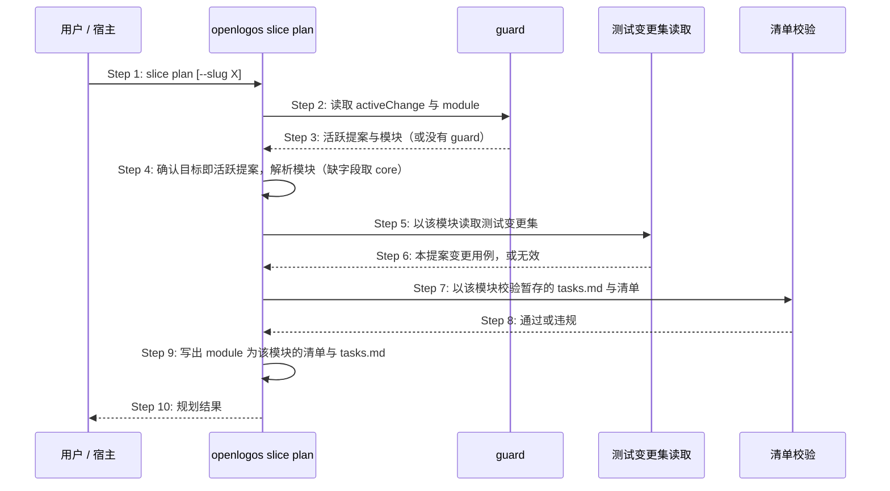

## ADDED — S32 切片规划的目标提案与模块（verify-scope-fields-and-slice-module）

> 来源变更：verify-scope-fields-and-slice-module（openlogos #7；proposal-r1 F2 处置）。规则权威见功能规格 §2.110、`spec/test-slice-manifest.md`「写入前置条件」。切片清单的 `module` 等于活跃 guard 的模块是既有规则，本节补上写入侧的时序与「目标不是活跃提案」的异常。

### 场景目标

`openlogos slice plan` 只为活跃提案规划切片，并用该提案登记的模块读取测试变更集、校验并写出切片清单，使清单与合并记录、verify 的比对口径一致。提案登记在非 `core` 模块时，规划后的验收不再因清单模块不符而暂停。

### 参与者

| 别名 | 组件 | 说明 |
|---|---|---|
| U | 用户 / 宿主 | 执行 `openlogos slice plan [--slug <slug>]` |
| P | `openlogos slice plan` | 规划并落盘 `tasks.md` 的 `[code]` 段与切片清单 |
| G | guard | `logos/.openlogos-guard`，记录活跃提案与模块 |
| T | 测试变更集读取 | 读取并校验 `SPEC_MERGED.test_change_set` |
| V | 清单校验 | 校验暂存的 `tasks.md` 与切片清单 |

### 前置条件

- 项目存在活跃提案，规格已合并（`SPEC_MERGED` 在场），提案目录有 `tasks.md`。
- 切片输入文件合法。

### 成功后置条件

- 切片清单的 `change` 为活跃提案、`module` 为该提案的模块；`tasks.md` 的 `[code]` 段与清单同时落盘。
- 目标不是活跃提案时两个产物保持原内容。

### 时序图

### 步骤说明

1. **用户 / 宿主** 执行 `openlogos slice plan`，可带 `--slug`（Step 1）。
2. **slice plan** 读取 guard（Step 2、3）。
3. **slice plan** 确定目标并解析模块（Step 4）：不传 `--slug` 时目标为 guard 的 `activeChange`；传了 `--slug` 时要求它等于 `activeChange`，否则拒绝（EX-32.38）。模块按提案模块取值规则（功能规格 §2.110.2）取值：guard 的 `module` 去掉首尾空白后非空则取该值，缺该字段或为空白时取 `core`（EX-32.40、EX-32.42）。本步在读取输入、暂存任何产物之前完成。
4. **slice plan** 以该模块作为期望值读取测试变更集（Step 5、6）。
5. **slice plan** 把即将生效的 `tasks.md` 与清单写入临时文件，以同一个模块作为期望值交给清单校验（Step 7、8）；校验失败时两个产物不动（既有规则）。
6. **slice plan** 写出清单，`module` 字段为同一个值，并替换 `tasks.md` 的 `[code]` 段（Step 9），返回结果（Step 10）。

### 异常与边界

#### EX-32.38：`--slug` 指向的不是活跃提案
- **触发条件**：`--slug X`，而 guard 的 `activeChange` 不是 `X`；或没有 guard、guard 无法解析。`X` 的提案目录与 `tasks.md` 可以存在。
- **期望响应**：以 `SLICE_PLAN_NO_ACTIVE_CHANGE` 失败，退出码 1，message 写明 `X` 不是活跃提案并给出当前活跃提案（没有时写明没有）；`--format json` 时 stderr 输出错误信封。
- **副作用**：无。`X` 的 `tasks.md` 与 `TEST_SLICE_MANIFEST.json` 逐字节不变，不留临时文件。

#### EX-32.39：提案登记在非 `core` 模块
- **触发条件**：guard 的 `module` 为 `backend` 等非 `core` 模块，`SPEC_MERGED.test_change_set` 的 `module` 相同。
- **期望响应**：规划成功，清单 `module` 为该模块；随后的 `openlogos verify` 不报 `test-slice-manifest-invalid`，进入切片 checkpoint。
- **副作用**：两个产物落盘。

#### EX-32.40：guard 缺 `module` 字段
- **触发条件**：guard 指向目标提案，但没有 `module` 字段（旧版 CLI 创建）。
- **期望响应**：模块取 `core`，行为与引入前相同。
- **副作用**：两个产物落盘。

#### EX-32.41：提案登记在 `core`
- **触发条件**：guard 的 `module` 为 `core`。
- **期望响应**：写出的 `tasks.md` 与清单与引入前相同（清单的 `generated_at` 除外）。
- **副作用**：两个产物落盘。

#### EX-32.42：guard 的 `module` 带首尾空白
- **触发条件**：guard 的 `module` 写成 `" backend "`。
- **期望响应**：写入侧取 `backend`，清单 `module` 为 `backend`；verify 的切片状态派生、范围计算与门禁读取切片清单和测试变更集时，都用同一取值规则得到 `backend`：不报 `test-slice-manifest-invalid`，门禁不出现 `test_change_set_invalid`，进入第一个切片的 checkpoint 并可 PASS。
- **副作用**：两个产物落盘。

### 追溯

- 需求：AC-VERIFY-FIELD-08～10。
- 功能规格：§2.110、§2.78.3。
- 读取侧的模块取值：`spec/test-slice-manifest.md`「读取侧使用同一取值规则」。
- 测试：`core-S32-test-cases.md`「S32 切片规划的目标提案与模块测试」（UT-S32-126～134）。
