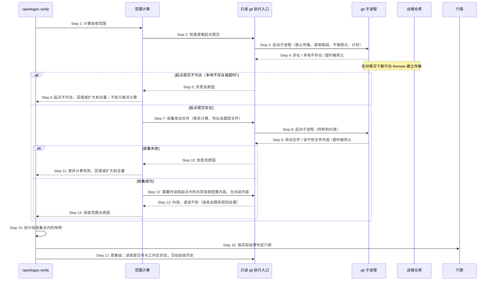

## MODIFIED — EX-10.5: 提案起点不可用
- **触发条件**：guard 缺 `baseRef`、项目不是 git 仓库、`baseRef` 不可达，或差异计算失败。其中：
  - `baseRef` 不可达包含：提交对象本地不存在（即使远端可以提供，也不取回）；检查该提交的调用超过时限。
  - 差异计算失败包含：提交在，但读不到差异计算所需的文件内容（不取回）；收集改动文件的调用超过时限。
- **期望响应**：回落全量，`fallback_reason.code` 依次为 `base_ref_missing`、`not_git_repository`、`base_ref_unreachable`、`diff_failed`。超时按失败的那一次调用归类：检查 `baseRef` 的调用超时为 `base_ref_unreachable`，且不再执行差异计算。本地缺少对象或超时时 `detail` 写明原因（功能规格 §2.111.4）。
- **副作用**：无。不连接远端，不向本地对象库写入。

## MODIFIED — EX-13.33：提案起点不可用
- **触发条件**：不是 git 仓库、guard 缺 `baseRef`、`baseRef` 不可达，或差异计算失败。`baseRef` 不可达与差异计算失败各自包含本地缺少对象且不取回、调用超过时限两种情形（同 EX-10.5）。
- **期望响应**：扩大到全量，原因 `base_ref_unavailable` 并附具体情形；本地缺少对象或超时时写明。扩大后的集合照常执行并判定门禁。
- **副作用**：无。不连接远端，不向本地对象库写入。

## ADDED — S13 验收期间的 git 调用只读本地（verify-git-local-only）

> 来源变更：verify-git-local-only（Team 需求池 openlogos #8）。规则权威见功能规格 §2.111；本节细化「S13 按模块限定范围的 verify」「S13 分层验收：提案级三层集合」「S13 发布级全量验收」中由 verify 发起的 git 调用，各场景的其余步骤不变。

### 场景目标

`openlogos verify` 自己启动的只读 git 调用不连接远端、不向本地对象库写入、不弹出提示，并且有时限。本地读不到所需对象或调用超时的时候，按失败的那一次调用落入既有的结果，验收照常完成。

### 参与者

| 别名 | 组件 | 说明 |
|---|---|---|
| CLI | `openlogos verify` | 提案级验收、发布级验收或发布查询 |
| Scope | 范围计算 | 按模块限定范围（§2.96.3）与分层验收的扩大规则（§2.109.7）共用的提案起点与改动文件判定 |
| Runner | 只读 git 执行入口 | 为每个 git 子进程施加三项约束（§2.111.2） |
| Git | git 子进程 | 只读本地对象库 |
| Remote | 远端仓库 | 可以按需提供对象；本场景中不应收到任何请求 |
| Gate | 门禁 | 按最终验收集合的实际结果判定 |

### 前置条件

- 项目是 git 仓库，存在活跃提案（发布查询与发布级验收不要求活跃提案）。
- 按模块限定范围已启用，或分层验收已开启，或执行的是发布级验收 / 发布查询。

### 成功后置条件

- 远端没有收到请求；本地对象库没有新增对象。
- 验收给出结论：能读到所需对象时与引入前相同；读不到或超时时落入既有的回落、扩大或拒绝。
- 没有任何调用等待超过其时限。

### 时序图

### 步骤说明

1. **CLI** 发起范围计算（Step 1）。
2. **范围计算** 经 **只读 git 执行入口** 检查提案起点提交是否存在（Step 2～4）。执行入口为子进程置空传输协议白名单、设置禁用按需取回的开关、禁止终端提示，并开始计时。
3. 起点提交本地不存在、或这次调用超过时限时，范围计算判为起点不可达（Step 5、6）：按模块限定范围回落全量（`base_ref_unreachable`），分层验收扩大到全量（`base_ref_unavailable`）；**不再执行差异计算**（EX-13.71、EX-13.73）。
4. 起点提交存在时，收集改动文件（Step 7～9）：差异计算与列出未跟踪文件，各自是一次受约束的调用。
5. 差异计算读不到所需的文件内容、或某次调用超过时限时，判为差异计算失败（Step 10、11）：按模块限定范围回落全量（`diff_failed`），分层验收扩大到全量（`base_ref_unavailable`）（EX-13.70、EX-13.74）。
6. 收集成功后，范围计算按需读取提案起点中的共享验收配置文件内容、合并基线记录的合并前内容（Step 12、13），读不到时按各自既有规则处理（EX-13.75）。
7. **CLI** 执行验收集合内的用例（Step 15），**门禁** 按实际结果判定（Step 16）：回落或扩大本身不判 FAIL（EX-13.76）。
8. 提案级验收中，**CLI** 经同一个执行入口读取提交号与工作区状态，把快照交给验收历史（Step 17）；`openlogos smoke` 的历史记录不走这条路径（EX-13.79）。发布级验收不执行这一步：历史记录归属于运行开始时前置检查固定的提交 A；收尾照既有发布门禁复核 HEAD 与工作区（提交变化或工作区有改动都判 `release_commit_changed`，EX-13.45）。前置检查与收尾复核的 git 调用经同一个执行入口，提交归属与门禁都不变（EX-13.80）。
9. 发布查询只执行其中解析提交的一步：`--commit` 指定的提交本地解析不出时照旧拒绝（EX-13.72）。

### 异常与边界

#### EX-13.70：差异计算读不到文件内容
- **触发条件**：本地有提案起点的提交，但缺少差异计算要读的文件内容；远端可以按需提供。
- **期望响应**：不取回。按模块限定范围回落全量，`fallback_reason.code="diff_failed"`；分层验收扩大到全量，原因 `base_ref_unavailable`；`detail` 写明本地缺少对象、验收不从远端取回。
- **副作用**：无。远端没有收到请求，本地对象库没有新增对象。

#### EX-13.71：提案起点的提交对象本地不存在
- **触发条件**：guard 的 `baseRef` 指向的提交对象本地不存在；远端可以提供。
- **期望响应**：不取回。按模块限定范围回落全量，`fallback_reason.code="base_ref_unreachable"`；分层验收扩大到全量，原因 `base_ref_unavailable`。不执行差异计算。
- **副作用**：无。

#### EX-13.72：发布查询指定的提交本地不存在
- **触发条件**：`openlogos verify --release --check --commit <sha>`，该提交本地不存在、远端可以提供；或解析该提交的调用超过时限。
- **期望响应**：以 `RELEASE_CHECK_COMMIT_INVALID` 拒绝，退出码 2。不回落、不执行任何用例、不写任何文件。
- **副作用**：无。远端没有收到请求。

#### EX-13.73：检查提案起点提交的调用超过时限
- **触发条件**：提案起点的提交实际存在，但检查它的调用超过时限。
- **期望响应**：该子进程被终止。结果同 EX-13.71（`base_ref_unreachable` / `base_ref_unavailable`），`detail` 写明超时与时限秒数；不执行差异计算。
- **副作用**：无。

#### EX-13.74：收集改动文件的调用超过时限
- **触发条件**：差异计算或列出未跟踪文件的调用超过时限。
- **期望响应**：该子进程被终止。结果同 EX-13.70（`diff_failed` / `base_ref_unavailable`），`detail` 写明超时与时限秒数。
- **副作用**：无。

#### EX-13.75：读取提案起点中的配置内容或合并前内容失败
- **触发条件**：收集改动文件成功，但读取提案起点中的共享验收配置文件内容、或合并基线记录的合并前内容时读不到，或调用超过时限。
- **期望响应**：都不取回，按各自的既有规则处理，结果不同：
  - 读取提案起点中的共享验收配置内容失败或超时：按整文件变化处理（EX-13.60）——按模块限定范围回落全量（`shared_config_changed`），分层验收扩大到全量（`shared_path_changed`）；
  - 读取合并前内容失败或超时：只有该测试用例文档按文件名记为 delta 触及（EX-13.66），其他文档照常比较，不因此扩大到全量。
- **副作用**：无。

#### EX-13.76：回落之后门禁按实际结果判定
- **触发条件**：因 EX-13.70、EX-13.71、EX-13.73 或 EX-13.74 回落或扩大到全量。
- **期望响应**：回落或扩大只改变验收集合，门禁按最终集合与既有规则、既有原因优先级判定。其他门禁条件都满足、没有优先级更高的原因时：全部自动化用例通过则 `gate.result="PASS"`；原本不在验收集合内、因扩大而执行的用例失败则 `gate.result="FAIL"`、`gate.reason="failed_cases"`。同时存在优先级更高的原因（如主链路用例偶发）时取那个原因。
- **副作用**：按既有规则写验收报告、历史与提案标记。

#### EX-13.77：Git 不识别禁用取回的开关
- **触发条件**：Git 早于 2.45；本地缺少验收要读的对象。
- **期望响应**：传输在建立之前被传输协议白名单拒绝。结果同 EX-13.70、EX-13.71。可能出现一个被启动又被拒绝的 fetch 子进程，不视为连接远端。
- **副作用**：无。远端没有收到请求，本地对象库没有新增对象。

#### EX-13.78：对象齐全
- **触发条件**：验收要读的对象在本地齐全，有关的 git 调用都在时限内正常完成，且原有条件允许缩小范围。
- **期望响应**：验收范围、原因、执行的命令与用例、门禁结论与引入前相同；仍能正常缩小范围。对象齐全但调用超过时限时不属于本条：检查起点提交或收集改动文件超时按 EX-13.73、EX-13.74 处理（全量）；读取起点配置内容或合并前内容超时按 EX-13.75 处理（前者按整文件变化回落或扩大到全量，后者只影响那一份文档）。
- **副作用**：与引入前相同。

#### EX-13.79：smoke 的历史记录
- **触发条件**：`openlogos smoke` 写历史记录。
- **期望响应**：读取提交号与工作区状态的调用不经只读 git 执行入口，环境变量、时限（10 秒、30 秒）与结果和引入前相同。
- **副作用**：与引入前相同。

#### EX-13.80：发布级验收期间 HEAD 发生变化
- **触发条件**：`openlogos verify --release` 在干净的提交 A 上开始，测试执行期间 HEAD 变为 B；或 HEAD 仍为 A，但有已跟踪文件被改写而未提交。
- **期望响应**：与引入前相同（EX-13.45）：历史记录的提交为运行开始时固定的 A，不因写历史而重新读取；收尾复核同时核对 HEAD 与工作区，两种情形都按既有发布门禁判 `release_commit_changed`。前置检查与收尾复核的 git 调用带三项约束。
- **副作用**：与引入前相同。

### 追溯

- 需求：AC-VERIFY-LOCAL-01～AC-VERIFY-LOCAL-08。
- 功能规格：§2.111、§2.96.6。
- 测试：`core-S13-test-cases.md`（UT-S13-309～UT-S13-322、ST-S13-57、ST-S13-58）。
