# S13: 运行测试验收并生成报告 — 时序图

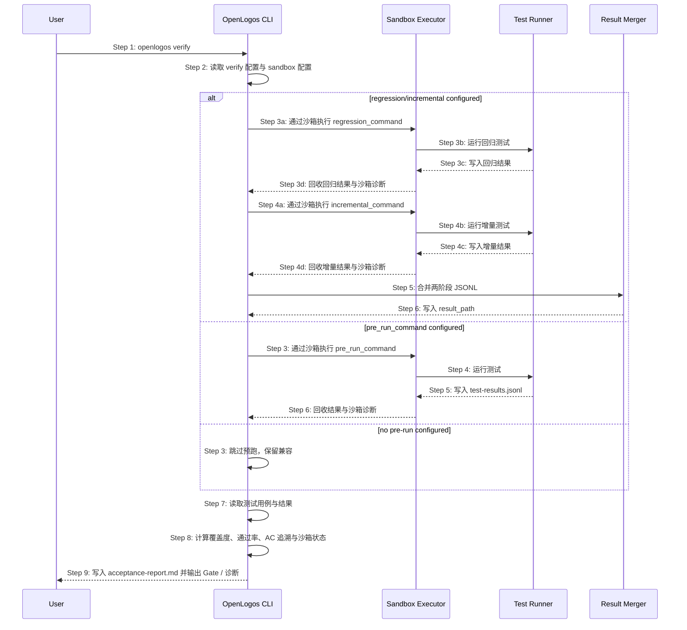

## 步骤说明

1. **用户**执行 `openlogos verify`。
2. **CLI** 读取 `logos.config.json` 的 `verify` 配置，包括预跑命令、结果路径与 `sandbox_mode`。
3. **CLI** 若检测到 `regression_command` 或 `incremental_command`，进入两阶段模型；若仅检测到 `pre_run_command`，走旧兼容路径；若都不存在，直接读取现有结果。
4. **Sandbox Executor** 根据 `sandbox_mode` 决定是否隔离执行：
   - `off`：保持历史行为。
   - `auto`：优先沙箱执行，无法隔离时降级并告警。
   - `always`：无法隔离或检测到非白名单写入时失败。
   - 复制 workspace 时保持 symlink 原始目标字面量，复制后执行 realpath containment 校验，存在逃逸链接按「无法隔离」处理；命令执行期间以 OS 级写保护（如 macOS `sandbox-exec` 拒写原 workspace 子树 / Linux mount namespace 只读绑定）保证运行期新建或改写的 symlink 也无法写入原 workspace，写保护不可用时按能力分层处理（见 EX-3.4 与功能规格 §2.9 symlink 隔离与运行期写保护不变量）。
   - 写入审计豁免沙箱内一次性依赖目录：规范化并统一分隔符后，存在**完整路径段严格等于** `node_modules` 的写入不参与非白名单判定，快照遍历直接跳过该目录（见 EX-3.3 与功能规格 §2.9）；近似名称（如 `node_modules-cache`）不豁免。
5. **测试运行器**写入阶段结果。阶段结果路径可由 `regression_result_path` / `incremental_result_path` 指定。
6. **Sandbox Executor** 只回收配置声明的结果文件，回收采用**定点采集**（对每个白名单路径在沙箱副本内存在即拷回，不依赖快照 diff），白名单路径位于豁免目录下亦照常回收；并返回沙箱诊断，依赖目录豁免生效时向 `sandbox.infos` 附一条信息级说明，不改变 `sandbox.status`、不进入 `pre_run.diagnostics`。
7. **结果合并器**将回归与增量结果合并到 `result_path`。同一用例 ID 多次出现时，按最新 `timestamp` 去重后生效（完整全序规则见「verify 结果账本一致性预检 → 规则」第 3 条；该 ID 存在任一缺失/非法时间戳时，整组退回文件行序 last-wins，等价旧行为）。
8. **CLI** 读取测试规格和合并后的结果。
9. **CLI** 计算验收指标，输出 PASS/FAIL，并在覆盖不足、预跑失败或沙箱失败时输出诊断。Gate 判据为四项（功能规格 §2.75.1）：**预跑命令全部成功**、账本一致、零失败、零未覆盖。单阶段 `pre_run_command` 或两阶段任一段非零退出时一律 FAIL，`gate.reason` 在账本含失败用例时取 `failed_cases`、否则取 `pre_run_failed`；预跑命令全部成功或未配置时保持既有顺序「`result_ledger_inconsistent` → `failed_cases` → `incomplete_coverage`」逐字不变。主原因之外的诊断照常输出（EX-9.1～EX-9.3、EX-9.6）。不再提示「Continuing verify with existing results.」。`--format json` 时 `pre_run.commands[]` 各条目附有界输出尾部 `stdout_tail` / `stderr_tail`（末尾最多 80 行、不超过 8 KiB、去除 ANSI 控制序列；截获不中断子进程、不改退出码，EX-9.4）；文本模式保持实时输出、不截获；`acceptance-report.md` 只记失败阶段与退出码，不写命令输出（EX-9.5）。

## 异常用例
### EX-4.1: 缺少测试结果
- **触发条件**：结果文件不存在。
- **期望响应**：输出错误并退出。

### EX-2.1: 两阶段与 pre_run_command 同时配置
- **触发条件**：`verify.pre_run_command` 与 `verify.regression_command` / `verify.incremental_command` 同时存在。
- **期望响应**：优先执行两阶段模型；在文本和 JSON 输出中标记 `pre_run_command` 被兼容保留但未执行。

### EX-5.1: 第二阶段清空第一阶段结果
- **触发条件**：增量测试 reporter 清空默认 `result_path`。
- **期望响应**：CLI 通过阶段化结果路径、临时快照或等价机制保留回归阶段结果，并在合并后写入最终 `result_path`。

### EX-3.1: sandbox always 无法隔离
- **触发条件**：`verify.sandbox_mode=always`，但当前环境无法创建沙箱。
- **期望响应**：verify FAIL，输出沙箱根目录、失败原因和修复建议；不得继续读取旧结果伪装通过。

### EX-3.2: 预跑命令写入仓库非白名单路径
- **触发条件**：`verify.sandbox_deny_workspace_write=true`，预跑命令写入仓库根目录中的非白名单路径（规范化后存在完整路径段严格等于 `node_modules` 的写入不参与本判定，见 EX-3.3；近似名称目录如 `src/node_modules-cache/**` 仍参与本判定）。
- **期望响应**：`always` 模式下 verify FAIL；`auto` 模式下若无法阻断写入必须输出 `sandbox.status=warn`，并给出改用 `always` 的建议。

### EX-3.3: 沙箱内依赖准备写入（依赖目录豁免）
- **触发条件**：`verify.sandbox_deny_workspace_write=true`，预跑命令仅写入沙箱副本内命中豁免规则的路径——规范化并统一分隔符后存在完整路径段严格等于 `node_modules`（含 monorepo 嵌套形态如 `packages/a/node_modules/**`）。典型来源：pnpm 11 `verifyDepsBeforeRun=install` 在沙箱副本内自动 install/repair，重写 `node_modules/.bin/*`。
- **期望响应**：任一沙箱模式下均不判为非白名单写入——`always` 不因此 FAIL，`auto` 不因此 warn；`sandbox.infos` 输出一条固定信息级豁免说明（依赖目录为沙箱内一次性目录，不参与写入审计，不会回收到工作区），`sandbox.diagnostics` 与 `pre_run.diagnostics` 不含该说明，文本输出以 `ℹ️` 渲染一次；`sandbox.status` 不因此改变；白名单之外的豁免路径不回收到原 workspace，快照遍历直接跳过；白名单结果文件即使位于 `node_modules` 下仍被定点采集回收。豁免规则之外的非白名单写入判定不变（仍按 EX-3.2 处理）。

### EX-3.4: 沙箱副本内 symlink 逃逸（启动前拓扑 + 运行期动态逃逸）
- **触发条件（启动前）**：workspace 复制进沙箱后，沙箱 workspace 内存在解析目标位于沙箱之外（含原 workspace）的 symlink——例如 monorepo 的 `node_modules/pkg -> ../packages/pkg` 被复制语义改写为指向原 workspace 的绝对路径，或项目本身含绝对目标外链。
- **期望响应（启动前）**：逃逸链接按「无法隔离」处理：`always` 模式下命令失败，输出逃逸链接路径与修复建议；`auto` 模式下降级为非隔离执行并告警（`sandbox.status=warn`）。逃逸链接不进入依赖目录豁免；复制必须保持内部相对链接的相对语义，保证内部链接不构成逃逸。
- **触发条件（运行期）**：预跑命令在通过启动前校验之后，于沙箱内（含 `node_modules` 下）**新建**指向沙箱外的 symlink，或把已通过校验的内部链接 **retarget** 到原 workspace，再经该链接写入。install/repair 类命令重建依赖 symlink 属正常行为，本情形不限于恶意构造。
- **期望响应（运行期）**：由 OS 级运行期写保护在**写入发生前**阻断（文件系统层拒绝对原 workspace 子树的写入）——任一模式下原 workspace 必须保持字节不变，写入尝试失败由命令自身报错体现；不得以依赖目录豁免静默通过。运行期写保护机制不可用时按能力分层处理：`always` 模式命令失败并说明「无法启用运行期写保护」；`auto` 模式继续沙箱执行但 `sandbox.status=warn` 并披露残留风险。仅命令后复查不满足本用例——写入已发生则无法挽回。

### EX-8.1: 覆盖不足且无预跑配置
- **触发条件**：未配置任何预跑命令，且存在未覆盖用例。
- **期望响应**：verify FAIL，输出覆盖不足列表，同时提示可能只运行了局部测试，并建议配置 `verify.pre_run_command`、`verify.regression_command` 或启用 verify 沙箱以隔离完整测试执行。

### EX-9.1: 单阶段预跑命令失败且账本被回滚为旧的完整结果

- **触发条件**：`verify.pre_run_command` 以非零状态退出；测试运行器在失败后把 `result_path` 回滚为上一份完好账本（RunLogos `scripts/run-vitest.js` 的既有行为，2026-10-06、2026-10-09 两次事故形态），或账本恰好完整、全部通过。
- **期望响应**：Gate FAIL，`gate.reason` 为 `pre_run_failed`（修改前分别误报为 `result_ledger_inconsistent` 或直接 PASS）；`pre_run.commands[0]` 如实记录 `status:"fail"` 与 `exit_code`；账本一致性与未覆盖诊断照常输出，不作为主原因。
- **副作用**：`acceptance-report.md` 记录失败阶段 `pre_run` 与退出码，不写命令输出；不写 `VERIFY_PASS`。

### EX-9.2: 预跑命令失败且账本含失败用例

- **触发条件**：预跑命令非零退出，结果账本中存在 `status:"fail"` 的用例。
- **期望响应**：Gate FAIL，`gate.reason` 仍为 `failed_cases`（更具体、可直接定位），`failed_cases` 照常列出；`pre_run.commands[]` 如实记录该段失败。账本同时不自洽时仍取 `failed_cases`（预跑失败分支），`consistency` 照常输出。
- **副作用**：同 EX-9.1。

### EX-9.3: 两阶段中任一段失败

- **触发条件**：`regression_command` 或 `incremental_command` 任一段以非零状态退出（另一段成功或未配置）。
- **期望响应**：与单阶段同一判据——Gate FAIL，原因按 §2.75.1 优先级取值；`pre_run.commands[]` 中失败段 `status:"fail"`、成功段 `status:"pass"`，两段结果照常合并到 `result_path`。
- **副作用**：报告记录失败的阶段名（`regression` / `incremental`）与退出码。

### EX-9.4: 预跑命令输出超过截获上限

- **触发条件**：`--format json` 下预跑命令输出远超 80 行或 8 KiB（含 ANSI 控制序列），或在沙箱中执行。
- **期望响应**：子进程完整运行至自然结束，不因输出量被提前终止；退出码如实记录；`stdout_tail` / `stderr_tail` 只保留末尾最多 80 行且不超过 8 KiB，截断落在完整 UTF-8 字符边界，ANSI 控制序列被去除。沙箱与非沙箱执行同一口径。
- **副作用**：无；输出全文不落盘。

### EX-9.5: 命令输出不进入验收报告

- **触发条件**：任一预跑命令失败，或 `--format json` 截获了输出尾部。
- **期望响应**：`acceptance-report.md` 只含失败阶段与退出码，不含 `stdout_tail` / `stderr_tail` 或任何命令输出片段；文本模式下命令输出实时打到终端，不被截获。
- **副作用**：无。

### EX-9.6: 预跑成功时失败用例与账本不一致并存

- **触发条件**：预跑命令全部以零状态退出（或未配置任何预跑命令），结果账本既含 `status:"fail"` 的规格用例，又不自洽（如含未知 ID 或计数不符）。
- **期望响应**：保持既有优先级，`gate.reason` 为 `result_ledger_inconsistent`（与修改前逐字一致），`failed_cases` 与 `consistency` 照常输出；本提案的新优先级只在预跑命令失败时生效。
- **副作用**：无。

## verify 结果账本一致性预检

在 Step 7 读取测试用例与结果之后、Step 8 计算验收指标之前，`openlogos verify` 必须执行结果账本一致性预检：

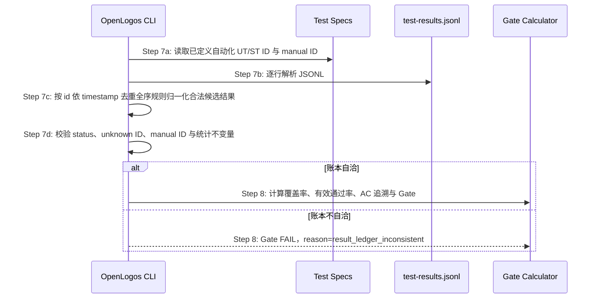

### 规则

1. `status` 只能为 `pass`、`fail`、`skip`；其它值必须进入一致性错误，不得计入 PASS。
2. 结果 ID 必须属于已定义自动化用例；未定义 ID 和 `[manual]` ID 都必须进入一致性错误。
3. 同一用例 ID 多条记录按最新 `timestamp` 去重（取代旧「文件行序 last-wins」，属 contract-self-description 主动语义变更），全序规则（`timestamp` 是可选字段，必须消除歧义）：
   1. 逐条严格解析 `timestamp`（ISO 8601，时区归一为绝对时刻）；非法格式按「缺失」处理；
   2. 该 ID 全部合法 → 绝对时刻最新优先；同刻（含异时区同刻）→ 文件行序后者优先；
   3. 该 ID 存在任一缺失/非法 → 整组退回文件行序 last-wins（等价旧行为，不做时间猜测——不对不完整证据做时间猜测，对齐宁慢勿错杀原则，也保证旧 reporter 产物零行为变化）。
4. 去重后的统计必须满足 `passed + failed + skipped == executed` 和 `executed <= defined`。守恒不变量（executed≤defined 等，既有 `consistency` 契约不变）在去重后计算。
5. `skip` 是合法的环境性跳过结果，计入 executed / covered / skipped，并在报告中展示，但不作为失败结果。
6. 通过率必须使用有效通过数计算：`pass_rate_pct = round((passed + skipped) / executed * 100)`。
7. 当 `failed == 0` 时，`passed + skipped` 必须等于 `executed`；否则说明存在幽灵结果，Gate 必须 FAIL。
8. Gate PASS 条件为：一致性通过、无 fail、无 uncovered、checklist 完成、AC 追溯完成。合法 skip 不得单独导致 `skipped_cases` 失败。
9. 一致性错误优先级高于覆盖率 / AC 追溯的普通失败诊断，因为结果账本不可信时覆盖率和通过率都不可作为放行依据。

### 诊断

- `invalid_test_result_json`：JSONL 行不可解析或不是对象。
- `invalid_test_result_schema`：缺少 `id` / `status`，或 `fail` 缺少 `error`。
- `invalid_test_result_status`：`status` 不属于 `pass` / `fail` / `skip`。
- `unknown_test_result_id`：结果 ID 不在自动化测试规格中。
- `manual_test_result_id`：结果 ID 对应 `[manual]` 用例。
- `result_count_mismatch`：统计守恒不成立。
- `executed_exceeds_defined`：执行数大于定义数。

## EX-7.1: 结果账本统计不自洽

- **触发条件**：去重后的结果集合出现 `passed + failed + skipped != executed`、`executed > defined`，或 `failed=0 && passed + skipped != executed`。
- **期望响应**：verify FAIL，`gate.reason` 为 `result_ledger_inconsistent` 或等价具体错误码；JSON 输出包含 `consistency.ok=false` 与具体不变量失败原因；不得写入 `VERIFY_PASS`。

## EX-7.2: JSONL 含非法结果状态

- **触发条件**：某条结果记录的 `status` 不是 `pass`、`fail` 或 `skip`。
- **期望响应**：verify FAIL，诊断 `invalid_test_result_status`；该记录不得被算作通过、失败或跳过，也不得让 Gate PASS。

## EX-7.3: JSONL 含未定义或 manual 用例 ID

- **触发条件**：结果记录 ID 不存在于自动化测试规格，或对应 `[manual]` 用例。
- **期望响应**：verify FAIL，诊断 `unknown_test_result_id` 或 `manual_test_result_id`，并列出相关 ID；不得因为 defined 用例均 pass 就忽略额外污染结果。

## EX-7.4: 合法 skip 不阻塞 verify Gate

- **触发条件**：已定义自动化用例全部被覆盖，其中部分结果为 `status:"skip"`，且无 `fail`、无 unknown ID、无 manual ID、无 schema 错误。
- **期望响应**：verify PASS；`skipped_count` 与 `skipped_cases` 正常展示；`pass_rate_pct` 为 100；不得返回 `gate.reason="skipped_cases"`。

## EX-7.5: 同一用例 ID 多条记录按 timestamp 去重

- **背景**：contract-self-description（C6）将同 ID 去重从「文件行序 last-wins」改为「按最新 `timestamp` 去重」。守恒不变量在去重后计算，既有 `consistency` 契约不变。
- **触发条件与期望响应**（测试必须覆盖混合情况）：
  1. **乱序追加**：该 ID 全部记录时间戳合法、但文件行序与时间顺序不一致 → 按绝对时刻比较取最新记录生效；
  2. **异时区同刻**：不同时区表示的同一绝对时刻（如 `2026-07-17T10:00:00+08:00` 与 `2026-07-17T02:00:00Z`）→ 视为同刻，文件行序后者优先；
  3. **缺失+合法混排**：该 ID 存在任一缺失 `timestamp` 的记录 → 该 ID 整组退回文件行序 last-wins（等价旧行为，旧 reporter 产物零行为变化）；
  4. **非法格式**：`timestamp` 存在但非合法 ISO 8601 → 按「缺失」处理，同上整组退回文件行序 last-wins。
- **副作用**：去重仅决定同 ID 的生效候选；一致性校验、守恒不变量与 Gate 规则在去重后照常计算，不因去重规则变化而放宽。

## smoke 覆盖预检步骤

在 Step 7 读取测试用例与结果之后、Step 8 计算验收指标之前，`openlogos verify` 或 code completion gate 应增加 smoke 覆盖预检：

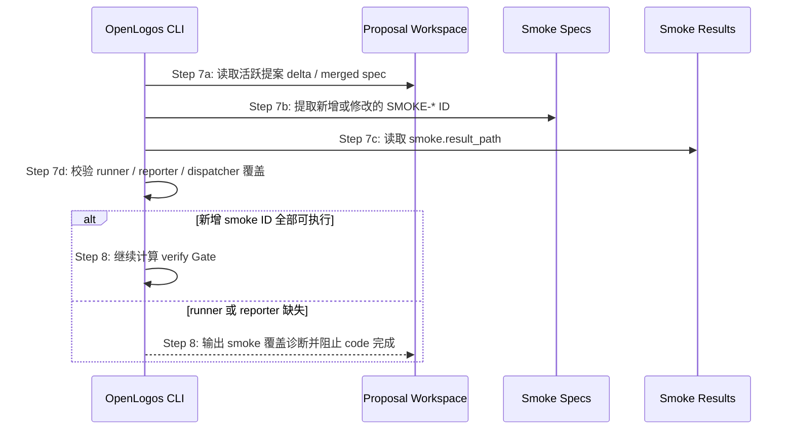

### 规则
1. 预检只针对当前提案新增或修改的 smoke 用例；历史未执行 smoke 用例仍由部署后 `openlogos smoke` 统一判定。
2. 新增 smoke 用例 ID 来自 `logos/changes/<slug>/deltas/test/smoke/*.md`，merge 后也可从 `logos/resources/test/smoke/*.md` 与变更范围推导。
3. 若新增 `SMOKE-*` ID 没有对应执行结果，且无法发现 runner/dispatcher 接入证据，预检必须返回失败诊断。
4. 预检不得伪造 `SMOKE_PASS` / `SMOKE_FAIL`，不得替代部署后 `openlogos smoke`。

### 诊断
- `smoke_runner_missing`：找不到当前提案新增 smoke 用例对应 runner 或 dispatcher 注册。
- `smoke_reporter_missing`：runner 存在但没有写入 `smoke.result_path`。
- `smoke_cases_uncovered`：结果文件存在但缺少新增 `SMOKE-*` ID。

## verify 结果与 reporter 证据分层

### 目标

`openlogos verify` 的结果必须支持自动 driver 区分局部切片证据与全量回归结论。focused tests / reporter pass 证明某个切片的指定测试已执行通过；acceptance report 的全量失败证明仍需要 repair。二者不是互斥关系。

### 时序补充

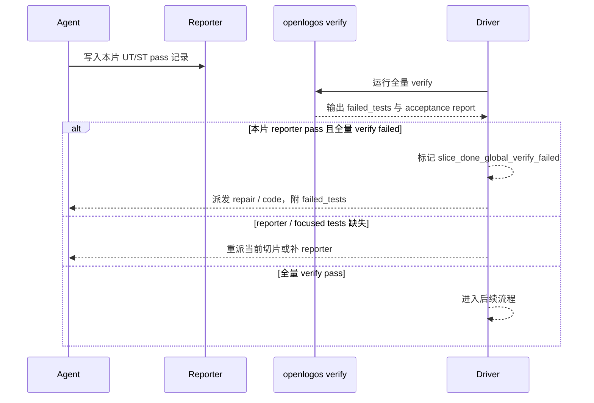

### 规则

- `test-results.jsonl` 中存在本片要求的 test ID 且均 pass 时，可作为本片 focused tests 通过证据。
- acceptance report 中存在失败用例时，应输出 `global-verify-failed` 与失败用例列表。
- 本片 focused tests pass + global verify failed 时，不得输出 `claimed-done-but-unverified`。
- verify JSON / report 应为 driver 暴露足够字段，避免 driver 解析自然语言报告。

### 异常路径

- reporter 缺失对应 test ID：输出 `reporter-missing` 或 `focused-tests-missing`。
- acceptance report 失败但没有失败测试列表：输出 `global-verify-failed` 并附 `driver-cannot-validate-artifacts` 或等价诊断，提示补充结构化失败证据。

## verify 诊断与后续前沿传播边界

`openlogos verify --format json` 可以在本次验收失败时输出 `automation_diagnostic`，包括 `global-verify-failed`、失败测试列表、缺失 reporter、缺失 focused tests 等结构化原因。该诊断用于解释 verify 结果，并为实现/验证闭环中的 repair 提供输入。

verify 诊断不得无条件传播到后续 `status` / `next` 的所有前沿。传播规则如下：

1. 若当前活跃提案仍处于 plan/spec/merge/slice 未完成前沿，历史 verify 诊断只能作为只读背景信息或被省略，不得覆盖当前前沿。
2. 若当前活跃提案处于 `coding`、`ready-to-verify` 或 `verify-failed`，且存在本轮切片 artifacts、reporter 与 focused tests 证据，`global-verify-failed` 可以驱动 repair/code。
3. 若失败证据属于上一提案、上一轮已离开的 flow 阶段或过期 acceptance report，`status` / `next` 不得把它提升为当前提案的 `suggested_next_node:"code"`。

该边界不削弱 verify 本身的诊断能力；它只限制诊断在非当前前沿中的跨阶段抢占。

## 切片 checkpoint 与 final verify 时序

### 目标

在多切片实现期只验收当前可交付集合，并在全部切片通过后执行最终全量验收；任何模式都不得伪造未来测试结果。

### 参与者

- 用户或自动化宿主
- OpenLogos CLI
- SliceVerificationService
- 测试 runner / OpenLogos reporter
- manifest、checkpoint、marker 与 loop 账本

### 前置条件

- 活跃 launched 提案已完成 spec-complete 与切片规划。
- `TEST_SLICE_MANIFEST.json` 有效；若无效则转 S28/S32 恢复路径。
- 测试规格中的 UT/ST/SMOKE ID 已定稿。

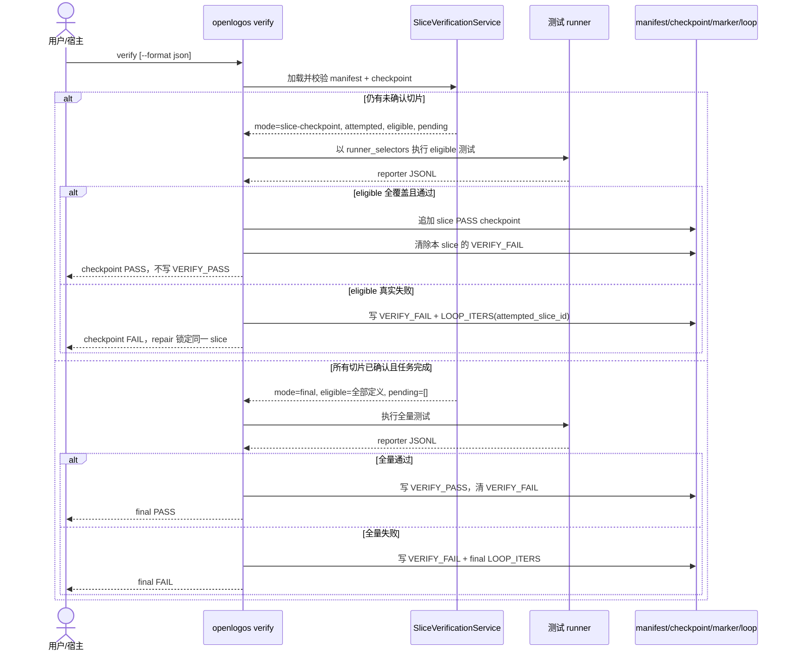

### 步骤说明

1. verify 在运行任何测试前校验 manifest 和 fingerprint。
2. 服务以有效 PASS checkpoint 恢复 attempted slice，不读取“下一未勾 checkbox”决定身份。
3. checkpoint 运行基线回归、已确认切片与 attempted slice；未来切片只进入 pending。
4. CLI 按 eligible 集合执行既有结果合法性、去重、覆盖和通过率硬门。
5. checkpoint PASS 仅追加检查点；final PASS 才写最终 marker。

### 异常与边界

- manifest 缺失/可恢复失效：测试不启动，转 `plan-slices`，不写失败事实。
- reporter 出现 pending ID：视为结果越界并失败，不把它吸收入 eligible。
- checkbox 已勾但 checkpoint 未通过：attempted identity 保持不变。
- checkpoint 重试得到相同 PASS：幂等，不追加重复有效事实。
- final 发现任何未覆盖 ID：全量失败，绝不改列 pending。

### 追溯

- 需求：S13/S16/S27/S31 多切片验收边界。
- 规格：功能规格 §2.37；`spec/test-slice-manifest.md`。
- 测试：UT-S13-56～UT-S13-64、ST-S13-15～ST-S13-17。

## S13 权威测试 ID 语法放宽后的 defined 集合与覆盖度口径

### 场景目标

明确测试 ID 语法放宽后，verify 的 `defined` / `eligible` / `pending` 集合如何变化，以及覆盖度判据为何不因分母变大而放宽。

### 参与者与前置条件

| 别名 | 组件 | 说明 |
|---|---|---|
| V | `openlogos verify` | 验收门 |
| E | `extractDefinedVerificationIds` | 从已合并测试规格提取可验收 ID |
| G | 测试 ID 语法权威 | 表格首列读法的唯一来源 |

前置：已合并测试规格中存在 11 个 `UT-JSON-*` / `ST-JSON-*` 表格首列 ID（全部在 `core-S16-test-cases.md`）。

### 集合变化时序

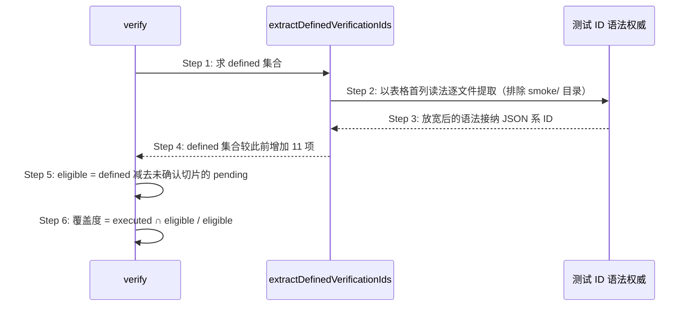

**Step 4 的变化方向只增不减**：不存在此前进入 defined、此后被排除的 ID。

**Step 6 的判据不变**：覆盖度与通过率的公式、100% 的门槛、`failed==0` 的要求全部保持。分母变大意味着**这 11 个用例此后必须真实执行并报告**——它们对应的测试代码本就存在（`cli/test/s16-json-output.test.ts` 引用 37 处），此前只是没被计入统计。

### 为何这是修复而非加严

这些用例一直在跑、也一直在通过，只是 verify 看不见它们：

| | 此前 | 此后 |
|---|---|---|
| 测试代码是否执行 | 是 | 是 |
| 是否计入 defined | **否** | 是 |
| 改动是否受切片归属约束 | **否** | 是 |
| 缺失时是否被 verify 发现 | **否** | 是 |

所以放宽语法不是把标准降低，而是**把一批一直在暗处的用例纳入统计口径**。若其中某条实际未被执行，verify 会立刻报为未覆盖——那是它本就该被发现的状态。

### 不变量

1. `defined` 集合的提取判据只有一处，即权威语法的表格首列读法。
2. 语法放宽只增不减；ID 一旦进入 defined 集合，不得因语法调整而静默移出。
3. 覆盖度与通过率的判据不因分母变化而放宽。
4. `smoke/` 目录仍被排除在 `defined` 之外——smoke 由独立的 Gate 3.8 统计。

### 异常与边界

- 放宽后某 JSON 系 ID 未被任何测试报告：verify 判其未覆盖并阻断，这是正确行为。
- 该批 ID 无场景号，不影响切片归属——归属以切片的 `owned_test_ids` 为准，不依赖 ID 中的场景编号。

### 追溯

- 需求：AC-MERGEGATE-08、AC-MERGEGATE-09。
- 功能规格：§2.51.7；架构：§四十一.6.1。
- 测试：UT-S13-65～UT-S13-66、ST-S13-18。

## S13 人工用例判据的声明位与一致性判据的输入

### 场景目标

本节把两件事各自钉到一个判据上：**「某 ID 是不是人工用例」只看标记的声明位**，
**「账本是否自洽」只看精确计数**。前者此前有两套读法，后者此前消费的是舍入后的展示值，
两者叠加使一个零失败、100% 覆盖的下游提案被 Gate 3.5 拒收。

### 参与者与前置条件

| 别名 | 组件 | 说明 |
|---|---|---|
| V | `openlogos verify` | 验收门与统计器 |
| M | manual 判定 | 判断某表格行是否声明为人工用例 |
| C | 计数一致性判据 | `buildVerifyCountMismatches` 一族 |
| R | 验收报告渲染 | `acceptance-report.md` 的 Summary |

前置：已合并测试规格中存在一条**首格干净、描述列含裸 `[manual]` 字面量**的自动化用例
（典型情形：「manual 标记排除」这条能力自己的元用例），且其结果已按正常路径写入账本。

### 判定时序

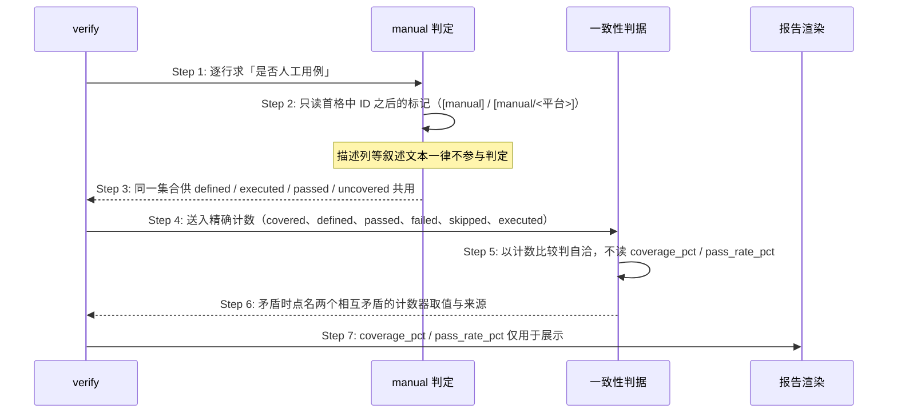

**Step 2 的方向只收不放**：收敛后被排除的集合是收敛前的**子集**——原先因整行匹配而被误排除的
用例回到统计口径内，真人工用例的判定逐字不变。

**Step 5 与 Step 7 的分工是本节的要点**：判定消费事实，展示消费格式化后的值；
一旦判定去读展示值，`Math.round` 就会把「差一条未覆盖」这种自洽状态塌缩成矛盾。

### 为何这是修复而非加严

被误排除的那条用例一直在跑、也一直在通过，只是统计口径把它当人工用例丢掉了：

| | 此前 | 此后 |
|---|---|---|
| 测试代码是否执行 | 是 | 是 |
| 是否计入 `defined` | 视判据而定（两套读法互相矛盾） | 是（单一判据） |
| 是否计入 `executed` | **否**（被整行匹配排除） | 是 |
| 是否计入 `passed` | 是（该计数器不过滤） | 是 |
| Gate 结论 | ❌ 账本自相矛盾 | 按真实通过率判定 |

所以收敛判据不是降低标准，而是**让四个计数器数同一件事**。

### 不变量

1. **声明位唯一**：人工用例的标记只在测试用例表**首格** ID 之后声明；其余列出现的标记字面量是
   叙述文本，不参与判定。
2. **判定单一事实源**：`defined` / `executed` / `passed` / `skipped` / `uncovered` 与报告渲染
   消费同一个判定函数；任一计数器自带一套读法即为回归。
3. **只收不放**：收敛后的人工集合必须是收敛前的子集；不得有任何原先计入统计的 ID 被新判据排除。
4. **一致性判据只消费精确计数**：覆盖与通过的自洽判定用计数比较；把展示精度改成任意位数
   都不得改变任何判定结论。
5. **判定强度零放宽**：结果含未定义 ID 或人工 ID、真实计数不等、存在未覆盖用例，
   这些情形仍按既有诊断码判 FAIL。
6. **矛盾必须可自证**：报告内部矛盾时，诊断点名两个相互矛盾的计数器**取值与来源**，
   不得只给一个笼统结论——否则 CLI 自身的算术分叉会被归咎于下游账本。

### 异常与边界

#### EX-7.6: 首格干净、描述列含裸标记字面量

- **触发条件**：某自动化用例首格为纯 ID，描述列出现裸 `[manual]` 字面量。
- **期望响应**：该 ID 正常计入 `defined` 与 `executed`，`passed + failed + skipped == executed`；
  Gate 按真实通过率判定，不产出任何计数矛盾诊断。
- **副作用**：无。

#### EX-7.7: 覆盖差一条而真实覆盖率四舍五入为 100%

- **触发条件**：`covered == defined - 1` 且 `defined` 足够大（真实覆盖率 ≥ 99.5%）。
- **期望响应**：判 `uncovered_count == 1` 并逐个点名，**不得**产出
  `coverage_full_with_uncovered`——那条判据的输入必须是计数而非舍入后的百分比。
- **副作用**：无；展示仍可显示 100%（展示与判定分离）。

#### EX-7.8: 真人工用例的判定不得被收敛波及

- **触发条件**：首格带 `[manual]` 或 `[manual/<平台>]`。
- **期望响应**：仍被排除在 `defined` 与 `executed` 之外；若其 ID 出现在结果中，
  仍按既有 `manual_test_result_id` 判 FAIL。
- **副作用**：无。

#### EX-7.9: 修复未进入安装态

- **触发条件**：仓内源码已修，但本机全局安装态仍是旧版本。
- **期望响应**：安装态 smoke 判 FAIL——下游消费的是安装态，源码修好不等于阻塞解除。
- **副作用**：无；回滚为重装上一版本。

### 追溯

- 需求：`AC-VERIFY-MANUAL-01～04`、`AC-VERIFY-COUNT-01～03`。
- 同源章节：本文档 >「verify 结果与 reporter 证据分层」、
  >「S13 权威测试 ID 语法放宽后的 defined 集合与覆盖度口径」。
- 测试：`core-S13-test-cases.md`（UT-S13-69 起、ST-S13-20 起）；
  部署后 smoke：`core-smoke-test-cases.md`（SMOKE-core-208 起）。

## S13 沙箱复用与增量同步时序

> 来源变更：verify-sandbox-reuse-0-16-1（决策 C01～C05）；功能规格 §2.91。本节细化 S13 主时序 Step 3～6 中「Sandbox Executor」在 `sandbox_reuse` 生效时的内部步骤；主时序其余步骤、门禁判据与 EX-3.1～EX-3.4、EX-9.x 不变。

### 场景目标

`verify.sandbox_mode` 为 `auto` / `always` 且 `verify.sandbox_reuse` 未设为 `false` 时，预跑命令在**每项目一份的持久沙箱**中执行：路径稳定、mtime 保真、构建产物留存，让项目构建工具的增量编译生效；隔离不变量与一次性沙箱逐条相同。

### 参与者

- **CLI**：`openlogos verify`。
- **Sandbox Executor**：`runSandboxedCommand`。
- **Lock**：持久沙箱项目目录下的 `lock/` 世代锁记录。
- **Workspace Generation**：当前工作区世代 `ws-<世代号>/`（`workspace/` + `sync-manifest.json`）。
- **Test Runner**：项目的预跑命令及其构建工具。

### 时序

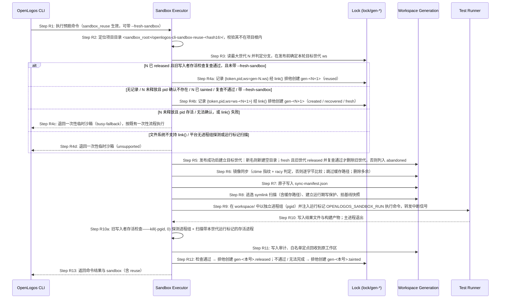

### 步骤说明

1. **R1**：两阶段模型下回归、增量两段各走一次本时序；第二段命中第一段刚释放的世代（`reused`）。
2. **R2**：项目目录名取项目根 realpath 的 SHA-256 前 16 位十六进制；位于项目根内时按「无法创建沙箱」处理（EX-3.10）。
3. **R3～R4**：世代锁规则见功能规格 §2.91.6。目标世代在发布前确定并随锁记录一起原子发布，`gen-<N+1>.ws` 即本轮实际使用的世代；发布后不再改写锁记录。已用世代号永久占位，锁记录在 CLI 中从不删除、不复用、不压缩；获取以 `link()` 排他创建成功为准。
4. **R5**：目录操作只在发布成功后进行。`--fresh-sandbox` 删除旧世代的条件与 `reused` 判定同一（`released` 且旧写入者存活检查复查通过），否则保留并列入 `abandoned`（EX-3.9）。发布后、同步完成前中断时，下次按「未释放且 pid 确认不存在」新建世代（EX-3.7）。
5. **R6～R7**：同步规则见功能规格 §2.91.4，内容同步后对 `mode`、`mtime` 不一致的副本原位整定（不重写字节、不换 inode），整定后才记录指纹。verify 已在 R1 之前清空结果文件，清空状态经同步进入沙箱；只复用旧写入者存活检查通过（进程组已空且无带该世代运行标记的存活进程）的世代，上次运行及其后代写出的结果不会被回收为本次结果（EX-3.7、EX-3.8）。
6. **R8～R11**：与一次性沙箱完全相同——逃逸 symlink 按「无法隔离」处理（EX-3.4，持久世代内残留的同样适用），运行期写保护按能力分层，非白名单写入（含缓存路径内的写入）`auto` 告警、`always` 失败，依赖目录豁免不变，白名单定点回收不变。
7. **R9～R12**：命令置于独立进程组并注入运行标记，CLI 收到的 SIGINT / SIGTERM / SIGHUP 转发给该组。主进程退出后做旧写入者存活检查：通过写 `released`；进程组仍有成员（如关闭继承 stdio 的后台进程）、扫描到带运行标记的存活进程（如 `setsid` / `detached` 脱组的后台进程）或无法完成检查写 `tainted`，不杀进程、不删目录，下一轮新建世代（EX-3.7）。命令失败、审计失败也照此释放；CLI 被强杀则不释放，下次运行按「未释放且 pid 确认不存在」新建世代。
8. **R13**：`sandbox.reuse` 字段见 `spec/cli-json-output.md`「verify / smoke `sandbox.reuse` 沙箱复用字段」；复用摘要经 `sandbox.infos` 以 `ℹ️` 输出一行，不影响 `sandbox.status`。

### 异常用例

#### EX-3.5: 等长改写且 mtime 被保留

- **触发条件**：① 工作区源文件被等长改写，mtime 与权限保持不变（如保留时间戳的恢复 / 复制）；② 上轮命令在沙箱副本中等长改写源文件并恢复其 mtime。
- **期望响应**：两种情形下该文件的 `ctime` 均已变化，与同步清单不符，必然进入逐字节内容比较并以工作区内容覆盖；本轮命令读到的是工作区的实际内容。仅凭大小 + mtime 跳过复制的实现在此必红。

#### EX-3.6: 两个进程竞争同一世代

- **触发条件**：① 两个进程同时读到同一个「未释放且持有者已死」的最大世代 N 并交错获取；② 三方交错：A 读到已释放的世代 N 后暂停于 `link()` 前，B 取得并释放 N+1，C 取得 N+2 并运行，随后恢复 A。
- **期望响应**：① 至多一方 `link(gen-<N+1>)` 成功，另一方 `busy-fallback`；② A 的 `link(gen-<N+1>)` 命中已存在编号而失败，按占用退回一次性沙箱；任何时刻同一工作区世代至多一个持有者；`lock/` 下已用编号的记录全部保留；旧持有者的释放不能使新持有者的锁失效。

#### EX-3.7: 旧写入者跨轮残留

- **触发条件**：① 上一轮 CLI 被超时强杀或单独终止，其测试 / 编译子进程仍在旧世代内写入，锁未释放、持有者 pid 已不存在；② 上一轮命令主进程正常退出，但启动了后台进程——②a 关闭继承 stdio、仍在命令进程组内；②b 以 `setsid` / Node `spawn(..., {detached:true, stdio:"ignore"})` 并 `unref` 脱离进程组——该进程在下一轮清空结果之后、回收之前向结果路径写入旧的全 pass 账本；③ 发布锁记录后、目标世代同步完成前 CLI 被杀。
- **期望响应**：① 上一世代未释放且 pid 确认不存在；② 上一轮主进程退出后的旧写入者存活检查不通过——②a 进程组仍有成员，②b 进程组已空但运行标记扫描命中脱组后代——释放写为 `tainted`；若后代在释放时尚未被调度、释放后才出现，下一轮发布前的复查同样命中；③ 同 ①。三者本轮均以新世代号获取锁，锁记录 `ws` 即新建的空工作区世代，全量同步（`recovered`），对旧世代不同步、不改写、不删除；旧世代（③ 中若半成品目录已存在）列入 `sandbox.reuse.abandoned` 并在文本输出提示确认无进程使用后手动清理；旧写入者写出的结果只落在旧世代，不会被回收为本轮结果——② 中本轮命令不写结果时，门禁必须 FAIL。执行器不终止残留进程。

#### EX-3.8: 上轮结果文件残留在沙箱

- **触发条件**：上一轮命令在沙箱中写过结果文件；本轮命令异常，未写任何结果。
- **期望响应**：verify 预先清空的结果文件经同步覆盖沙箱副本，回收得到的是空结果；门禁按空结果判定（如 `pre_run_failed` / `incomplete_coverage`），不会因旧结果而 PASS。

#### EX-3.9: `--fresh-sandbox` 与占用 / 非正常退出

- **触发条件**：带 `--fresh-sandbox` 执行 verify，分别处于：锁已释放；锁被存活进程持有；上一轮非正常退出且后代仍在写。
- **期望响应**：锁已释放（`released` 且旧写入者存活检查复查通过）→ 锁记录 `ws` 写为新世代名后发布，新建空世代全量同步，发布成功后删除被替换的旧世代，`state=fresh`，下一轮普通运行读到的锁记录 `ws` 即该新世代并 `reused`；锁被占用 → `busy-fallback`，不删除任何世代；非正常退出、`tainted` 或复查不通过 → 新建空世代，旧世代保留并列入 `abandoned`。

#### EX-3.10: 无法复用的环境

- **触发条件**：① 持久沙箱项目目录位于项目根之内；② `sandbox_root` 所在文件系统不支持 `link()`（如 exFAT），或当前平台不具备进程组探测或运行标记扫描能力（如 Windows）；③ 工作区含 socket / FIFO 等特殊文件。
- **期望响应**：① 与 ③ 按「无法创建沙箱」处理（`auto` 降级为非隔离执行并告警，`always` 失败），与一次性沙箱口径一致；② 退回一次性临时沙箱（`state=unsupported`）并在 `sandbox.infos` 给出信息级说明，`sandbox.status` 不因此改变。

#### EX-3.11: 非法缓存路径

- **触发条件**：`verify.sandbox_cache_paths` 含绝对路径、含 `..`、为空或项目根，或与任一白名单结果路径相同 / 为其祖先 / 为其后代（如 `logos/resources/verify`）。
- **期望响应**：该项被忽略，`sandbox.diagnostics` 点名该项与原因，`sandbox.status` 至少为 `warn`；该路径按普通镜像路径同步，结果文件不会跨运行留存。合法缓存路径照常生效。

#### EX-3.12: 关闭复用与关闭沙箱

- **触发条件**：① `verify.sandbox_reuse=false`；② `verify.sandbox_mode=off`。
- **期望响应**：① 走一次性临时沙箱，行为与引入复用前逐字一致，仅 `sandbox.reuse` 为 `{enabled:false, state:"disabled", …}`；② 行为与输出逐字不变，不出现 `sandbox.reuse`；两者下 `--fresh-sandbox` 无效果、不报错。

### 追溯

- 功能规格：§2.91（复用）、§2.9（隔离不变量）、§2.7（结果文件清空与预跑失败判定）。
- 测试：UT-S13-89～UT-S13-100、ST-S13-25。
- 根规范：`spec/cli-json-output.md`「verify / smoke `sandbox.reuse` 沙箱复用字段」；`spec/test-results.md`「沙箱复用配置」。

## S13 Linux 运行标记扫描与环境不可读进程

> 来源变更：fix-sandbox-reuse-linux-liveness（决策 C01、C02）；功能规格 §2.92。本节细化「S13 沙箱复用与增量同步时序」Step R9～R12 中旧写入者存活检查在 Linux 上的判定，时序其余步骤不变。

### 步骤补充

1. **R9 之前**：执行器在 Linux 上读取 `/proc/uptime` 记录本世代命令启动时刻（§2.92.3）。
2. **R10a**：运行标记扫描遇到同用户、environ 不可读的存活进程时，读取其 `/proc/<pid>/stat` 启动时刻，早于「命令启动时刻 − 1 秒」即跳过，否则判无法完成扫描（§2.92.2）。
3. **R12**：释放记录写入 `command_started_uptime`；下一轮 R3 对 `released` 世代的复查与 `--fresh-sandbox` 删除条件使用该值；旧记录缺该字段时按保守口径处理（§2.92.4）。

### 异常用例

#### EX-3.13: Linux 上存在环境不可读的同用户进程

- **触发条件**：Linux 上与 CLI 同用户的进程中存在不可转储进程（`/proc/<pid>/environ` 读取 EACCES），分四种情形：① 该进程的启动时刻早于「本世代命令启动时刻 − 1 秒」（如早已运行的 Electron 沙箱渲染进程）；② 该进程在命令启动前不足 1 秒内启动（处于容差内），或其启动时刻无法读取；③ 该进程由本世代命令启动并脱离命令进程组，命令退出后仍存活；④ 上一轮释放记录缺 `command_started_uptime`（旧版写入），本轮复查时存在情形 ① 的进程。
- **期望响应**：① 该进程被跳过，存活检查通过，释放写 `released`，下一轮 `reused`；② 按保守口径判无法完成扫描，释放写 `tainted`，下一轮 `recovered`——容差保护不得为通过而放宽；③ 进程组探测已空，运行标记扫描对该后代判无法完成扫描（原因点名其 pid），释放写 `tainted`，下一轮 `recovered`，旧世代列入 `abandoned`，不删除；④ 本轮复查判不通过，新建世代（`recovered`），本次释放写入新字段后，后续轮次恢复 `reused`。macOS 不出现本情形（经 setuid `/bin/ps` 读取）。

### 追溯

- 功能规格：§2.92、§2.91.6。
- 测试：UT-S13-101、UT-S13-102、ST-S13-26。

## S13 按模块限定范围的 verify

> 来源变更：module-scoped-verify（决策 C01、C02；review F1、F2 处置）。功能规格 §2.96；规范 `spec/test-results.md`「按模块限定 verify 范围的运行约定（module-scoped-verify）」、`spec/test-slice-manifest.md` §7、`spec/cli-json-output.md`（`scope`）。

### 场景目标

一个仓库按模块承载多个子系统时，提案 verify 只执行、只核对受本提案影响的模块（及全局）测试，跨模块改动覆盖每个受影响的模块；判断不了归属时回落全量，不降级测试门。未启用模块范围的项目（单模块，或没有任何模块声明 `paths`）行为完全不变。

### 参与者

- 用户或自动化宿主（RunLogos driver）
- OpenLogos CLI（`openlogos change`、`openlogos verify`）
- 范围计算（ScopeResolver）：读取 `logos-project.yaml`、guard、提案 delta 与 git 差异
- 测试 runner 与 OpenLogos reporter（按模块命令执行）
- 切片服务（SliceVerificationService）与结果账本

### 前置条件

- 项目已登记多个模块；至少一个模块在 `modules[].paths` 声明了代码目录（否则走「未启用」分支）。
- 活跃提案由新版 `openlogos change` 创建，guard 记有 `baseRef`；项目为 git 仓库。
- 测试规格文件按 `<module>-SXX-test-cases.md` 命名；可选地为部分模块配置 `verify.modules.<id>` 命令。

### 成功后置条件

- 只执行了范围内模块的测试命令（相同命令组只执行一次），只核对范围内模块与全局测试规格中的用例；范围外结果被忽略并计数。
- verify JSON `data.scope` 记录范围、每个模块进入范围的依据与回落原因；验收报告 Summary 有「范围」行。
- 门禁结论（PASS / FAIL）、`VERIFY_PASS` / `VERIFY_FAIL` / `LOOP_ITERS` 语义与现有一致。

### 时序图

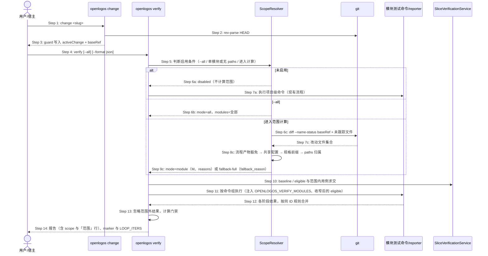

### 步骤说明

1. **用户 / 宿主**执行 `openlogos change <slug>`（时序 Step 1）。
2. **openlogos change** 读取当时 `HEAD`（Step 2），在 guard 中写入 `activeChange` 与 `baseRef`（Step 3）；非 git 或无提交时不写 `baseRef`。
3. **用户 / 宿主**执行 `openlogos verify`（Step 4）。
4. **ScopeResolver** 先判断启用条件（Step 5）：传 `--all` 时直接全量（Step 6b）；单模块或没有任何模块声明 `paths` 时不启用，CLI 按现有流程只执行项目级命令、不输出 `scope`（Step 6a、7a），跳到第 8 步的门禁计算。
5. **ScopeResolver** 取 `baseRef` 到工作区的差异与未跟踪文件（Step 6c、7c），按「流程产物豁免 → 共享验收配置回落 → `logos/resources/` 下模块前缀规格归属 → `paths` 归属」分类（Step 8c），与提案归属模块、delta 前缀模块合并为 M（Step 9c）；任一回落条件成立则 `fallback-full`。
6. **SliceVerificationService** 把 baseline、confirmed、attempted、eligible 与范围内用例求交（Step 10）。
7. **CLI** 为范围内模块选出命令组并去重，逐组执行，注入 `OPENLOGOS_VERIFY_MODULES` 与收窄后的 `OPENLOGOS_VERIFY_ELIGIBLE_TEST_IDS`（Step 11）；各阶段结果按同 ID 去重全序规则合并（Step 12）。
8. **CLI** 忽略范围外模块用例的结果行并计入 `out_of_scope_result_count`，按既有硬门计算门禁（Step 13），写报告、marker 与 `LOOP_ITERS`（Step 14）。

### 异常与边界

#### EX-10.1: 未启用模块范围的多模块项目上的纯规格提案（review F1）
- **触发条件**：多模块项目没有任何模块声明 `paths`；提案由新版 change 创建（有合法 `baseRef`），只改了某个模块前缀的 delta，改动文件集合为空。
- **期望响应**：不进入范围计算；defined、失败结果处理与命令选择与现有流程一致；JSON 不输出 `scope`，报告无「范围」行。
- **副作用**：无。

#### EX-10.2: 改动文件归不到任何模块
- **触发条件**：模块范围已启用，改动文件中有不属于流程产物、不是共享验收配置、不是带模块前缀规格、也不命中任何 `paths` 的文件。
- **期望响应**：`mode: "fallback-full"`，`fallback_reason.code: "unmapped_file"`，`detail` 给出首个文件与总数；按全部模块执行与核对。
- **副作用**：无。

#### EX-10.3: 共享验收配置被修改（review F2）
- **触发条件**：改动文件含 `logos/logos.config.json` 或 `logos/logos-project.yaml`。
- **期望响应**：回落全量，`fallback_reason.code: "shared_config_changed"`，`detail` 写明文件。
- **副作用**：无。

#### EX-10.4: logos/ 下已声明归属的文件被修改（review F2）
- **触发条件**：`core` 的 `paths` 含 `logos/tools/**`，提案修改 `logos/tools/protocol-check.ts`。
- **期望响应**：`core` 进入范围，`reasons` 含 `{ module: "core", source: "path", ref: "logos/tools/protocol-check.ts" }`；只有 `PATH_CLASSES_V1` 的流程产物不参与判定。
- **副作用**：无。

#### EX-10.5: 提案起点不可用
- **触发条件**：guard 缺 `baseRef`、项目不是 git 仓库、`baseRef` 不可达，或差异计算失败。
- **期望响应**：回落全量，`fallback_reason.code` 依次为 `base_ref_missing`、`not_git_repository`、`base_ref_unreachable`、`diff_failed`。
- **副作用**：无。

#### EX-10.6: 模块命令失败
- **触发条件**：范围内某模块的命令组非零退出。
- **期望响应**：其余命令组照常执行；门禁以既有 `pre_run_failed` 失败，`pre_run.commands[]` 的 `modules` 与诊断点名该模块。
- **副作用**：写 `VERIFY_FAIL` 与失败的 `LOOP_ITERS`，与现有预跑失败相同。

#### EX-10.7: 跨模块提案
- **触发条件**：归属 `portal-web` 的提案还改了命中 `core` `paths` 的文件。
- **期望响应**：两个模块都进入范围，两组命令都执行；`reasons` 分别记录 `proposal` / `delta` 与 `path` 依据。
- **副作用**：无。

#### EX-10.8: `--all`
- **触发条件**：用户执行 `openlogos verify --all`。
- **期望响应**：不计算范围，`mode: "all"`，按全部模块执行与核对；未启用项目同样输出 `scope.mode: "all"`。
- **副作用**：marker 与 `LOOP_ITERS` 语义不变；archive 不要求做过 `--all`。

#### EX-10.9: `paths` 非法或 `verify.modules` 引用未登记模块
- **触发条件**：某模块 `paths` 以 `/` 开头、含 `..` 段或为空串；或 `verify.modules` 含未登记的模块 id。
- **期望响应**：前者回落全量（`module_paths_invalid`）；后者给出警告 `verify_module_unknown` 并忽略该项，不影响门禁。
- **副作用**：无。

### 追溯

- 需求：`core-01-requirements.md`「S13 按模块限定 verify 范围验收补充」。
- 功能规格：§2.96。
- 测试：`core-S13-test-cases.md`「S13 按模块限定 verify 范围测试」——UT-S13-104～UT-S13-121、ST-S13-27～ST-S13-32；smoke：SMOKE-core-280～284。

## S13 切片 checkpoint 的 owned 验收范围

### 场景目标

用例规模达到阈值的项目，多切片提案的每次 slice-checkpoint 只验收本片与已通过前序切片的 owned 用例，不再回归基线集 B；所有切片完成后由 final 跑一次全量回归。本子场景是「切片 checkpoint 与 final verify 时序」在 manifest 冻结 `verify_scope: "owned"` 时的分支；`baseline` 范围（含旧 manifest 缺该字段）沿用原时序，行为不变。

### 参与者

- **用户或自动化宿主**：执行 `openlogos verify`，读取 `status` / `next` 的 `slice_verification_state.verify_scope` 调整派发。
- **openlogos verify（CLI）**：读取 manifest 冻结的验收范围，计算 eligible / pending，注入环境变量，执行 Gate 并写报告。
- **SliceVerificationService**（`deriveSliceVerificationState()`）：按 `verify_scope` 分支计算集合，与 status / next 同源。
- **测试 runner / OpenLogos reporter**：据 `OPENLOGOS_VERIFY_SLICE_SCOPE` 与 `OPENLOGOS_VERIFY_ELIGIBLE_TEST_IDS` 只运行覆盖 eligible 的测试，只输出 eligible 内结果。
- **manifest / checkpoint 账本 / 验收报告**：`TEST_SLICE_MANIFEST.json`、`SLICE_CHECKPOINTS.jsonl`、`acceptance-report.md` 与多模块项目的 `<m>-acceptance-report.md`。

### 前置条件

- 活跃 launched 提案已 spec-complete，`openlogos slice plan` 已按 S32「S32 切片规划冻结验收范围时序」写出有效 manifest，且其 `verify_scope` 为 `owned`。
- 仍有未通过 checkpoint 的切片（存在 attempted slice A），或全部切片已通过且 `[code]` 全部勾选（进入 final）。

### 成功后置条件

- checkpoint：eligible 为 `owned(P) ∪ owned({A})`；基线 ID 不进入分母、不计 uncovered；PASS 追加绑定当前 manifest 身份的 checkpoint 行，不写 `VERIFY_PASS`；共用验收报告标明验收范围；模块验收报告字节不变。
- final：eligible 为全部已定义非 manual 用例 D，100% 覆盖、一致性与 `VERIFY_PASS` 规则与 `baseline` 范围相同，模块验收报告照常写出。

### 时序图

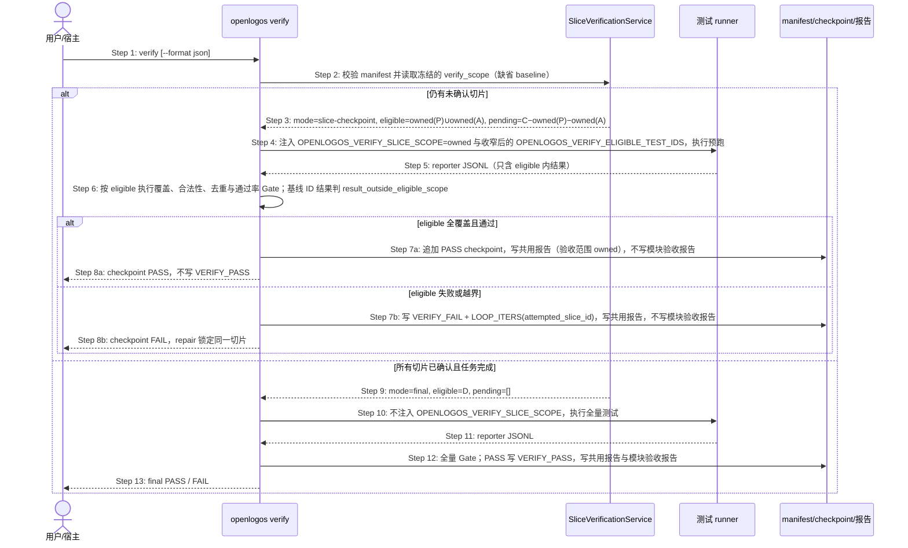

### 步骤说明

1. **用户或宿主**执行 `openlogos verify`；宿主可先从 `status` / `next` 的 `slice_verification_state.verify_scope` 得知本提案的验收范围。
2. **CLI** 在运行任何测试前校验 manifest，读取冻结的 `verify_scope`；字段缺省按 `baseline`，取值非法时 manifest 判 `test-slice-manifest-invalid`，转 S32 恢复路径，不启动 runner。
3. **SliceVerificationService** 在 `owned` 范围下计算 `eligible = owned(P) ∪ owned({A})`，pending 与 `baseline` 范围相同；启用模块范围时先与范围 S 求交，C 始终在 S 内，结果不变。
4. **CLI** 在执行预跑命令前注入 `OPENLOGOS_VERIFY_SLICE_SCOPE=owned` 与收窄后的 `OPENLOGOS_VERIFY_ELIGIBLE_TEST_IDS`；runner 据此只运行覆盖 eligible 的测试，ID 到测试文件的映射由项目 runner 自行决定。
5. **Runner** 通过 OpenLogos reporter 只输出 eligible 内的结果。
6. **CLI** 只按 eligible 执行既有 Gate；基线与 pending ID 的结果一律判 `result_outside_eligible_scope`。
7. **CLI** 在 PASS 时追加 checkpoint 行（身份含 `verify_scope: "owned"`）；PASS 与 FAIL 都写共用验收报告并标明验收范围；`owned` 范围的 checkpoint 不写、不改模块验收报告。
8. **CLI** 返回 checkpoint 结论；checkpoint PASS 不写 `VERIFY_PASS`，FAIL 锁定同一 attempted slice。
9. **SliceVerificationService** 在全部切片确认且 `[code]` 全部勾选时切换为 final，eligible 为 D。
10. **CLI** final 不注入 `OPENLOGOS_VERIFY_SLICE_SCOPE`，执行全量预跑。
11. **Runner** 输出全量结果。
12. **CLI** 以全量 Gate 裁决：100% 覆盖且通过才写 `VERIFY_PASS`；共用与模块验收报告照常写出。基线回归在此处第一次、也是唯一一次被验收。
13. **CLI** 返回 final 结论。

### 异常与边界

#### EX-11.1: owned 范围下 runner 输出基线用例结果
- **触发条件**：runner 未按 `OPENLOGOS_VERIFY_ELIGIBLE_TEST_IDS` 收窄，输出了基线用例的结果行。
- **期望响应**：既有越界规则不变，以 `result_outside_eligible_scope` 判 checkpoint FAIL，不把基线结果吸收入 eligible。
- **副作用**：写 `VERIFY_FAIL` 与带 `attempted_slice_id` 的 `LOOP_ITERS`，与其他 checkpoint 失败相同。

#### EX-11.2: 旧 manifest 没有 `verify_scope` 字段
- **触发条件**：升级前规划的在途提案，manifest 无 `verify_scope`。
- **期望响应**：按 `baseline` 处理，eligible 含 B，注入 `OPENLOGOS_VERIFY_SLICE_SCOPE=baseline`；判定实质身份与升级前相同，已确认 checkpoint 继续被采信。
- **副作用**：无。

#### EX-11.3: 多模块项目 owned 范围的 checkpoint
- **触发条件**：多模块项目，manifest 冻结为 `owned`，checkpoint 完成 Gate 裁决。
- **期望响应**：共用验收报告照常写；各 initial 模块的 `<m>-acceptance-report.md` 字节与修改时间不变（模块报告按完整 U(m) 统计，只验收 owned 时会把基线误报为未覆盖）。
- **副作用**：无；final 照常写模块验收报告。

#### EX-11.4: 后续切片改坏了前序切片
- **触发条件**：`owned` 范围下切片二的实现使切片一的 owned 用例失败。
- **期望响应**：切片二的 checkpoint eligible 含 `owned(P)`，切片一的用例失败使 checkpoint FAIL，repair 锁定切片二。
- **副作用**：写 `VERIFY_FAIL` 与 `LOOP_ITERS(attempted_slice_id=切片二)`。

#### EX-11.5: final 发现基线回归
- **触发条件**：`owned` 范围下所有切片已通过 checkpoint，final 全量中某个基线用例失败。
- **期望响应**：final FAIL，不得把缺失或失败的基线结果改列 pending；修复目标由失败输出判断。
- **副作用**：写 `VERIFY_FAIL` 与 final `LOOP_ITERS`，不写 `VERIFY_PASS`。

### 追溯

- 需求：`core-01-requirements.md`「S13/S16/S27/S28/S31/S32 多切片验收边界与自动恢复要求」高效模式验收条件。
- 功能规格：§2.37.2、§2.37.4、§2.37.8、§2.101。
- 根规范：`spec/test-slice-manifest.md` §7；`spec/test-results.md`「切片 checkpoint 的结果集合与 pending 语义」。
- 测试：`core-S13-test-cases.md`「S13 切片 checkpoint owned 验收范围测试」——UT-S13-132～UT-S13-140、ST-S13-35～ST-S13-37。

## 验收历史留存与查询时序（verification-history）

### 目标

让每一次进入执行的 `openlogos verify` 都留下一条不会被覆盖的历史，历史与同一次调用的最终门禁、共用验收报告一致，并能在提案归档后按 run_id 查到完整记录。规则权威见功能规格 §2.104。

### 参与者

- 用户或自动化宿主（RunLogos driver）
- OpenLogos CLI（`openlogos verify`、`openlogos history`）
- ResultPathLock（结果路径运行锁）
- 测试 runner / OpenLogos reporter
- VerificationHistory（三层写入与读取）
- 提案目录、中央索引目录与本机运行态目录

### 前置条件

- 项目已初始化；`verify` 配置可解析。
- 有活跃提案时提案目录存在；没有活跃提案时同样适用（只写中央索引）。
- 本次命令已通过用法、配置与前置拒绝检查（未通过时不开启运行、不留历史）。

### 时序图

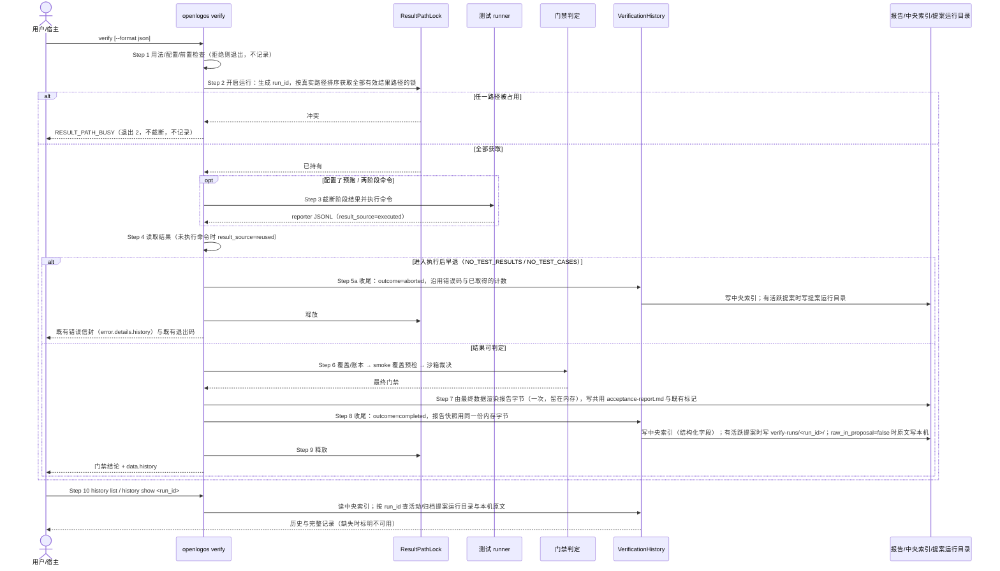

### 步骤说明

1. **Step 1**：用法错误、`logos.config.json` 缺失、guard 拒绝等在开启运行前退出，不留历史，行为与修改前一致。
2. **Step 2**：锁集合为 `result_path`、`regression_result_path`、`incremental_result_path` 的有效值（按模块命令组解析），统一解析为真实路径后排序，全有或全无获取。
3. **Step 3～4**：执行了任一预跑 / 两阶段命令时 `result_source=executed`，只读取既有结果时为 `reused`。
4. **Step 5a**：进入执行后的早退（未配置预跑且结果文件不存在的 `NO_TEST_RESULTS`、缺少可验收用例定义的 `NO_TEST_CASES`）写 `outcome=aborted` 记录，报告字段缺省；沿用既有 stderr 错误信封、错误码与退出码，history 元数据放在 `error.details.history`。结果文件存在但为空（如预跑失败）时不是早退，照常到达门禁。
5. **Step 6～7**：共用 `acceptance-report.md` 在全部门禁（含 smoke 覆盖预检改判与沙箱裁决）之后写出一次；`VERIFY_PASS` / `VERIFY_FAIL`、`LOOP_ITERS`、切片 checkpoint 按既有规则写入。
6. **Step 8**：报告快照使用 Step 7 渲染时留在内存的同一份字节，不从共用报告路径回读；中央索引只写结构化白名单字段；有活跃提案时 `verify-runs/<run_id>/` 写 `record.json`、`results.jsonl`、`report.md`；`verify.history.raw_in_proposal=false` 时 `results.jsonl` 去掉自由文本字段，报告快照与被去掉的字段写到 `logos/.openlogos-runtime/verify-runs/<run_id>/`。写入失败只在 history 元数据中置 `write_status: "failed"` 与 `write_error`。
7. **Step 9**：释放全部锁。
8. **Step 10**：`history list` 只读中央索引；`history show` 以 run_id 精确匹配活动或归档提案的运行目录。

### 异常与边界

#### EX-13H.1: smoke 覆盖预检把门禁改判 FAIL
- 用例全部通过，但本提案新增的 smoke 用例缺 runner，`applySmokePrecheck` 把门禁改为 FAIL。
- 共用 `acceptance-report.md`、命令结果与历史的结论都是 FAIL；报告快照与共用报告逐字节一致。

#### EX-13H.2: 复用既有结果
- 未配置预跑命令，两次 verify 读取同一份预先生成的结果文件。
- 两条记录的 `result_source` 都是 `reused`，不冒充重新执行。

#### EX-13H.3: 进入执行后早退
- 未配置预跑且结果文件不存在（`NO_TEST_RESULTS`），或已合并测试规格中没有可验收用例（`NO_TEST_CASES`，预跑可能已执行）。
- 写 `outcome=aborted` 记录，带既有错误码与已取得的计数；报告字段缺省；stderr 错误信封、错误码与退出码不变，`error.details.history` 给出历史元数据。预跑失败但结果文件已被创建（为空）时不属于早退，照常判定为 FAIL 并记 `completed`。用法错误与配置缺失不记录。

#### EX-13H.4: 结果路径冲突
- 另一个 verify 或 smoke 正在运行，且其有效结果路径与本次锁集合有交集（包括只共享 regression / incremental 阶段路径、或对方只读取既有结果）。
- 本次以 `RESULT_PATH_BUSY` 拒绝（退出 2），释放已获取的锁，不截断、不改写任何结果文件，不写历史。

#### EX-13H.5: 历史写入失败
- 中央索引目录不可写或提案运行目录写入失败。
- `data.history.write_status="failed"`，`write_error.code="verification_history_write_failed"` 点名失败层与路径；门禁结论、退出码与标记不受影响。

#### EX-13H.6: 损坏的历史文件
- 中央索引目录中有非 JSON 或缺必填字段的文件。
- `history list` / `show` 跳过它并给出 `verification_history_corrupt` 警告，其余记录照常返回。

#### EX-13H.7: 切片 checkpoint 与 final
- 多切片提案依次执行 checkpoint verify 与 final verify。
- 各留一条记录，`verify_mode` 分别为 `slice-checkpoint`（带 `attempted_slice_id`）与 `final`；checkpoint 重复 PASS 也各留一条（历史记录每次运行，不同于 checkpoint 账本的去重）。

#### EX-13H.8: 没有活跃提案
- 初始开发阶段或两次提案之间执行 verify。
- 只写中央索引，`proposal=null`、`raw_location="none"`；`history show` 注明没有完整记录。

#### EX-13H.9: 归档后与同名新提案
- 提案归档后又新建同名提案并运行 verify。
- 旧 run_id 从 `logos/changes/archive/*-<slug>/verify-runs/<run_id>/` 读到完整记录；新运行 run_id 不同，不会被认成旧记录；中央索引不改写。完整记录在本机缺失时（如重新克隆）返回中央字段并标明 `full_record: "unavailable"`。

#### EX-13H.10: 历史路径被 git 忽略
- 历史目录命中 `.gitignore` 规则。
- 文件照常写入，输出给出路径；由流程提交或用户以 `git add -f` 纳入。CLI 不执行 git 操作。

### 追溯

- 需求：「S13/S19 验收历史留存与追溯要求」。
- 规格：功能规格 §2.104；架构「五十八、验收历史留存与查询」；`spec/test-results.md`「验收历史留存（verification-history）」。
- 测试：UT-S13-141～UT-S13-156、ST-S13-38～ST-S13-39。

## S13 verify 自足：环境预检与跳过分类（verify-self-sufficient-cases）

### 场景目标

让 `openlogos verify` 全程不需要人配合：执行任何预跑命令之前，先确认提案承诺的环境要求已写入配置、本机环境已就绪；测试结束后，本次改动的 UT/ST 只允许平台跳过，不允许「环境没准备好就写 skip」混过门禁。规则权威见功能规格 §2.106；格式见 `spec/test-results.md`「verify 环境要求声明、对账与预检」「verify 跳过分类」。

### 参与者

| 别名 | 组件 | 说明 |
|---|---|---|
| Caller | 用户或 RunLogos driver | 发起 verify |
| CLI | `openlogos verify` | 门禁与统计 |
| Cfg | 生效配置 | 未启用模块范围时为项目级 `verify.requirements`；启用时先按覆盖模块求 E(m)（模块级同名 check 只替换本模块），再合并（同名同命令合并、同名异命令分别执行） |
| Prop | 活跃提案 | proposal「验收标准」段；`SPEC_MERGED.test_change_set`（经 `readTestChangeSet` 校验） |
| Env | 预检执行环境 | 预跑命令将继承的环境变量与 `PATH`；检查命令经与预跑命令同一个沙箱执行器执行 |
| Runner | 项目测试入口 + OpenLogos reporter | 在调度前排除 `[manual]` 用例，写结果账本 |
| Gate | 门禁判定 | §2.106.7 优先级 |

### 前置条件

- 项目已初始化，`verify` 配置可解析；本次命令已通过用法与前置拒绝检查。
- 结果路径锁已获取（见本文档「验收历史留存与查询时序」Step 2）。
- 有无活跃提案均适用；无活跃提案时不对账，跳过分类只出警告。

### 成功后置条件

- 预检类原因均未命中时，预跑与门禁按既有流程执行；严格集合内只有平台跳过，平台跳过在 JSON 与报告中单独列出。
- 预检类原因命中时，未执行任何预跑命令，门禁 FAIL 并逐项列出缺失项。

### 时序图

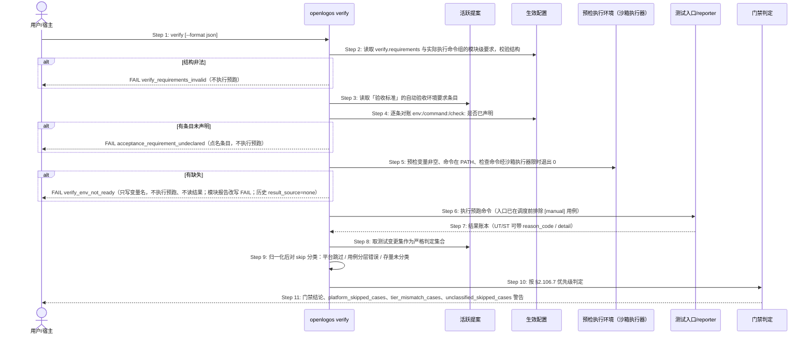

### 步骤说明

1. **Caller** 执行 `openlogos verify`（可带 `--format json`）。
2. **CLI** 求生效集合：未启用模块范围时取项目级 `verify.requirements`；启用时先沿用既有命令组选择得到本次实际执行的命令组，只对这些命令组服务的模块 m 求 E(m)（项目级加 `verify.modules.<m>.requirements`，m 的同名 check 只替换 m 自己的），再合并——`env`、`commands` 取并集，名称与命令都相同的 check 合并，名称相同、命令不同的 check 分别执行并记录归属模块。结构非法时以 `verify_requirements_invalid` 判 FAIL，不执行预跑。
3. **CLI** 有活跃提案时读取 proposal「验收标准」段的「自动验收环境要求」；字段为「无」、缺段或无活跃提案时跳过 Step 4。
4. **CLI** 逐条核对 `env:` / `command:` / `check:` 条目是否出现在生效集合对应字段；缺任一项以 `acceptance_requirement_undeclared` 判 FAIL 并点名，不执行预跑。
5. **CLI** 逐项预检：变量（按预跑命令将继承的环境）存在且非空；命令可在同一 `PATH` 解析；检查命令经与预跑命令同一个沙箱执行器执行（同一沙箱模式与复用配置，工作目录为沙箱工作副本中的项目根，写回白名单为空，注入归属模块的 `OPENLOGOS_VERIFY_MODULES`），60 秒内退出 0。缺任一项以 `verify_env_not_ready` 判 FAIL，诊断只写变量名与检查名（check 只写退出码或「超时」，并带归属模块）。本次没有任何预跑命令执行时，Step 5 只检查项目级要求（模块级要求不检查），缺项即在读取结果文件前判 FAIL。无沙箱隔离（`off` 或 `auto` 降级）时检查命令在源工作区运行、不承诺源工作区保护，检查命令须只读，输出标注 `isolation: "unisolated"`。Step 2～5 任一失败：不执行预跑、不截断也不读取结果文件；共用报告计数显示「未执行」；覆盖的 initial 模块报告改写为 FAIL；验收历史记 `result_source: "none"`。
6. **CLI** 执行既有预跑流程；项目测试入口在调度前排除 `[manual]` 用例的测试代码（测试分组、独立文件或独立入口）。
7. **Runner** 通过 reporter 写结果账本；平台限定用例在不适用时写 `reason_code: "platform-unavailable"` 与说明执行条件的 `detail`。
8. **CLI** 经 `readTestChangeSet` 读取活跃提案 `SPEC_MERGED.test_change_set.changed_test_ids`，取其中 UT/ST 作为严格判定集合：尚未 merge 时为空集；读取器判有效时取其集合（含合法空集）；已有 `SPEC_MERGED` 但读取器判无效时报 `test_change_set_invalid`，门禁 FAIL；切片 checkpoint 下与可计入集合求交。
9. **CLI** 对 `status:"skip"` 分类：严格集合内的平台跳过入 `platform_skipped_cases`；严格集合内的其余 skip 入 `tier_mismatch_cases`；严格集合外的非平台 skip 入 `unclassified_skipped_cases`（警告）。
10. **Gate** 按功能规格 §2.106.7 取 `gate.reason`：预检类原因最先；`case_tier_mismatch` 紧随 `failed_cases`。
11. **CLI** 输出门禁结论、`data.requirements` 与三个跳过子集；验收报告单独列出平台跳过与用例分层错误，警告单列。

### 异常与边界

#### EX-13.1：验收标准条目未写入配置
- **触发条件**：活跃提案验收标准列出 `check:db-ready`，生效配置中没有同名 check。
- **期望响应**：门禁 FAIL，`gate.reason="acceptance_requirement_undeclared"`，诊断点名 `check:db-ready`；预跑命令未执行。
- **副作用**：无；验收历史记一条门禁 FAIL 的记录。

#### EX-13.2：环境缺失
- **触发条件**：生效配置声明 `env: ["DB_URL"]` 与 `commands: ["docker"]`，本机两者都缺。
- **期望响应**：门禁 FAIL，`gate.reason="verify_env_not_ready"`，诊断依次列出 `env DB_URL` 与 `command docker`；输出与报告中不出现任何变量值；预跑命令未执行。
- **副作用**：无。

#### EX-13.3：检查命令超时或非零退出
- **触发条件**：`checks` 中某项 60 秒未退出，或以非零状态退出。
- **期望响应**：该项计为缺失，`detail` 为「超时」或退出码；超时的检查进程组被终止；不写检查命令的输出。
- **副作用**：无。

#### EX-13.4：严格集合内的非平台 skip
- **触发条件**：活跃提案新增 UT-S01-90，结果为无原因的 skip。
- **期望响应**：门禁 FAIL，`gate.reason="case_tier_mismatch"`（无失败用例且账本自洽时），`tier_mismatch_cases` 含该 ID 与 fix_hint「准备好环境并声明到 verify.requirements，或改标 `[manual]`」。
- **副作用**：无。

#### EX-13.5：平台跳过缺 detail
- **触发条件**：严格集合内用例写 `reason_code: "platform-unavailable"`，`detail` 为空串或缺失。
- **期望响应**：不按平台跳过放行，按 EX-13.4 判用例分层错误。
- **副作用**：无。

#### EX-13.6：适用平台缺前置工具与平台不适用的区分
- **触发条件**：本仓 ST-S13-26 只在「Linux、非 root、沙箱复用能力可用」时执行并需要 `cc`；`check:linux-nondump-cc` 与用例共用同一适用判定。机器为非 root Linux、没有 `cc`。
- **期望响应**：复用能力不可用时，检查直接通过，用例写平台跳过；复用能力可用时，预检报 `verify_env_not_ready`（缺 `check linux-nondump-cc`），不执行预跑；非 Linux 机器上检查直接通过、用例写平台跳过。
- **副作用**：无。

#### EX-13.7：人工用例不被测试入口启动
- **触发条件**：项目有一条自动用例与一条 `[manual]` 用例，后者的测试代码被启动即写哨兵文件。
- **期望响应**：普通最终 verify 完成，自动用例有结果，哨兵文件不存在；人工 ID 未出现在结果账本中。
- **副作用**：无。

#### EX-13.8：无活跃提案或存量用例
- **触发条件**：无活跃提案时执行 verify；或存量用例写了无原因的 skip。
- **期望响应**：不对账；skip 口径按 §2.7A 不变，门禁结论与退出码不变；输出警告 `unclassified_skipped_cases` 并列出 ID。
- **副作用**：无。

#### EX-13.9：未声明任何要求的零变化
- **触发条件**：未声明 `verify.requirements`，验收标准未列条目，严格集合内没有 skip。
- **期望响应**：判定、`gate.reason` 与退出码与引入前一致；`data.requirements` 缺省。
- **副作用**：无。

#### EX-13.10：模块验收报告不残留旧 PASS
- **触发条件**：双模块项目，两个 initial 模块已有 PASS 模块报告；随后 ① 项目级环境要求缺失；② 环境就绪，但模块 a 的用例子集中有严格集合内的非平台 skip。
- **期望响应**：① 两份模块报告都整份改写为 FAIL（计数「未执行」，写明预检原因），不读取旧账本；② 模块 a 的报告 FAIL（用例分层错误），模块 b 的报告 PASS。两种情形下受影响模块都不能再通过 `launch` 的验收报告检查。
- **副作用**：被改写的模块报告原子替换。

#### EX-13.11：预检失败的验收历史
- **触发条件**：① 首次 verify、从未生成过结果文件、验收标准条目未写入配置；② 上次 verify 留下 PASS 账本，本次环境未就绪。
- **期望响应**：两种情形都写一条 `outcome: "completed"`、`result_source: "none"`、`gate.result: "FAIL"` 的中央索引，计数为 null、ID 数组为空；报告快照按既有留存策略落点——无活跃提案只有中央索引；有活跃提案且 `raw_in_proposal: true` 时在提案完整记录；`raw_in_proposal: false` 时提案完整记录只有结构化 `record.json`、快照在本机原文目录。任何情况下都不写本轮结果文件；② 中旧账本未被截断，也不被复制或引用。
- **副作用**：无。

#### EX-13.12：模块同名检查命令不同
- **触发条件**：模块 a、b 同时被覆盖，各自声明 `db-ready`，命令分别检查各自的数据库；a 的数据库不可用。
- **期望响应**：两条检查都被执行；预检报 `verify_env_not_ready`，缺失项为 `{kind:"check", name:"db-ready", modules:["a"]}`；不因名称相同而漏掉任何一个模块的检查。
- **副作用**：无。

#### EX-13.13：检查命令在沙箱中执行
- **触发条件**：`verify.sandbox_mode: "always"`；某依赖只在宿主工作区存在、沙箱工作副本中不存在；检查命令还会在当前目录写一个临时文件。
- **期望响应**：检查在沙箱工作副本中执行并失败，报 `verify_env_not_ready`，测试入口未启动；源工作区没有出现检查写出的文件，`isolation: "sandboxed"`。沙箱无法隔离时：`always` 按既有规则判 FAIL；`auto` 降级后检查在源工作区运行，`isolation: "unisolated"`，此时不承诺源工作区保护，只读检查执行后源工作区不变。
- **副作用**：无。

#### EX-13.14：已合并提案的测试变更集无效
- **触发条件**：活跃提案已正常 merge（新增 UT-S01-90），随后 `SPEC_MERGED.test_change_set` 的摘要被改坏；UT-S01-90 写无原因 skip，其余用例通过。
- **期望响应**：读取器判无效，不推导为空集；门禁 FAIL，`gate.reason="test_change_set_invalid"`，`detail` 带读取器原因码；不产生最终 PASS。
- **副作用**：无。

#### EX-13.15：被覆盖但没有任何预跑命令的模块
- **触发条件**：`verify --all` 覆盖 a、b；项目级未配置预跑命令，a 有自己的命令组，b 只有模块级要求 `command:b-tool`，本机没有 `b-tool`。
- **期望响应**：既有命令组选择只返回服务 a 的命令组；b 的要求不检查；预检通过，a 的 runner 被启动。另一种情形：项目没有任何预跑命令、已有一份通过的旧账本、显式声明的项目级 `env: ["DB_URL"]` 缺失——预检照常执行并报 `verify_env_not_ready`（点名 `DB_URL`），旧账本不被读取，不得 PASS。
- **副作用**：无。

### 追溯

- 需求：AC-VERIFY-SELF-01～08、AC-VERIFY-SELF-11、AC-VERIFY-SELF-13。
- 功能规格：§2.106.2～§2.106.7A、§2.106.10、§2.104.3（`result_source: "none"`）。
- 同源章节：本文档「verify 结果账本一致性预检」「EX-7.4: 合法 skip 不阻塞 verify Gate」（存量口径不变）、「S13 人工用例判据的声明位与一致性判据的输入」（声明位不变）、「验收历史留存与查询时序（verification-history）」（预检失败照常留存）。
- 测试：`core-S13-test-cases.md`（UT-S13-157 起、ST-S13-40 起）；安装态 smoke：`core-smoke-test-cases.md`（SMOKE-core-338 起）。
