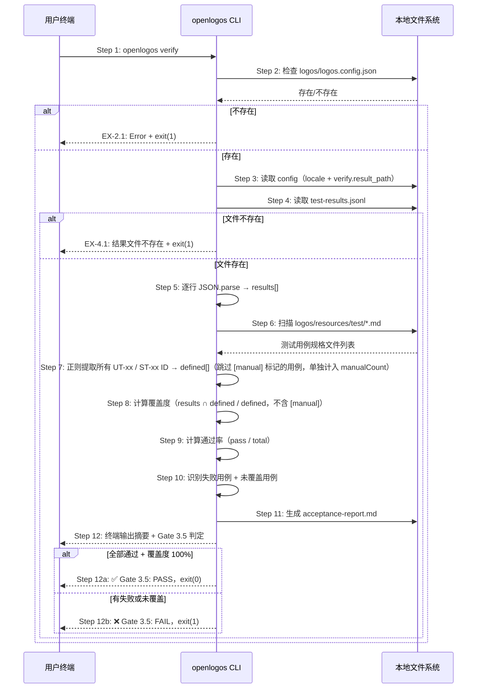
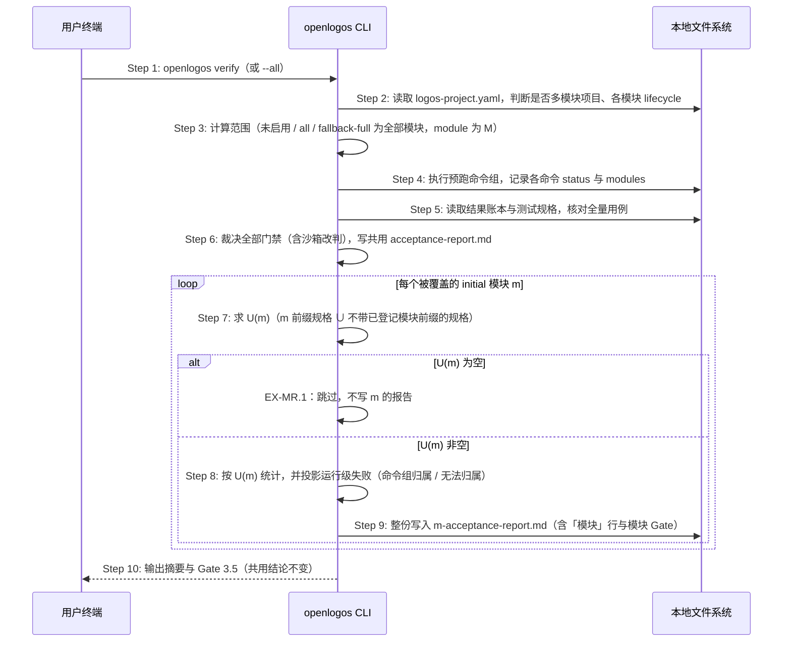

# S13: 测试验收 — 场景实现

> Phase 3 Step 1 · 场景建模

## 参与方

| 别名 | 组件 | 说明 |
|------|------|------|
| U | 用户终端 | 执行 CLI 命令的终端 |
| CLI | openlogos CLI | `cli/src/commands/verify.ts` |
| FS | 本地文件系统 | JSONL 结果文件 + 测试用例规格 + 验收报告 |

## 时序图

## 步骤说明

1. **开发者**在终端输入 `openlogos verify`。
2. **CLI** 检查当前目录下 `logos/logos.config.json` 是否存在。如果不存在 → 见 EX-2.1。
3. **CLI** 从配置文件中读取 `locale`（用于输出语言切换）和 `verify.result_path`（JSONL 文件路径）。如果 `verify.result_path` 未配置，使用默认值 `logos/resources/verify/test-results.jsonl`。
4. **CLI** 读取 JSONL 结果文件。如果文件不存在 → 见 EX-4.1。
5. **CLI** 逐行执行 `JSON.parse`，将每行解析为结果对象，收集到 `results[]` 数组中。

> 同一个 `id` 如果出现多次（如测试重试），取最后一次出现的结果。解析失败的行记录警告但不中断流程。

6. **CLI** 扫描 `logos/resources/test/` 目录，找到所有 `*-test-cases.md` 文件。
7. **CLI** 对每个文件用正则提取所有用例 ID。扫描时检查 ID 后是否紧跟 `[manual]` 标记：若是则跳过不加入 `defined[]`，单独计入 `manualCount`；否则加入 `defined[]` 并去重。
8. **CLI** 计算覆盖度：`results` 中出现的 ID 与 `defined` 的交集 / `defined` 总数。`[manual]` 用例不计入分母，也不出现在未覆盖列表中。
9. **CLI** 计算通过率：`results` 中 `status=pass` 的数量 / `results` 总数。
10. **CLI** 识别四类问题用例：
    - **失败用例**：`status=fail`，输出 ID + error 信息
    - **跳过用例**：`status=skip`
    - **未覆盖用例**：在 `defined` 中存在但在 `results` 中不存在的 ID（不含 `[manual]`）
    - **人工用例**：标记为 `[manual]` 的用例，单独计入 `manual_count`，不触发 Gate 失败
11. **CLI** 在 `logos/resources/verify/` 目录下生成 `acceptance-report.md`，包含：定义用例总数、人工用例数（已排除）、执行用例数、通过/失败/跳过/未覆盖明细、覆盖度百分比、通过率百分比、Gate 3.5 判定结果。AC trace 中全部关联 `[manual]` 用例的 AC 标记为 `🔵 MANUAL`（人工待验），不计入失败。
12. **CLI** 在终端输出摘要信息。如果所有用例通过且覆盖度 100% → 输出 `✅ Gate 3.5: PASS`，退出码 0；否则 → 输出 `❌ Gate 3.5: FAIL`，退出码 1。

> `openlogos verify` 不负责运行测试本身，只读取结果文件并判定。测试的运行由用户自行完成（`npm test`、`pytest` 等）。

## 异常用例

### EX-2.1: 项目未初始化

- **触发条件**：Step 2 检测到 `logos/logos.config.json` 不存在
- **期望响应**：stderr 输出 `Error: logos/logos.config.json not found. Run 'openlogos init' first to initialize the project.`，exit(1)
- **副作用**：不输出任何验收信息

### EX-4.1: 测试结果文件不存在

- **触发条件**：Step 4 检测到 JSONL 结果文件不存在（默认路径或 `verify.result_path` 配置的路径）
- **期望响应**：stderr 输出 `Error: No test results found at {path}. Run your tests first, then try again.`，exit(1)
- **副作用**：不生成验收报告

## S13 多模块项目写模块验收报告（module-scoped-phase-reports）

> 来源变更：module-scoped-phase-reports（决策 C01；proposal-r1 F3 处置）。判据见功能规格 §2.99.3、§2.99.5，`spec/test-results.md`「多模块项目的模块验收报告与模块冒烟报告（module-scoped-phase-reports）」。

### 场景目标

多模块项目中，verify 在写共用验收报告之外，为本次覆盖到的每个 initial 模块按该模块的用例子集写一份 `<m>-acceptance-report.md`，让 initial 模块凭「属于自己」的验收结论离开 phase.3-6；运行级失败按可靠归属投影，无法归属的失败不因子集全通过而消失。

### 参与者

- **用户终端**：执行 `openlogos verify`（含 `--all`）。
- **openlogos CLI**（`cli/src/commands/verify.ts`）：执行预跑、核对结果、裁决门禁、写报告。
- **本地文件系统**：测试规格、结果账本、`logos-project.yaml`、`logos/resources/verify/`。

### 前置条件

- `logos-project.yaml` 登记了两个及以上模块，其中至少一个为 `lifecycle: initial`。
- verify 能执行到门禁裁决（配置、结果文件与测试规格均存在）。

### 成功后置条件

- 本次覆盖到的每个 initial 模块 m（U(m) 非空）都有一份新写入的 `logos/resources/verify/<m>-acceptance-report.md`：Summary 含「模块」行 m，统计只按 U(m)，Gate 按功能规格 §2.99.5 的模块 Gate 判定。
- 共用 `acceptance-report.md`、verify JSON、`VERIFY_PASS` / `VERIFY_FAIL` 与修改前一致；未被覆盖模块的已有模块报告保持不动。

### 时序图

### 步骤说明

1. **用户**执行 `openlogos verify`（或 `--all`）。
2. **CLI** 读取 `logos-project.yaml`：登记模块少于两个，或没有 initial 模块时，整个子场景不发生，行为与修改前一致。
3. **CLI** 按功能规格 §2.96 计算范围：范围未启用、`--all`、`fallback-full` 时被覆盖模块为全部已登记模块；`module` 模式为范围 M。只有其中的 initial 模块进入后续步骤。
4. **CLI** 按既有规则执行预跑命令组；启用范围或 `--all` 时每条命令带 `modules`，范围未启用时项目级命令不带 `modules`。
5. **CLI** 按既有规则读取结果账本、提取用例并核对。
6. **CLI** 裁决全部门禁（账本一致性、零失败、零未覆盖、预跑、沙箱改判），写共用验收报告。模块报告必须在这一步之后写，不会先写 PASS 再被改判。
7. **CLI** 对每个被覆盖的 initial 模块 m 求 U(m)：m 前缀测试规格中的用例，加上不带已登记模块前缀的测试规格中的用例，文件判据与范围 M={m} 时的 `testFileInScope` 相同。U(m) 为空时见 EX-MR.1。
8. **CLI** 按 U(m) 统计 Defined / Executed / Passed / Failed / Skipped / Uncovered，并按功能规格 §2.99.5 投影运行级失败：带 `modules` 的预跑命令非零退出只计入其服务的模块；不带 `modules` 的预跑命令非零退出、账本不自洽、未定义结果 ID、沙箱失败、切片核验失败计入每个被覆盖模块。
9. **CLI** 整份写入 `logos/resources/verify/<m>-acceptance-report.md`：格式与共用报告相同，Summary 表新增「模块 / Module」行，Gate 行为 `**Gate 3.5** | **PASS**` 或 `**FAIL**`。
10. **CLI** 输出摘要与 Gate 3.5，退出码、JSON 与共用结论不变。

### 异常与边界

#### EX-MR.1：模块用例子集为空

- **触发条件**：被覆盖的 initial 模块 m 没有 m 前缀测试规格，且项目没有不带前缀的测试规格。
- **期望响应**：不写 `<m>-acceptance-report.md`；已有的同名报告保持不动；其他模块照常写入。
- **副作用**：无。

#### EX-MR.2：模块范围不含该模块

- **触发条件**：范围为 `module` 模式，M={core}；team 是 initial 模块且已有 `team-acceptance-report.md`。
- **期望响应**：只写 M 中 initial 模块的报告（core 若为 launched 则不写任何模块报告）；`team-acceptance-report.md` 内容与修改时间不变。
- **副作用**：无。

#### EX-MR.3：共享预跑命令非零退出

- **触发条件**：范围未启用，项目级 `pre_run_command` 退出码为 1；结果账本中 team 的用例全部 pass。
- **期望响应**：共用报告 Gate FAIL（既有规则）；每个被覆盖 initial 模块的报告 Gate 均为 FAIL，失败原因写明预跑命令非零退出、无法归属到模块。
- **副作用**：无。

#### EX-MR.4：独立命令组的失败只计入其模块

- **触发条件**：`fallback-full`，team 配置了 `verify.modules.team`，另一个 initial 模块 portal 使用项目级命令组；只有项目级命令组（`modules: [core, portal]`）非零退出，team 子集全部通过。
- **期望响应**：portal 的报告 Gate 为 FAIL；team 的报告按 team 子集判为 PASS；共用报告 Gate FAIL。
- **副作用**：无。

#### EX-MR.5：沙箱或账本拒绝

- **触发条件**：verify 沙箱判定失败（`sandbox.status=fail`），或结果账本不自洽 / 含未定义 ID，而 team 子集的结果全部 pass。
- **期望响应**：所有被覆盖 initial 模块的报告 Gate 均为 FAIL；模块报告在沙箱改判之后写入。
- **副作用**：无。

#### EX-MR.6：单模块项目

- **触发条件**：`logos-project.yaml` 只登记了一个模块。
- **期望响应**：不写任何模块验收报告，verify 行为与修改前逐字节一致。
- **副作用**：无。

### 追溯

- 需求：「S11/S13/S14/S19/S21/S42 多模块 initial 模块按模块阶段报告验收补充」AC-MOD-REPORT-03。
- 功能规格：§2.99.2、§2.99.3、§2.99.5。
- 测试：UT-S13-122 起、ST-S13-33 起。
