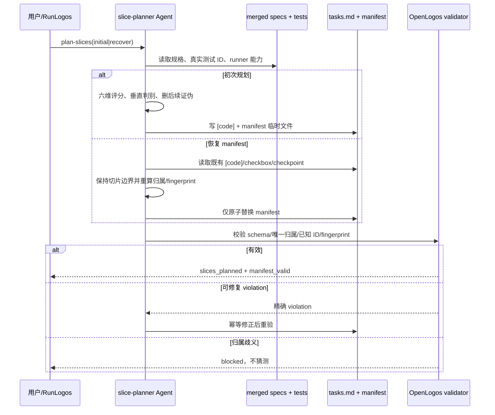
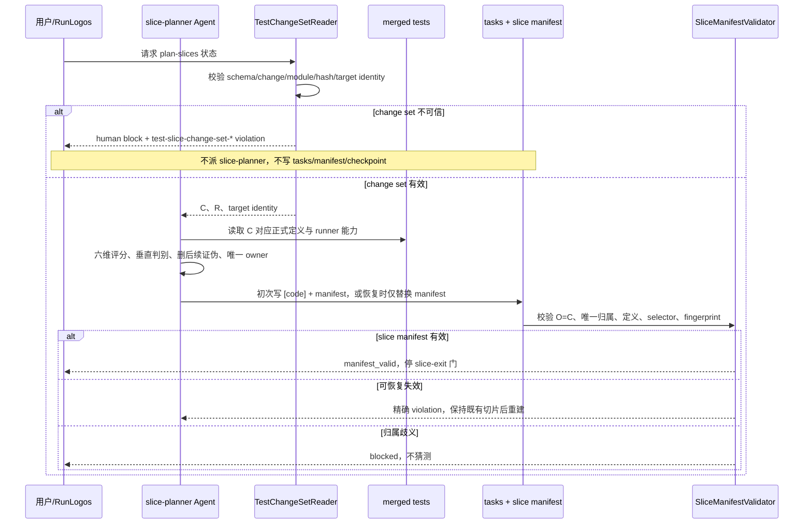
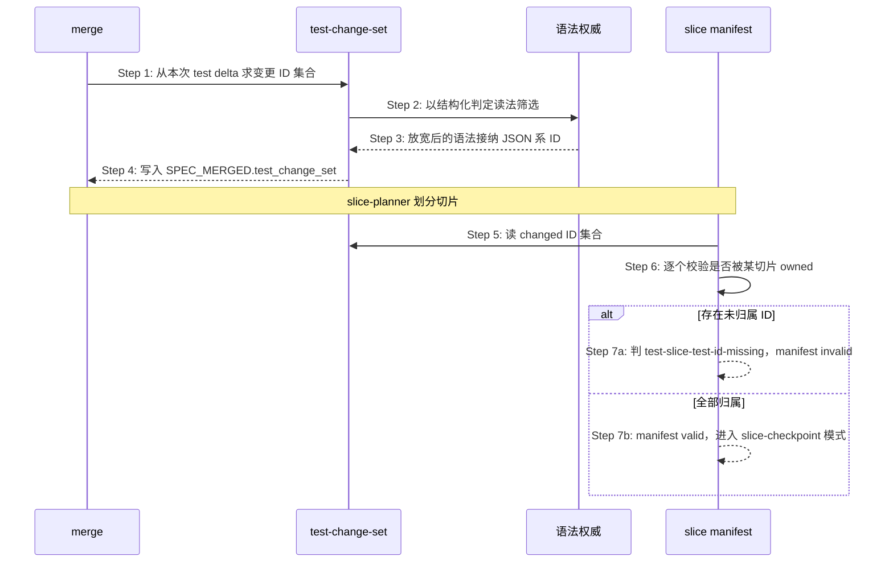
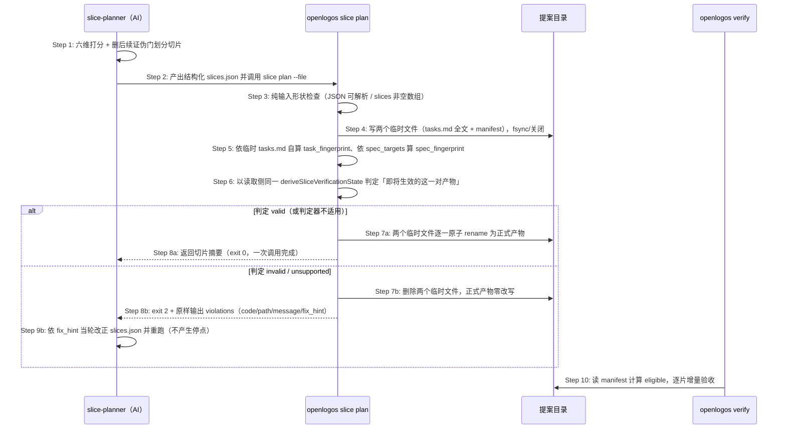
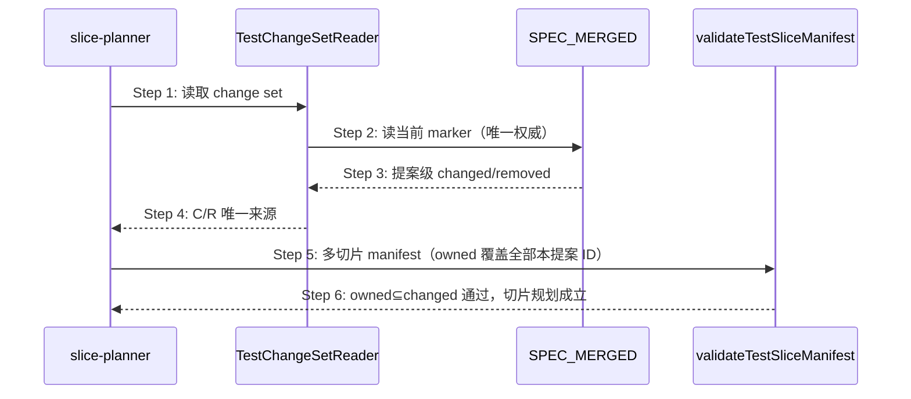
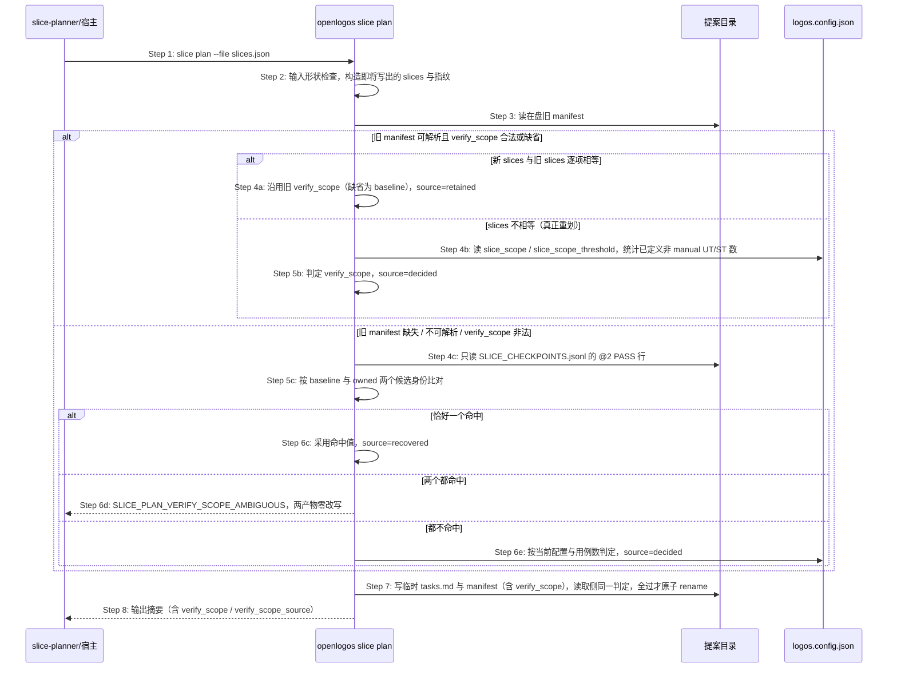
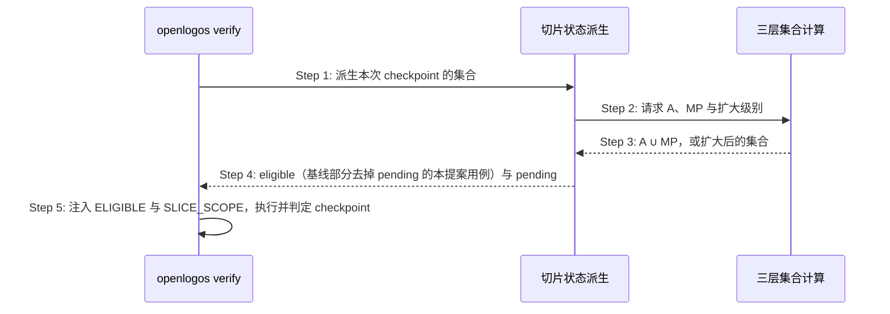
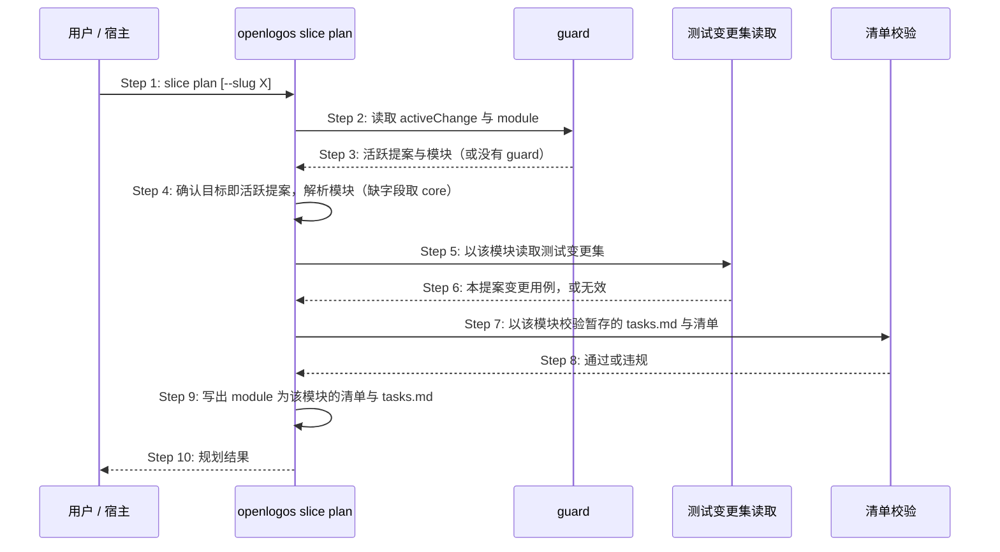

# S32：切片规划与 manifest 生成/恢复

### 场景目标

在 spec-complete 后基于已合并规格与真实测试 ID 同时产出良构 `[code]` 切片和稳定机器 manifest；缺失或漂移时能保留既有切片身份并安全重建 manifest。

### 参与者

- 用户或 RunLogos
- 使用 `slice-planner` Skill 的 Agent
- OpenLogos manifest validator
- `tasks.md`、已合并测试规格与提案目录

### 前置条件

- `SPEC_MERGED` 存在，测试规格包含真实 UT/ST/SMOKE ID。
- 初次模式下 `[code]` 仍为占位；恢复模式下 `[code]` 已规划且可能部分完成。
- 不存在未恢复的 seed commit journal。

### 后置条件

- 初次模式：`[code]` 良构切片与 `TEST_SLICE_MANIFEST.json` 同一轮原子收敛。
- 恢复模式：既有切片文本、顺序、checkbox、稳定 slice ID 和有效 checkpoint 均保留。

### 步骤

1. Agent 从规格提取本提案变更测试 ID，为每个 ID确定唯一 owning slice 和 runner selector。
2. 初次规划先完成 slice-planner 的六维评分、垂直/横向判别与删后续证伪，再给切片分配稳定 ID。
3. `slice_id` 从规范化顺序和切片语义生成；重复运行输入相同则逐字节稳定。
4. 计算 `task_fingerprint` 与 `spec_fingerprint`，写入 manifest。
5. 原子落盘后调用 validator；只有 schema、唯一归属、ID 存在性、selector 与 fingerprint 全部通过才完成。

### 恢复模式

- 禁止重新打分或调整既有切片边界。
- 以既有 manifest 可验证 slice ID 为优先；manifest 完全缺失时，依据既有 `[code]` 的规范化顺序和文本确定性重建。
- 已完成 checkbox 与有效 checkpoint 原样保留；若切片文本改变导致无法保持身份，必须报告歧义。

### 异常与边界

- 测试 ID 漏配、重复归属、未知 ID、空 selector、fingerprint 漂移均在实现/verify 前失败。
- 一个测试跨多个能力线时仍必须选择唯一 owning slice；共享回归通过基线集合运行，不重复 owned。
- 未知 manifest 主版本不覆盖。
- 文件存在但未通过 validator 不得宣布 slice 规划完成。

### 追溯

- 需求：S32、S28。
- 规格：功能规格 §2.37.1、§2.37.5；`skills/slice-planner/SKILL.md`、`spec/test-slice-manifest.md`。
- 测试：UT-S32-32～UT-S32-42、ST-S32-10～ST-S32-13。

## Canonical 测试变更集驱动的切片规划

### 目标

slice-planner 只为 merge 时已固化的真实 changed 测试集合规划唯一 owner；原样携带的 baseline 与已删除测试不得进入切片归属。

### 参与者

- 用户或 RunLogos
- 使用 `slice-planner` Skill 的 Agent
- OpenLogos `TestChangeSetReader`
- OpenLogos slice manifest validator
- `SPEC_MERGED`、`tasks.md`、正式测试规格与 `TEST_SLICE_MANIFEST.json`

### 前置条件

- `SPEC_MERGED` 存在并通过 spec-complete 身份检查。
- `[code]` 为初次规划空承载区，或处于仅重建 manifest 的恢复模式。
- 正式测试规格与 change set 的 `targets[].after_sha256` 一致。

### 步骤

1. OpenLogos 先读取并严格校验 `SPEC_MERGED.test_change_set`；不得从 Delta 或 Git 回退推导。
2. Agent 只把 `changed_test_ids` 分配给切片；`removed_test_ids` 仅供诊断，baseline 不进入 owned。
3. 初次规划按已合并规格与真实 ID 形成 `[code]` 切片，再生成稳定 `slice_id`、owner、selector 与 fingerprint。
4. validator 强制 `O=C`、切片间无交集、owned ID 在唯一 spec target 中存在且 selector 可执行。
5. change set 有效但 manifest 非法时，恢复模式保留 task 文本、顺序、checkbox、slice identity 与有效 checkpoint，只原子替换 manifest。
6. 合法 manifest 后停在 `slice-exit` 人类门，不因恢复自动越门进入实现。

### 事故样本

对完整 `MODIFIED` 测试章节，C 只能包含 `UT-S10-129`、`UT-S10-137`～`UT-S10-140`、`ST-S10-44`。`UT-S10-121`～`UT-S10-128`、`ST-S10-36`～`ST-S10-39` 留在 baseline；若 manifest owned 任一原样 ID，报 unknown；漏掉 `UT-S10-129`，报 missing。

### 异常与边界

- change set missing/unsupported/hash/target 漂移：`human_action_required=true`，不得派 `plan-slices`。
- changed ID 多片归属：ambiguous fail-closed，不自动选择。
- removed ID 被 owned：unknown；不得因它已从正式规格消失而放宽定义门。
- no-delta marker 且确无 mergeable delta：可信空 C/R；不得把任意既有测试猜成 changed。
- final `VERIFY_PASS` 已存在的 legacy 提案不回退。

### 追溯

- 需求：S32/S39 测试变更 ID 语义差异与持久化要求。
- 功能规格：§2.37。
- 方法论：`spec/test-slice-manifest.md`、`spec/baseline-closure.md`。
- 测试：UT-S32-43～UT-S32-49、ST-S32-14～ST-S32-16。

## S32 此前不可见的测试 ID 进入切片归属

### 场景目标

让此前对 `test-change-set` 不可见的 JSON 系测试 ID 进入 changed / owned 计算，使对这些用例的改动不再绕过切片归属校验。

### 参与者与前置条件

| 别名 | 组件 | 说明 |
|---|---|---|
| M | `merge` | 写入 `SPEC_MERGED.test_change_set` |
| C | `test-change-set` | 变更 ID 集合的权威 |
| S | `test-slice-manifest` | 切片归属校验 |
| G | 测试 ID 语法权威 | 结构化判定读法的唯一来源 |

### 归属校验时序

**Step 3 的缺陷形态**：此前严格读法要求 ID 形如 `(?:UT|ST)-S\d{2}-…`，JSON 系 ID 不符，在 Step 2 即被丢弃。于是 Step 6 根本看不到它们——修改这些用例的提案可以不为其规划任何切片，校验也不会报错。

**Step 7a 的行为不变**：未归属即 invalid，判据本身不放宽。变化只是**被校验的集合变大了**。

### 对切片规划的影响

| | 此前 | 此后 |
|---|---|---|
| 改动 JSON 系用例是否需规划切片 | 否（看不见） | 是 |
| 未规划时 manifest 状态 | valid（假阴性） | invalid，点名未归属 ID |
| ID 是否需携带场景号 | —— | 否，归属以 `owned_test_ids` 为准 |

**ID 无场景号不妨碍归属**：切片的归属关系由 manifest 的 `owned_test_ids` 显式声明，不从 ID 中的场景编号推断。`spec_targets` 同样由切片作者显式给出。

### 不变量

1. 变更 ID 集合的筛选判据只有一处，即权威语法的结构化判定读法。
2. 归属校验的判据不因集合变大而放宽——未归属仍判 invalid。
3. 集合变化只增不减；不存在此前被捕获、此后遗漏的 ID。

### 异常与边界

- 已归档提案的 manifest 不受影响：其 `test_change_set` 在 merge 时已固化。
- 若某 JSON 系 ID 被改动但作者未规划切片：manifest 判 invalid 并点名该 ID，属正确拦截。

### 追溯

- 需求：AC-MERGEGATE-08、AC-MERGEGATE-09。
- 功能规格：§2.51.7；架构：§四十一.6.1。
- 测试：UT-S32-50～UT-S32-51、ST-S32-17。

## S32 切片规划单条受控写入口时序

### 场景目标

把切片规划的落盘从「六动作事务」收敛为**一次 CLI 调用**：AI 产出结构化 `slices.json`，`openlogos slice plan` 校验后一次性写 `[code]` 段与 `TEST_SLICE_MANIFEST.json` 并自算指纹。结构化产物的生成权留在 CLI，不交给 AI 自行写入。

### 参与者

- **slice-planner（AI）**：按六维打分与删后续证伪门划分切片，产出**结构化** `slices.json`。
- **openlogos slice plan（CLI）**：结构化输入的唯一校验者与写入者。
- **verify**：下游消费者，读 manifest 计算 `eligible` 完成增量验收。

### 前置条件

活跃提案已 spec-complete（`SPEC_MERGED` 在场）、需要代码实现（`[code]` 标题在场且切片未填）、测试 ID 已在已合并规格中真实存在。

### 成功后置条件

`tasks.md` 的 `[code]` 段与 `TEST_SLICE_MANIFEST.json` 同时落盘且互相一致；`task_fingerprint` 依刚写出的 `tasks.md` 计算；`[delta]` / `[deploy]` 段与其勾选状态字节恒等。**产物非法时两者均不落盘**（fail-closed，见下文时序 Step 4～6 与 EX-32.23）。

### 时序图

### 步骤说明

1. **slice-planner** 按既有六维打分与删后续证伪门划分切片——切片划分方法论逐字不变。
2. **slice-planner** 把结果表达为**结构化** `slices.json`（`slice_id` / `owned_test_ids` / `runner_selectors` / `spec_targets`），一次调用 `openlogos slice plan --file`。
3. **CLI** 只做**纯输入形状检查**：输入 JSON 可解析、`slices` 为非空数组——这是构造产物的前置，不是判据。**结构、归属、ID 真实性与 `spec_targets` 路径前缀一律不在此判**（判据单点化，功能规格 §2.78.1；写入口自建判据副本是本次订正的缺陷本体）。
4. **CLI** 把新 `tasks.md` 全文（`[code]` 整段替换；`[delta]` / `[deploy]` 段与勾选状态字节恒等）与新 `TEST_SLICE_MANIFEST.json` **各写入同目录临时文件**并 fsync/关闭——此时两个正式产物均未被触碰。
5. **CLI** 依**临时** `tasks.md` 自算 `task_fingerprint`、依 `spec_targets` 算 `spec_fingerprint`——写入者与指纹计算者同一方同一时刻，漂移窗口从构造上消失。
6. **CLI** 以读取侧同一个 `deriveSliceVerificationState()` 对「即将生效的这一对产物」整体判定；判定输入是临时文件内容，不是在盘旧字节。
7. **判定通过**（`valid`，或判定器按设计不适用）→ 两个临时文件逐一原子 rename 为正式产物；**判定不通过**（`invalid` / `unsupported`）→ 删除两个临时文件，`tasks.md` 与 `TEST_SLICE_MANIFEST.json` 字节均不变。**禁止先以普通写入提交 `tasks.md` 再写 manifest**——那条路径下 manifest 非法时 `tasks.md` 已被改写且无从恢复（根规范 §2.2 两产物原子一致性）。
8. **CLI** 成功时返回切片摘要（exit 0，一次 CLI 往返完成全部落盘）；失败时 exit 2 并**原样输出** violations（逐条保留 `code` / `path` / `message` / `fix_hint`，顺序稳定），使 slice-planner 在**当轮**改正重跑，不把可自愈的输入错误升级为停点。
9. **verify** 照既有 `slice-checkpoint` 逻辑读 manifest 计算 `eligible`，逐片增量验收——该能力零改动。

### 异常与边界

#### EX-32.20：结构化输入非法
- **触发条件**：`slices.json` 缺字段、`slice_id` 重复、`owned_test_ids` 含未定义 ID、数组为空。
- **期望响应**：非零退出并报稳定错误码，`tasks.md` 与 `TEST_SLICE_MANIFEST.json` 均不被修改（零副作用）。输入不可解析、`slices` 非数组或空数组属操作错误（exit 1，稳定错误码）；其余经读取侧 validator 判定，按 EX-32.23 处置（exit 2 + 结构化违规）。
- **副作用**：无。

#### EX-32.21：重复执行（重新规划）
- **触发条件**：对同一提案再次执行 `slice plan`（切片调整或纠错）。
- **期望响应**：幂等覆盖——同一输入得到同一 `[code]` 与同一 manifest；不需要「重开」通道，不产生终态相位。
- **副作用**：无。

#### EX-32.22：指纹 stale
- **触发条件**：`[code]` 段或 spec targets 在 `slice plan` 之后被手工改动，导致 manifest 指纹与现状不一致。
- **期望响应**：**告警而非阻塞**——`status` / `next` / `verify` 输出 stale 诊断并建议重跑 `slice plan`，但不阻断流程推进（审计产物不得出现在流程分支的条件里）。
- **副作用**：无。

#### EX-32.23：`spec_targets` 非法（写入口 fail-closed 主分支）
- **触发条件**：`slices.json` 的某片 `spec_targets` 含不在 `logos/resources/test/` 下的路径（例如把全部 merge 目标一并填入）——该形态可通过订正前写入口的手抄检查，却被读取侧判 `test-slice-manifest-invalid`。
- **期望响应**：临时文件被删除，`tasks.md` 与 `TEST_SLICE_MANIFEST.json` 字节**均不变**；exit 2；逐条原样输出 validator violations（含每条的 `path` 与 `fix_hint`），不折叠为一句摘要。
- **副作用**：无。Agent 依 `fix_hint` 当轮改正重跑即可自愈，不产生 `blocked(no-progress)`。

#### EX-32.24：非法产出发生在 `tasks.md` 已提交之后（订正前形态，必须不可复现）
- **触发条件**：以订正前的落盘次序（普通 `writeFileSync` 先提交 `tasks.md`，再写 manifest）遇到非法产出。
- **期望响应**：该次序在订正后**不存在**——校验前置于任一 rename，任何拒绝路径下 `tasks.md` 都保持调用前字节。该分支作为回归断言存在：拒绝发生后 `tasks.md` 的字节与 mtime 均不得变化。
- **副作用**：无。

#### EX-32.25：合法输入（零行为变化边界）
- **触发条件**：`slices.json` 合法且能通过下游校验。
- **期望响应**：与订正前**逐字节一致**——`[code]` 文本与顺序、manifest 内容、五个 `data` 字段、exit 0 摘要均不变。校验前置只增加一次判定，不改变任何合法产出。
- **副作用**：无。

### 追溯

- 需求：切片规划单条受控写入口要求；写入侧 fail-closed 与判据单点化要求。
- 功能规格：§2.68、§2.78。
- 根规范：`spec/test-slice-manifest.md` §2.2 / §2.2.1 / §10。
- 测试：UT-S32-90、UT-S32-91、ST-S32-40、UT-S32-100、UT-S32-101、UT-S32-102、UT-S32-103、ST-S32-43。

## S32 change set 提案级语义与二次合并后切片归属

### 场景目标

明确 `SPEC_MERGED.test_change_set` 的消费语义为**提案级累计事实**：二次合并（`git checkout logos/resources/` 回滚重来）后，切片规划与校验读到的 changed/removed 表达「本提案引入/修改/删除了哪些测试 ID」，多切片方案（owned 归属 + 删后续证伪门）在二次合并后依然成立。消费侧代码零变化。

删除合并事务后这条性质从「需要前滚合并去构造」变成**结构上自动成立**：二次合并的 `before` 是回滚后的合并前基线，单次语义 diff 天然覆盖本提案引入的全部 ID，不再需要跨轮前滚。消费方读法不变。

### 参与者

- **slice-planner**：以 changed 为 C/R 唯一来源划分切片。
- **validateTestSliceManifest**：owned⊆changed 双向强校验。
- **slice-aware verify**：按切片归属豁免未完成切片 ID。
- **merge（生产者）**：一次调用合并后写出提案级 change set（时序见 S09）。

### 前置条件

提案经二次合并完成，`SPEC_MERGED.test_change_set` 为对合并前基线的完整语义 diff。

### 成功后置条件

本提案真实新增的每个测试 ID 均可被某切片 own（不再触发 `test-slice-test-id-unknown`）；多切片规划与删后续全量 verify 成立。

### 时序图

### 步骤说明

1. **slice-planner** 经共享 TestChangeSetReader 读取 change set，不感知提案经历过几次合并。
2. **TestChangeSetReader** 只读当前 `SPEC_MERGED.test_change_set` 并校验 payload hash 与 target after hash。
3. 二次合并的 diff 基线是回滚后的合并前字节，故 changed 含本提案引入且未删除的全部 ID。
4. **slice-planner** 按 C/R 正常划分多切片。
5. **validateTestSliceManifest** 的 owned⊆changed 校验对本提案真实 ID 全部放行；被本轮删除的 ID 不在 changed、出现在 removed，own 之即报 `test-slice-test-id-unknown`。
6. slice-aware verify 按归属豁免未完成切片 ID，删后续证伪门可成立。

### 异常与边界

#### EX-49.1：消费者试图读别处补齐
- **触发条件**：任何消费者在 changed 缺失时读取当前 marker 之外的来源并集裁决。
- **期望响应**：禁止（forbidden fallback）；change set 不可信时按既有分层阻断（`manifest_status=invalid` / human action required），不回退推导。
- **副作用**：无。

#### EX-49.2：change set 被篡改
- **触发条件**：payload hash 或 target hash 漂移。
- **期望响应**：与既有行为一致——精确 `test-slice-change-set-*` violation 阻断，零 Gate/loop/runner 副作用。
- **副作用**：无。

### 追溯

- 需求：merge 直接合并与规格结构检查要求。
- 测试：UT-S32-69～70、ST-S32-23。

## S32 切片规划冻结验收范围时序

### 场景目标

`openlogos slice plan` 落盘时为本次切片划分冻结 checkpoint 验收范围 `verify_scope`（`baseline` / `owned`），写进 `TEST_SLICE_MANIFEST.json`。首次规划、同一划分的幂等重跑、manifest 失效后的自动恢复与真正重划是同一个命令：只有形成新划分时才按当前配置与用例数判定；同一划分的重跑与自动恢复沿用已冻结的值，旧 manifest 缺失时从 checkpoint 账本恢复，保证已确认切片的身份连续。

### 参与者

- **slice-planner（AI）/ 宿主**：产出结构化 `slices.json` 并调用 `openlogos slice plan --file`；恢复时以相同 `slices.json` 重跑。
- **openlogos slice plan（CLI）**：验收范围的唯一判定者与写入者；读旧 manifest、只读 checkpoint 账本、读 `verify` 配置与已定义用例数。
- **提案目录**：`tasks.md`、`TEST_SLICE_MANIFEST.json`（本命令写）、`SLICE_CHECKPOINTS.jsonl`（verify 写，本命令只读）。
- **logos.config.json**：`verify.slice_scope`（`auto` / `baseline` / `owned`，缺省 `auto`）与 `verify.slice_scope_threshold`（缺省 1000）。

### 前置条件

- 活跃提案已 spec-complete，测试 ID 已在已合并规格中真实存在。
- `slices.json` 通过「S32 切片规划单条受控写入口时序」的输入形状检查。

### 成功后置条件

- `tasks.md` 的 `[code]` 段与含 `verify_scope` 的 manifest 同时落盘且互相一致；输出带 `verify_scope` 与 `verify_scope_source`。
- 同一划分重跑与自动恢复后，判定实质身份不变，已确认切片继续被采信，前沿停在首个未确认切片。
- 拒绝路径（`SLICE_PLAN_VERIFY_SCOPE_AMBIGUOUS`、`SLICE_PLAN_VERIFY_SCOPE_CONFIG_INVALID`）下两产物零改写。

### 时序图

### 步骤说明

1. **slice-planner / 宿主**调用 `openlogos slice plan --file <slices.json>`；初次规划、恢复与重划都是这同一个调用。
2. **CLI** 完成输入形状检查，构造即将写出的 `slices` 数组与 `task_fingerprint`、`spec_fingerprint`（规则同「S32 切片规划单条受控写入口时序」Step 3～5）。
3. **CLI** 读取在盘旧 manifest，判断它能否作为冻结值来源：可解析、schema 主版本为 1、`verify_scope` 合法或缺省。
4. **CLI** 在旧 manifest 可用时比较新旧 `slices`（逐字段、保序，不比较 `generated_at` 与指纹）：相等即同一划分，沿用旧值（缺省写为 `baseline`），`source=retained`；不相等即真正重划，转 Step 5。
5. **CLI** 在需要判定时读取 `verify.slice_scope` 与 `verify.slice_scope_threshold`：`baseline` / `owned` 直接采用；`auto` 时已定义非 manual UT/ST 用例数（集合 D 的大小，不与模块范围求交）大于等于阈值取 `owned`，否则取 `baseline`；`source=decided`。
6. **CLI** 在旧 manifest 不可用时只读 checkpoint 账本：以即将写出的判定实质分别按 `baseline`（现行身份公式）与 `owned`（身份输入加入 `verify_scope: "owned"`）计算候选身份，与 `openlogos/slice-checkpoint@2` 的 PASS 行比对；恰好一个命中采用之（`recovered`），两个都命中拒绝（`SLICE_PLAN_VERIFY_SCOPE_AMBIGUOUS`），都不命中按 Step 5 判定（`decided`）。`@1` 行按文件字节绑定，不参与比对。
7. **CLI** 把含 `verify_scope` 的 manifest 与新 `tasks.md` 按既有 fail-closed 落盘：先写临时文件、以读取侧同一判定校验、全过才原子 rename；不触碰 `SLICE_CHECKPOINTS.jsonl` 与 `SLICES_APPROVED`。
8. **CLI** 返回摘要：`--format json` 的 `data` 新增 `verify_scope`、`verify_scope_source`，文本摘要新增「验收范围」行；既有五个 `data` 字段不变。

### 异常与边界

#### EX-32.26：配置或阈值变化后的同一划分恢复
- **触发条件**：manifest 冻结为 `owned`、切片一已通过 checkpoint；项目把阈值调高到按当前用例数应判 `baseline`；随后 manifest 失效（invalid / stale），宿主以相同 `slices.json` 重跑。
- **期望响应**：沿用 `owned`（`retained`），判定实质身份不变，切片一继续被采信，前沿停在切片二；不重新读配置判定。
- **副作用**：仅重写 manifest 与 `[code]`（checkbox 按既有规则保留）。

#### EX-32.27：同样配置变化下的真正重划
- **触发条件**：同 EX-32.26 的配置变化，但 `slices.json` 改变了切片划分。
- **期望响应**：按当前配置与用例数重新判定为 `baseline`（`decided`），身份变化，旧划分的 PASS checkpoint 不再被采信。
- **副作用**：重写两产物；账本不改写，旧行保留审计。

#### EX-32.28：旧 manifest 缺 `verify_scope` 字段
- **触发条件**：升级前规划的提案，manifest 无该字段，以相同 `slices.json` 重跑。
- **期望响应**：沿用为 `baseline` 并显式写出 `verify_scope: "baseline"`（`retained`）；`baseline` 的身份按现行公式计算，与升级前相同，已确认切片继续被采信。
- **副作用**：manifest 多出该字段，其余判定实质不变。

#### EX-32.29：manifest 缺失且账本两个候选都命中
- **触发条件**：manifest 缺失或不可解析，账本中当前划分在 `baseline` 与 `owned` 两个候选身份下都有 PASS 行。
- **期望响应**：以 `SLICE_PLAN_VERIFY_SCOPE_AMBIGUOUS`（exit 1，错误 envelope 点名两个候选身份与命中的 `slice_id`）拒绝，不按当前配置择一。
- **副作用**：无；`tasks.md` 与 manifest 字节均不变，需要人工确认后再处置。

#### EX-32.30：manifest 缺失且账本无命中
- **触发条件**：manifest 缺失或不可解析，账本中没有属于当前划分的 PASS 行（含账本不存在、只有 `@1` 行或只有 FAIL 行）。
- **期望响应**：当前划分没有任何已确认进度，按当前配置与用例数判定，输出 `verify_scope_source: "decided"`，判定可见、不静默。
- **副作用**：正常写出两产物。

#### EX-32.31：判定路径上配置非法
- **触发条件**：需要判定（`decided` 路径）时 `verify.slice_scope` 不是 `auto` / `baseline` / `owned`，或 `verify.slice_scope_threshold` 不是正整数。
- **期望响应**：以 `SLICE_PLAN_VERIFY_SCOPE_CONFIG_INVALID`（exit 1，点名配置项与取值）拒绝；`retained` / `recovered` 路径不读配置，不受影响，恢复入口保持可达。
- **副作用**：无；两产物零改写。

#### EX-32.32：在盘 manifest 的 `verify_scope` 取值非法
- **触发条件**：manifest 被手工写入 `verify_scope: "full"` 等非法值。
- **期望响应**：读取侧判 `test-slice-manifest-invalid`（path 指向 `verify_scope`），按既有恢复动作输出 `plan-slices`；重跑 `slice plan` 时该旧 manifest 不作为冻结值来源，走 Step 6 账本恢复。
- **副作用**：恢复态不写 `VERIFY_FAIL`、`LOOP_ITERS` 或 checkpoint。

> 「S32 切片规划单条受控写入口时序」EX-32.25 的「合法输入零行为变化」以本场景为准修订比较基准：manifest 多出 `verify_scope` 字段、成功摘要多出验收范围行与两个 `data` 字段，其余产出逐字节不变。

### 追溯

- 需求：`core-01-requirements.md`「S13/S16/S27/S28/S31/S32 多切片验收边界与自动恢复要求」中验收范围冻结与恢复的验收条件。
- 功能规格：§2.68、§2.101.2～§2.101.6。
- 根规范：`spec/test-slice-manifest.md` §2.3、§2.4、§3、§6.1；`spec/cli-json-output.md`「openlogos slice plan 输出合同」「status/next slice_verification_state」。
- 测试：`core-S32-test-cases.md`「S32 切片规划冻结验收范围测试」——UT-S32-104～UT-S32-117、ST-S32-44、ST-S32-45；修订 UT-S32-103。

## S32 分层开启时切片 checkpoint 的基线部分（layered-verification）

> 来源变更：layered-verification。规则权威见功能规格 §2.109.9；验收范围的冻结规则见「S32 切片规划冻结验收范围时序」（不变）；三层集合见 `core-S13-verify-results.md`「S13 分层验收：提案级三层集合」。

### 场景目标

分层开启后，`baseline` 范围的切片 checkpoint 不再回归全部基线，而是回归「受影响用例 ∪ 主链路用例」，使切片验收不超出提案级验收的范围（切片 ⊂ 提案 ⊂ 发布）。

### 参与者

| 别名 | 组件 | 说明 |
|---|---|---|
| V | `openlogos verify` | 执行切片 checkpoint |
| S | 切片状态派生 | 计算 eligible / pending |
| L | 三层集合计算 | 给出 A、MP 与扩大级别（§2.109.6～§2.109.7） |

### 前置条件

- 活跃提案有有效的切片清单，处于 slice-checkpoint；`verify.layered.enabled` 为 true。

### 成功后置条件

- `baseline` 范围 checkpoint 的 eligible = 基线部分 ∪ 已确认切片的 owned ∪ 本片的 owned，其中基线部分取自三层集合计算。

### 时序图

### 步骤说明

1. **verify** 进入 slice-checkpoint 模式，请求切片状态派生。
2. **切片状态派生** 在 `verify_scope` 为 `baseline` 且分层开启时，向三层集合计算请求基线部分。
3. **三层集合计算** 返回：未扩大时为 A ∪ MP；扩大到按模块时 A 取 §2.109.7 第 2 级算出的值（模块范围内用例 ∪ 已识别场景与 delta 触及场景的用例，模块范围之外的已识别场景同样保留）；扩大到全量时为全部非本提案用例（与引入前相同）。本步骤不另行计算 A，只引用三层集合计算的结果。
4. **切片状态派生** 从基线部分中去掉尚未轮到的本提案用例（pending），并上已确认切片与本片的 owned。
5. **verify** 照既有规则注入变量、执行、判定并记录 checkpoint：注入的清单、已定义集合与复跑集合都是本次 eligible（执行集合），不是提案集合 P；`layers.total` 输出 P，`layers.execution` 输出本次 eligible。

### 异常与边界

#### EX-32.33：`owned` 范围
- **触发条件**：切片清单冻结的 `verify_scope` 为 `owned`。
- **期望响应**：与分层无关，eligible 仍为已确认切片与本片的 owned。越界判定也与引入前相同：测试入口额外上报 eligible 之外的任何已定义用例（包括提案集合之外的基线用例），都计入 `outside_eligible_result_ids` 并判 `result_outside_eligible_scope`，checkpoint FAIL——不按「提案集合之外只计数并告警」处理。
- **副作用**：无。

#### EX-32.34：分层未开启
- **触发条件**：`verify.layered.enabled` 不为 true。
- **期望响应**：`baseline` 范围的基线部分为全部非本提案用例，与引入前一致。
- **副作用**：无。

#### EX-32.35：扩大时 checkpoint 随之扩大
- **触发条件**：声明缺失、涉及共享改动等扩大情形。
- **期望响应**：基线部分取扩大后的集合；`data.layers.expansion` 同样输出。按模块扩大时，声明中已识别、但不在模块范围内的场景的用例仍在基线部分、在注入的清单与 `layers.execution` 中，其所属模块的命令组一并执行。
- **副作用**：无。

#### EX-32.36：受影响场景中含本提案用例
- **触发条件**：某条尚未轮到的本提案用例同时属于受影响场景。
- **期望响应**：它仍是 pending，不进入本次 eligible、不在注入的清单中；没有它的结果是正常的，不计未覆盖。它被测试入口提前上报时，照既有 checkpoint 规则判 `result_outside_eligible_scope`（不按「P 之外的结果」忽略）。轮到其所属切片时作为 owned 进入。
- **副作用**：无。

#### EX-32.37：主链路约束
- **触发条件**：分层开启的 checkpoint，主链路小节结构错误或超限，或主链路用例偶发。
- **期望响应**：与 final 相同（§2.109.10）：前两者在执行前判 FAIL，后者执行后判 FAIL；checkpoint 记为 FAIL。
- **副作用**：无。

### 追溯

- 需求：AC-VERIFY-TIER-13。
- 功能规格：§2.109.9、§2.101。
- 测试：`core-S32-test-cases.md`（UT-S32-118 起）。

## S32 切片规划的目标提案与模块（verify-scope-fields-and-slice-module）

> 来源变更：verify-scope-fields-and-slice-module（openlogos #7；proposal-r1 F2 处置）。规则权威见功能规格 §2.110、`spec/test-slice-manifest.md`「写入前置条件」。切片清单的 `module` 等于活跃 guard 的模块是既有规则，本节补上写入侧的时序与「目标不是活跃提案」的异常。

### 场景目标

`openlogos slice plan` 只为活跃提案规划切片，并用该提案登记的模块读取测试变更集、校验并写出切片清单，使清单与合并记录、verify 的比对口径一致。提案登记在非 `core` 模块时，规划后的验收不再因清单模块不符而暂停。

### 参与者

| 别名 | 组件 | 说明 |
|---|---|---|
| U | 用户 / 宿主 | 执行 `openlogos slice plan [--slug <slug>]` |
| P | `openlogos slice plan` | 规划并落盘 `tasks.md` 的 `[code]` 段与切片清单 |
| G | guard | `logos/.openlogos-guard`，记录活跃提案与模块 |
| T | 测试变更集读取 | 读取并校验 `SPEC_MERGED.test_change_set` |
| V | 清单校验 | 校验暂存的 `tasks.md` 与切片清单 |

### 前置条件

- 项目存在活跃提案，规格已合并（`SPEC_MERGED` 在场），提案目录有 `tasks.md`。
- 切片输入文件合法。

### 成功后置条件

- 切片清单的 `change` 为活跃提案、`module` 为该提案的模块；`tasks.md` 的 `[code]` 段与清单同时落盘。
- 目标不是活跃提案时两个产物保持原内容。

### 时序图

### 步骤说明

1. **用户 / 宿主** 执行 `openlogos slice plan`，可带 `--slug`（Step 1）。
2. **slice plan** 读取 guard（Step 2、3）。
3. **slice plan** 确定目标并解析模块（Step 4）：不传 `--slug` 时目标为 guard 的 `activeChange`；传了 `--slug` 时要求它等于 `activeChange`，否则拒绝（EX-32.38）。模块按提案模块取值规则（功能规格 §2.110.2）取值：guard 的 `module` 去掉首尾空白后非空则取该值，缺该字段或为空白时取 `core`（EX-32.40、EX-32.42）。本步在读取输入、暂存任何产物之前完成。
4. **slice plan** 以该模块作为期望值读取测试变更集（Step 5、6）。
5. **slice plan** 把即将生效的 `tasks.md` 与清单写入临时文件，以同一个模块作为期望值交给清单校验（Step 7、8）；校验失败时两个产物不动（既有规则）。
6. **slice plan** 写出清单，`module` 字段为同一个值，并替换 `tasks.md` 的 `[code]` 段（Step 9），返回结果（Step 10）。

### 异常与边界

#### EX-32.38：`--slug` 指向的不是活跃提案
- **触发条件**：`--slug X`，而 guard 的 `activeChange` 不是 `X`；或没有 guard、guard 无法解析。`X` 的提案目录与 `tasks.md` 可以存在。
- **期望响应**：以 `SLICE_PLAN_NO_ACTIVE_CHANGE` 失败，退出码 1，message 写明 `X` 不是活跃提案并给出当前活跃提案（没有时写明没有）；`--format json` 时 stderr 输出错误信封。
- **副作用**：无。`X` 的 `tasks.md` 与 `TEST_SLICE_MANIFEST.json` 逐字节不变，不留临时文件。

#### EX-32.39：提案登记在非 `core` 模块
- **触发条件**：guard 的 `module` 为 `backend` 等非 `core` 模块，`SPEC_MERGED.test_change_set` 的 `module` 相同。
- **期望响应**：规划成功，清单 `module` 为该模块；随后的 `openlogos verify` 不报 `test-slice-manifest-invalid`，进入切片 checkpoint。
- **副作用**：两个产物落盘。

#### EX-32.40：guard 缺 `module` 字段
- **触发条件**：guard 指向目标提案，但没有 `module` 字段（旧版 CLI 创建）。
- **期望响应**：模块取 `core`，行为与引入前相同。
- **副作用**：两个产物落盘。

#### EX-32.41：提案登记在 `core`
- **触发条件**：guard 的 `module` 为 `core`。
- **期望响应**：写出的 `tasks.md` 与清单与引入前相同（清单的 `generated_at` 除外）。
- **副作用**：两个产物落盘。

#### EX-32.42：guard 的 `module` 带首尾空白
- **触发条件**：guard 的 `module` 写成 `" backend "`。
- **期望响应**：写入侧取 `backend`，清单 `module` 为 `backend`；verify 的切片状态派生、范围计算与门禁读取切片清单和测试变更集时，都用同一取值规则得到 `backend`：不报 `test-slice-manifest-invalid`，门禁不出现 `test_change_set_invalid`，进入第一个切片的 checkpoint 并可 PASS。
- **副作用**：两个产物落盘。

### 追溯

- 需求：AC-VERIFY-FIELD-08～10。
- 功能规格：§2.110、§2.78.3。
- 读取侧的模块取值：`spec/test-slice-manifest.md`「读取侧使用同一取值规则」。
- 测试：`core-S32-test-cases.md`「S32 切片规划的目标提案与模块测试」（UT-S32-126～134）。
