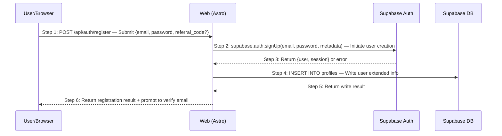

# Skill: Scenario Architect

> Expand business scenarios defined in Phase 1/2 into technical sequence diagrams, letting API design emerge naturally, and design comprehensive exception cases. Scenario numbering follows Phase 1 definitions.

## Trigger Conditions

- User requests drawing sequence diagrams, designing business scenarios, or performing scenario modeling
- User mentions "Phase 3 Step 1", "scenario-driven", "technical plan design"
- Requirements documents and product design documents (with scenario definitions) already exist, ready to begin technical implementation
- User specifies a particular scenario number (e.g., S01) to be expanded into a sequence diagram

## Core Capabilities

1. Read scenario definitions and acceptance criteria from Phase 1/2 as input for sequence diagrams
2. Draw Mermaid sequence diagrams for each scenario (strictly following numbering conventions)
3. Write explanatory notes for key steps (explaining "why" rather than "what")
4. Identify exception conditions for each step and design structured exception cases
5. Generate scenario overview documents (scenario map + scenario index)

## Linking with Phase 1/2

**Phase 3 does not identify scenarios from scratch.** Scenarios are defined in Phase 1 (`S01`, `S02`...), interaction flows are refined in Phase 2, and technical architecture and technology choices are established in Step 0. The job of Phase 3 Step 1 is to expand the same scenario from an "interaction perspective" into a "technical perspective". The participants in the sequence diagram should align with the system components in the architecture diagram:

| Input (from Phase 1/2) | Output (Phase 3) |
|------------------------|----------------|
| Scenario number and name | Sequence diagram title retains the number |
| Trigger conditions | Starting arrow of the sequence diagram |
| Main path description | Step sequence in the sequence diagram |
| GIVEN/WHEN/THEN (business level) | Behavior description of sequence diagram steps |
| Exception acceptance criteria | EX exception cases (technical level) |
| Pages and interactions involved (Phase 2) | Participant identification |

## Execution Steps

### Step 1: Load Scenario Context

Read scenario definitions from the Phase 1 requirements document, Phase 2 product design document, and Phase 3 Step 0 technical architecture summary. **Do not reinvent scenarios**—directly reuse existing numbers and descriptions. Participant naming should be consistent with the system components in the architecture diagram.

**Scenario Granularity Pre-Check (before drawing any sequence diagram):**

Before proceeding, verify that the scenario definitions from Phase 1 have proper granularity. Check for these anti-patterns:

- **One-API scenarios**: If a scenario's main path only has 1-2 steps (e.g., "Create Task" = just `POST /api/tasks`), it is too fine-grained
- **CRUD fragmentation**: If the scenario list contains separate "Create X", "Read X", "Update X", "Delete X" scenarios for the same entity, they should be merged into goal-driven scenarios
- **No business goal**: If a scenario's outcome is just "data was written/read", it lacks a real user goal

**If any anti-pattern is detected**: Stop and recommend returning to Phase 1 to re-organize scenarios by business goals before drawing sequence diagrams. Drawing sequence diagrams for overly fine-grained scenarios will propagate the problem to API design, test cases, and code.

Confirm the following for each scenario:
- **Scenario number**: Reuse Phase 1's `S01`, `S02`... (or Phase 2 sub-scenarios `S01.1`)
- **Participants**: Identify which system components are involved from Phase 2's interaction flows
- **Main path**: Extract the normal flow from Phase 1/2 acceptance criteria
- **Known exceptions**: Extract from Phase 1/2 exception acceptance criteria

### Step 2: Draw Sequence Diagrams

Draw Mermaid sequence diagrams for each scenario, **strictly following these conventions**:

**Numbering conventions**:
- Every arrow must have a `Step N:` number prefix
- Numbering starts at 1 and increments consecutively
- Each arrow includes a one-line behavior description: `HTTP_METHOD /api/path — brief explanation`

**⚠️ Single-line constraint (required)**:
- The full content of every arrow (`->>` or `-->>`) must stay on one line; do not insert line breaks inside the message text.
- If a message is too long, shorten it instead of splitting it across lines.
- Details such as UI button names, side effects, JSON bodies, or error payloads belong in the step narrative below the diagram, not inside arrow lines.
- Violating this rule can make Mermaid parsing fail and break Markdown rendering.

**⚠️ Mermaid sequenceDiagram syntax safety (required)**:
- Participant aliases must be short ASCII identifiers such as `U`, `W`, `API`, or `DB`; do not put `/`, spaces, parentheses, or Chinese text in aliases.
- Keep `participant <alias> as <display name>` display names short. Put complex technology stacks, ports, API paths, and extra explanations in the step narrative below the diagram.
- Arrow messages must stay on one line. `POST /api/path` is fine, but multi-line JSON, long error bodies, HTML, Markdown tables, or deeply nested parentheses should not appear in Mermaid messages.
- JSON examples, error-code lists, field explanations, and side-effect notes must go into "Step Descriptions" or "Exception Cases", not Mermaid message lines.
- When unsure, simplify diagram messages so the diagram shows call order and the prose carries detail.

**Participant conventions**:
- Use short aliases: `U` (User/Browser), `W` (Web/Frontend), `SB` (Supabase), `DB` (Database)
- Full name for each participant is noted in the `participant` declaration

**Scenario numbering conventions**:
- Document title format: `S01: Email Registration — Sequence Diagram`
- One scenario per file, numbered to correspond with Phase 1

**Format example**:



### Step 3: Write Step Narratives

After the sequence diagram, use a **consecutively numbered list** to write out all steps one by one, forming a linear narrative that humans can read fluently from start to finish.

**Format conventions**:

1. **Every step must be written out**—no skipping, no omitting. Simple steps can be covered in one line; complex steps are elaborated below using `>` blockquote
2. **Every step must have a clear subject**—the reader should never have to guess "who is doing this". Use the alias or full name from the participant table as the subject
3. **Numbering strictly corresponds to the Step N in the sequence diagram**
4. **Normal flow and exception cases are written separately**—normal flow comes first, exception cases follow. In the normal flow, only add `→ see EX-N.M` references after steps that trigger exceptions; do not expand exception content inline

**Normal flow format example**:

````markdown
## Step Descriptions

1. **Developer** enters `openlogos init my-project` in the terminal.
2. **CLI** checks whether `logos/logos.config.json` already exists. If it exists → see EX-2.1.
3. **CLI** displays a language selection menu in the terminal (1. English / 2. 中文). If the terminal is non-TTY → see EX-3.1.

> Language selection is placed in the `init` phase (rather than global configuration) because this is the user's first interaction with OpenLogos, making it the most natural moment to confirm language preference.

4. **Developer** selects a language (enters 1 or 2).
5. **CLI** detects the project name from `package.json` / `Cargo.toml` / `pyproject.toml` / directory name. If the user-provided name conflicts with the config file name → see EX-5.1.

> Priority chain: CLI argument > package.json > Cargo.toml > pyproject.toml > directory name. Scoped names automatically strip the `@org/` prefix.

6. **CLI** creates 11 directories in sequence (`logos/resources/prd/...` etc.), writing `.gitkeep` to each.
7. **CLI** writes `logos/logos.config.json` (containing locale + 5 document module definitions).
8. **CLI** writes `logos/logos-project.yaml` (containing empty tech_stack + conventions).
9. **CLI** writes `AGENTS.md` and `CLAUDE.md` (containing Phase detection logic).
10. **CLI** outputs the list of created files and next-step suggestions in the terminal.
````

**Exception case format example**:

````markdown
## Exception Cases

### EX-2.1: Project Already Initialized

- **Trigger condition**: Step 2 detects that `logos/logos.config.json` already exists
- **Expected response**: stderr outputs `Error: logos/logos.config.json already exists in current directory.`, exit(1)
- **Side effects**: No files created, existing configuration not overwritten

### EX-3.1: Non-TTY Environment

- **Trigger condition**: Step 3 detects that `process.stdin.isTTY` is false (CI pipeline / piped input)
- **Expected response**: Skip language selection interaction, default to `locale = 'en'`
- **Side effects**: None, flow proceeds directly to Step 5

### EX-5.1: Project Name Conflict

- **Trigger condition**: In Step 5, the user-provided `name` differs from the name in `package.json` (or other config files)
- **Expected response**: Display two options for the user to choose from; in non-TTY environments, automatically use the user-provided name
- **Side effects**: None, flow continues to Step 6 after selection
````

**Narrative principles**:
- **No skipping steps**: Even if a step is worth only one line (e.g., "CLI writes file"), it must still be written out to maintain consecutive numbering
- **Subject first**: Each step begins with a bold subject, so the reader can immediately see "who is acting"
- **Use blockquotes for supplementary notes**: When you need to explain "why" or document a design decision, expand below the step using `>` blockquote without disrupting reading flow
- **Exception cases as separate sections**: Normal flow only contains `→ see EX-N.M` references; the trigger conditions, expected responses, and side effects of exceptions are expanded in the "Exception Cases" section at the bottom of the document

### Step 4: Design Exception Cases

Expand exception acceptance criteria identified in Phase 1/2 into technical-level exception cases, and supplement with technical exceptions not covered in Phase 1/2 (e.g., service unavailable, database write failure):

```markdown
#### Exception Cases

##### EX-2.1: Email Already Registered (← Phase 1 S01 exception acceptance criteria)
- **Trigger condition**: Submitted email already exists in the auth.users table
- **Expected response**: HTTP 409 `{ code: "EMAIL_EXISTS", message: "Email already registered" }`
- **Side effects**: No records created, no emails sent

##### EX-2.2: Supabase Auth Service Unavailable (technical exception, not covered in Phase 1)
- **Trigger condition**: Supabase Auth service times out or returns 5xx
- **Expected response**: HTTP 503 `{ code: "AUTH_SERVICE_UNAVAILABLE", message: "Authentication service temporarily unavailable" }`
- **Side effects**: Error logged, alert triggered

##### EX-4.1: Profile Write Failure (technical exception, not covered in Phase 1)
- **Trigger condition**: INSERT INTO profiles violates unique constraint or RLS denies access
- **Expected response**: HTTP 500 `{ code: "PROFILE_CREATE_FAILED", message: "User profile creation failed" }`
- **Side effects**: Record in auth.users already created but profiles not created (compensation mechanism needed)
```

**Exception case numbering rule**: `EX-{step number}.{sequence number}`

### Step 5: Generate Scenario Overview Document

Summarize the technical implementation status of all scenarios:

```markdown
# Business Scenario Overview (Technical Implementation)

## Scenario Map
| Number | Scenario Name | Phase 1 | Phase 2 | Phase 3 Sequence Diagram | API | Orchestration | Status |
|--------|--------------|---------|---------|--------------------------|-----|---------------|--------|
| S01    | Email Registration | ✅ | ✅ | ✅ | ✅ | 🔲 | In Progress |
| S02    | Password Login | ✅ | ✅ | 🔲 | 🔲 | 🔲 | Not Started |

## Scenario Dependencies
[Describe prerequisite/follow-up relationships between scenarios]

## Scenario Index
[File links for each scenario, spanning all three Phases]
```

## Output Specification

- **Scenario overview**: `logos/resources/prd/3-technical-plan/2-scenario-implementation/core-00-scenario-overview.md`
- **Scenario documents**: `logos/resources/prd/3-technical-plan/2-scenario-implementation/<module>-{scenario-number}-{scenario-name}.md` (read current module from `modules[]` in `logos-project.yaml`, default is `core`; read `scenario_counter.next_id` before generating, increment and write back immediately after)
- Sequence diagrams use Mermaid format (renderable directly in Markdown)
- Exception cases use `EX-N.M` numbering, globally unique
- Each scenario document contains: sequence diagram + step descriptions + exception cases
- **Scenario numbers must be consistent with Phase 1/2**

## Best Practices

- **Do not identify scenarios from scratch**: Phase 3 scenarios come from Phase 1 requirements documents. If a scenario not present in Phase 1 is discovered, go back to Phase 1 to add it
- **Phase 1/2 exceptions are inputs**: Phase 1's "exception: email already registered" should be expanded in Phase 3 into a technical specification with HTTP status codes and response bodies
- **Draw the main path first, then add exceptions**: Do not try to draw all branches in the first pass; get the main path clear first
- **Exception case coverage strategy**: Every step involving an external call (database, third-party service) should have at least 1 exception case
- **Step numbering maintenance**: When inserting a step in the middle, renumber all subsequent steps and update all EX references accordingly
- **Participant granularity**: In microservice architectures, each service is a participant; in monolithic applications, divide by logical layers (Web, Auth, DB)
- **Sequence diagrams are the source of APIs**: Cross-system-boundary arrows in sequence diagrams are the APIs that need to be designed—if an API cannot be traced back to a sequence diagram, it probably should not exist

## Recommended Prompts

The following prompts can be copied directly for AI use:

- `Help me draw the sequence diagram for S01`
- `Help me do scenario modeling for all P0 scenarios`
- `Help me add exception case sequence diagrams for S03`
- `Based on the product design, help me do technical scenario modeling`

## Authority / Projection 时序建模（规范引用）


先读取 `spec/authority-closure.md` 与项目 Authority Registry。场景只引用稳定 `fact_id`，不从代码、文件名或参与者名称推断 owner。

sequence diagram 必须区分 command、mutation entry、authority write/read、projection refresh、consumer decision 与 recovery；projection 消息标注 freshness identity。若两个参与者都能直接 write canonical state 或给出最终 decision，停止场景交付并回退 architecture-designer。

异常路径至少包含 stale projection、conflicting old copy、response lost/restart 和 legacy writer。恢复从 authority/receipt 开始；禁止把目录扫描、mtime、marker 存在性或 stale cache 画成权威 fallback。追溯必须连接 fact_id、AC 条款和真实 UT/ST。

## Load relevant enterprise knowledge (S45)

> Source changes: enterprise-knowledge-base (S45); knowledge-direct-intake (direct intake, tag table, index and lookup). Rule authority: feature spec §2.102 and §2.103; directory convention: `spec/directory-convention.md` "logos/resources/knowledge/". There is only one skip condition: the project has no knowledge entries, the active proposal has no `deltas/knowledge/`, **and the user has not provided enterprise material in this turn** — then skip this section; all other steps are unchanged.

### Intake entry point (runs before loading, not subject to the skip condition)

When the user provides enterprise material to capture in this turn (policy text, interface notes, glossaries, etc.), capture first and load afterwards, even if the project has no `logos/resources/knowledge/`, `logos/resources/reference/knowledge/` or `deltas/knowledge/` yet (for example a project launched before this upgrade, capturing knowledge for the first time):

1. **Choose the channel**: the user only provides material with no requirement change (or the new knowledge may take effect before the requirement) → **capture directly; do not open a proposal** (steps 2–5). A knowledge revision must take effect together with a scenario change (for example retiring an old rule while rewriting the scenarios that cite it) → use the proposal channel (step 7).
2. **Numbering and tags**: run `openlogos knowledge list --format json` to read the entries and `tag_state` of the effective knowledge view. A new entry takes the highest KXX (including `deprecated`) + 1, or K01 when the view is empty; a new rule in an existing entry takes that entry's highest Rn (including `deprecated`) + 1. Prefer tags or aliases already in `logos/resources/knowledge/TAGS.md`.
3. **Prepare a candidate directory** in a one-off directory **outside the project root** (for example the result of `mktemp -d`), containing:
   - complete entry files `<module>-KXX-<slug>.md`: new ones, or whole-file replacements when revising — keep every existing rule row, retire only by changing the status, and leave retired content byte-for-byte unchanged;
   - when new tags are needed, a complete `TAGS.md`: copy every existing row and append, with the header "标签 | 别名 | 说明";
   - originals under `sources/<file name>`; if an original with the same name already exists with different content, use a new file name (e.g. `-v4`). The entry's `source.path` is `logos/resources/reference/knowledge/<file name>`.

   Do not write `logos/resources/knowledge/` with file tools — the directory is guard-protected and the write will be blocked. Because the candidate directory is outside the project root, the project's `guard.exempt` setting does not matter.
4. **Capture**: from the project root, run `openlogos knowledge apply <candidate dir> --format json` **on its own**; do not chain it with other commands via `&&`.
5. **Act on the result**:
   - Exit code 1: the whole batch was rejected and nothing was written to the project. Fix the candidates according to `errors[]` and rerun step 4.
   - Exit code 0: read back the entries listed in `written[]` and tell the user: "the original will spread with the repository on push; confirm what may be published before pushing". Pass any `knowledge_tag_synonym` (suspected synonym tags) in `warnings[]` on to the user; the human owner decides whether to merge them — never merge them yourself.
   - The project's first apply generates `TAGS.md` from the existing entries automatically, so no existing entry becomes invalid.
   - Exit code 2 with `rolled_back=false`, or any command reporting `knowledge_apply_incomplete`: a previous capture was interrupted or its rollback failed. Run `openlogos knowledge apply --recover` first and continue only after it succeeds; if it still fails, hand the output to the user.
   - `knowledge_apply_busy`: another capture is in progress; rerun step 4 later, and never delete the lock or transaction files under `logos/.openlogos-runtime/`.
   - `knowledge_apply_conflict`: a candidate has the same file name or number as an active proposal's knowledge delta; pick another number or make the change inside the proposal.
6. **Entries must be structurally valid**: the H1 starts with the KXX; the "元数据" YAML has valid `type`, `scope`, `status` (plus `module` when `scope: module`), a non-empty `tags` list, and a non-empty `source` list whose items each give the repository-relative `path` of the original (a file that exists in `logos/resources/reference/knowledge/` or in this batch's `sources/`; a repository file outside that directory, such as `README.md`, is invalid) and a non-empty `version`; `type: rule` entries have a "规则" table in which every row's first column is this entry's `KXX-Rn` and whose "状态" is `active` or `deprecated`; once the tag table is enabled, every tag must be a tag or alias in `TAGS.md` (or be added by the `TAGS.md` in the same batch). Otherwise apply rejects the whole batch with `knowledge_entry_invalid` / `knowledge_tag_unknown`, and change-lint rejects the same in the proposal channel.
7. **Proposal channel**: change-writer plans `deltas/knowledge/<module>-KXX-<slug>.md` in the `[delta]` section of `tasks.md` and reserves the KXX (numbered as in step 2), then writes the knowledge delta, which lands on merge. Originals: if the project's `guard.exempt` still contains `logos/resources/reference/`, write them directly to `reference/knowledge/`; if not (for example an explicit `guard.exempt: []`), create a candidate directory outside the project root that **contains only `sources/`** and run `openlogos knowledge apply <candidate dir>` to write the originals (no entries); the entries still merge with the scenarios through the delta. `deltas/knowledge/` holds entry files only; add any new tags to `TAGS.md` through apply first (steps 3–5). Initial projects also default to direct capture.
8. After intake, load from the effective knowledge view as below; entries just captured, or added in the same proposal, can be cited immediately.

### Effective knowledge view

Load from the **effective knowledge view**: the candidate after-state of knowledge entries from the active proposal's point of view. Before the proposal is merged, it is the on-disk `logos/resources/knowledge/` entries with this proposal's `deltas/knowledge/` applied; once merged with no pending amendment, read the on-disk entries directly (the deltas are already applied and are not replayed); with a pending amendment, apply the amended deltas to the merge baseline. Without an active proposal it is simply the on-disk entries. Only the current proposal counts; never other proposals or the archive. `openlogos knowledge list` outputs this view's metadata.

Tag table state (`tag_state` from `knowledge list`):

- `never`: the tag table has never been enabled; entry validity follows the original criteria;
- `enabled`: every tag of an entry must be in `TAGS.md` (aliases included); entries with tags outside the table cannot serve as a basis or as a citation target;
- `missing`: enabled but `TAGS.md` is gone — stop capturing and citing, and ask the user to restore `TAGS.md` from git or run `openlogos knowledge apply --init-tags` to re-initialise it.

### Loading steps

1. Run `openlogos knowledge list --module <current module> --format json` (add `--tag <tag>` when useful; matching follows the tag table rows, aliases included) to get the effective metadata, including this proposal's knowledge deltas. Do not filter by `INDEX.md` — it only indexes the on-disk entries and lacks this proposal's knowledge deltas.
2. Narrow the result by `scope` (`global` always matches) and `tags` to the entries relevant to the current requirement or scenario. Do not rely on `resource_index` descriptions; no semantic search.
3. For each matching entry run `openlogos knowledge show <KXX> --format json` and read its **composed full text** (`content`) and rules (`rules`) in the same effective knowledge view. Do not read the delta file at the `path` returned by `list` — a delta that only modifies the "元数据" section does not contain the existing rules. For `type: rule` entries, the `active` `KXX-Rn` rows of the rules table are binding; `deprecated` entries or rules are background only and must not justify new design.
4. If one KXX appears in two files, or an Rn repeats within one entry, do not resolve that ID; ask the user to fix the duplicate first (reported as `knowledge_id_duplicate`).
5. Do not rely on entries with `valid=false` (`problems` explains why: structurally invalid, or tags outside the table); ask the user to fix them through the intake entry point first (citing one makes change-lint report `knowledge_reference_unknown`).
6. When you need to know which scenarios use an entry or rule (retiring, revising, assessing impact), run `openlogos knowledge refs <KXX|KXX-Rn>`.

### Cite the basis and handle conflicts

- Wherever output is constrained by enterprise knowledge, cite the `KXX` or `KXX-Rn` it relies on.
- When a requirement or design conflicts with an `active` rule, **do not hard-block and do not silently pick a side**: list the conflict (rule ID, conflicting point, options: comply / exception for this change / rule needs updating), stop and ask the user, one decision at a time. If the user rules "exception for this change", record the reason in the "例外" (exception) column of the scenario's "适用业务约束" (applicable business constraints) section; if "rule needs updating", revise the rule through the intake entry point (capture directly when only knowledge changes; hand it to change-writer to plan a knowledge delta when it must land together with a scenario change).

### When this Skill loads and what it outputs

- **When**: in Step 1 "load scenario context", together with the Phase 1/2/3 documents.
- **Output**: add a `## 适用业务约束` (applicable business constraints) section to the scenario document, placed before "异常与边界", as a fixed table:

| 引用 | 作用位置 | 说明 | 例外 |
|---|---|---|---|
| K03-R1 | Step 4 "submit refund"; EX-12.2 | Amounts above 5000 go through the finance second-review branch | 无 |
| K05 | Step 2 "compute settlement day" | "Settlement day" follows the bank clearing calendar | 无 |

- The first column is `KXX-Rn` (one rule) or `KXX` (a whole entry, for terms, external-system notes and other entries without a rules table); "作用位置" names the sequence Step or exception ID; "例外" records a user-approved exception and its reason, otherwise "无".
- The main path and exception branches of the sequence diagram must reflect the cited rules; every cited ID must exist in the effective knowledge view, otherwise change-lint reports `knowledge_reference_unknown`.
- The scenario-knowledge link lives on the scenario side only; never write scenario lists back into knowledge entries.
- Before citing, you may run `openlogos knowledge refs <KXX|KXX-Rn>` to see how existing scenarios cite the same entry or rule and keep "作用位置" and "例外" consistent; a cited entry must be `valid=true` in `openlogos knowledge list` (once the tag table is enabled, entries with tags outside the table cannot be cited).
